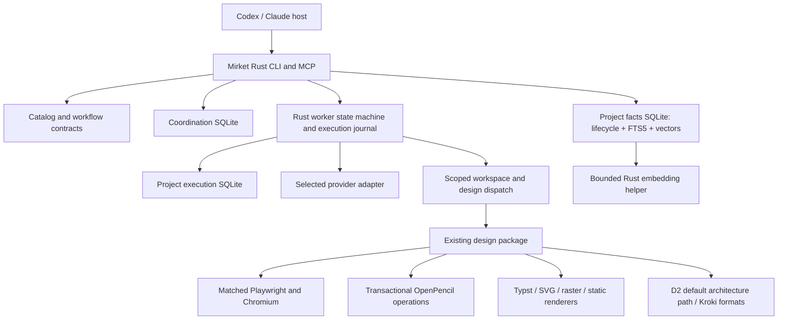

# Long-term stability and performance proposal

Date: 22 October 2026. Status: approved for implementation; amended by the user to establish a clean 0.0.1 baseline. Deployment remains a separate action after verification.

## Decision

Consolidate durable execution and explicit-fact lifecycle ownership in Rust, retain SQLite as the durable foundation, and narrow optional runtimes to specialist computation. Replace the Mem0/Qdrant fact-storage integration and LangGraph checkpoint integration in the clean 0.0.1 implementation. Keep the current embedding model to isolate retrieval-quality changes. Keep Podman and the existing design engines, but change browser packaging, document edit granularity and verification contracts.

This is a deliberate change from the preceding review's near-term recommendation to optimize around existing frameworks. The selected objective is now long-term stability and performance, with willingness to fund a larger migration. The reason for replacement is consolidated ownership and removal of cross-language lifecycle duplication, not a claim that Mem0 or LangGraph are inherently unreliable. Mirket assumes responsibility for the narrower replacement and its testing.

These are implementation decisions, not a list of competing experiments. Benchmarks and failure tests are release gates for the chosen architecture. They do not justify shipping a regression or claiming an unmeasured speedup. If a gate fails, repair the candidate and keep the existing implementation active; do not silently switch architecture or lower the gate.

Evidence: [source and alternatives review](harness-alternatives-review-2026-10-22.md), [current architecture](architecture.md), [runtime integration and existing measurements](runtime-integration-review-2026-10.md), [inventory](harness-map/inventory.md).

## Target topology

Arrows show dependencies, not new authorization. The embedding helper uses the existing managed package/container owner and immutable model assets. There is no new global daemon, graph database, distributed workflow service or installation system. Native host tools remain host-owned.

## Complete action register

The following 30 action IDs retain their ordering and dependencies. The user approved implementation and then removed legacy compatibility obligations; A10 and A14 below record that amendment. Documentation, schema changes, migrations, dependencies, removals and verification work are included. Publication, deployment to personal desktop installations, commits and pushes are not implicitly authorized by approving a technical design.

### A. Freeze the public contract and establish release evidence

**A01 — Define the 0.0.1 contracts.** Define MCP names, project namespaces, fact IDs, provenance, idempotency behavior and skill selections for the clean baseline. Do not add aliases, fallback readers or adapters solely for pre-release compatibility. Version database schemas, execution records, embedding identities and tool result contracts independently. New implementation modules must not create alternate installers or project registration paths. Owner: MCP, state and package boundaries.

**A02 — Create one reproducible acceptance corpus.** Use disposable synthetic projects covering English/Turkish retrieval, exact IDs, contradictions, expiry, supersession, concurrent desktop clients, long worker runs, interrupted effects, large editable documents, browser behavior and accessible PDFs. Freeze expected outcomes and hardware/image identities before candidate results. Keep private facts and model credentials out of fixtures. Retain existing project gates unchanged.

**A03 — Extend existing execution traces with phase timings.** Record queue wait, process startup, model load, lock wait, retrieval, checkpoint, inference, serialization and tool execution. Include bytes written, resident memory where observable, cancellation outcome and identities; exclude prompt/fact bodies by default. Use the existing trace/export path. Do not restore a cost dashboard, billing aggregation or mandatory telemetry service.

### B. Replace the explicit-fact storage stack

**A04 — Implement a Rust-owned project fact repository in SQLite.** Separate immutable fact versions/history, current publication state, supersession, expiry, provenance and idempotency records. Keep coordination and execution ownership logically separate; do not place everything into the global task database. Use one transaction for each fact lifecycle transition. Explicit forget must delete the intended data/history according to the existing contract, rather than leaving sensitive fact text in a supposedly permanent audit log.

**A05 — Make retrieval eligibility a database predicate.** Determine project scope, published version, expiry and deletion before selecting ranked results. Query lexical/vector branches from one consistent read snapshot and revalidate returned publication state when necessary. Eliminate adaptive overfetch of inactive candidates and the 256-stale-record starvation boundary. No per-candidate history query loop.

**A06 — Implement hybrid retrieval using FTS5 and exact vector scoring.** Store embedding BLOBs and their model identities alongside the fact repository; stream only eligible vectors into bounded Rust scoring. Use deterministic rank fusion, tie-breaking and explicit result limits. Do not introduce sqlite-vec, a separate vector server or approximate indexing in this release. Exact scoring removes an extension/API dependency and approximate-recall behavior for the bounded project-fact workload. It remains linear in eligible vectors: validate the supported size envelope, publish it, and never silently truncate to satisfy latency. Lexical-only retrieval is an explicit mode, not an undisclosed fallback when semantic retrieval is required.

**A07 — Replace Python embedding execution with a contained Rust helper using fastembed-rs.** Preserve the currently pinned multilingual MiniLM weights, tokenizer, normalization and 128-token rejection contract for the 0.0.1 baseline. Import the exact local assets through the helper's supported custom-model path; do not substitute a library default. Pin and review the complete ONNX/native closure. Keep network disabled, input/output bounded and filesystem access limited. Never download models while serving. Numerical, ranking and multilingual parity are gates, not assumptions.

**A08 — Add bounded embedding-session reuse.** Start a helper only for operations that need embeddings. Keep a project-bound helper warm for a 60-second idle period, under shared per-home admission and memory limits. Deduplicate concurrent starts for the same owner/project; terminate on idle, cancellation, owner exit or unhealthy state. Keep control operations available when embedding slots are full. No periodic polling daemon or automatic VM startup. Lexical reads and fact metadata operations must not initialize the model.

**A09 — Replace hot-path recursive storage scans with owned storage accounting.** Use database page/WAL accounting and manifest-backed artifact sizes, with write-time bounds and bounded reservations. Perform full structural/path/integrity checks on migration, backup, restore and explicit doctor, and reconcile counters after unclean termination. Continue validating every accessed path; an accounting cache must never replace symlink or ownership checks. Preserve recovery capacity near quota and never let an append-only journal grow without bound.

**A10 — Establish clean initialization and verified same-format import/export.** Create fresh versioned fact and execution databases in disposable verification homes. Validate IDs, model bindings, provenance, expiry, supersession and retry records on 0.0.1 backup/import. Publish restored state atomically with one writer. Pre-0.0.1 storage conversion, dual writes and legacy generation fallback are out of scope under the user's amendment. Existing personal data is not erased or silently adopted.

### C. Move durable worker execution to its effect owner

**A11 — Implement the worker transition machine in Rust.** Represent planned, running, effect-prepared, effect-uncertain, awaiting-verification, paused, completed, failed and cancelled states explicitly. Centralize turn/time/repair budgets, model selection, tool scope and resumption rules. Keep provider/model choice immutable except through an explicitly authorized supported transition. Preserve required-memory failure semantics and scope restrictions. Remove duplicated Rust/Python budget interpretation from the target architecture.

**A12 — Persist transition events with bounded snapshots in project execution SQLite.** Journal sequence numbers, expected revisions, request/effect IDs and outcomes. Store large immutable observations/artifacts separately by digest, within the existing owned runtime data root, and reference them from events. Checkpoint deltas instead of retransmitting the full transcript on every transition; create bounded periodic snapshots. Apply retention to completed histories only under the existing explicit lifecycle contract. Memory content copied into a run remains governed by run retention, with that distinction disclosed.

**A13 — Make uncertain effects first-class recovery outcomes.** Persist intent before dispatch and the observed outcome after dispatch. Transactional database effects may commit with their result record; arbitrary external tools cannot. Reconcile file writes through before/after identities and supported tool receipts. A crash after dispatch without a reliable result enters an uncertain state and never automatically replays the effect. Preserve safe-pause credit, maximum pause duration, cancellation and exhausted budgets. Define behavior for backward/forward wall-clock changes; use monotonic timing within a live process and persisted conservative recovery rules across restarts.

**A14 — Remove legacy-run compatibility from the release.** Superseded by the user's clean-baseline requirement. Do not ship a LangGraph compatibility runtime, old checkpoint translator or automatic restart of old runs. Recognize unsupported state and refuse to reinterpret it. Leave existing installations and their evidence untouched during candidate development.

**A15 — Rebuild backup/restore around consistent generations.** Quiesce writers or use appropriate SQLite snapshot APIs; include database schema versions, model identities, journal/artifact references and generation pointers. Restore to staging, verify every required binding, then publish atomically. Exercise restore with pending effects, superseded facts and storage pressure. Keep fact deletion, workflow deletion and backup retention distinct. A copied live database file is not the backup protocol.

### D. Correct worker budgeting and guidance delivery

**A16 — Separate context bytes, estimated input tokens, output limits and cumulative reservations.** Keep byte caps for transport/memory independently of token admission. Use an adapter-declared token estimator when supported; otherwise expose a conservative estimate and its method. Account for images using the selected provider's supported contract. Do not silently invent exact counts. A failed preflight must report which limit was reached. Do not add provider billing reconciliation.

**A17 — Separate immutable assignment context from changing observations.** Construct a stable instruction/skill/tool prefix; bound and select observation context separately. Reuse provider-side caching/session facilities only where the selected adapter supports their verified semantics. Preserve a stateless path. Omitted observations remain retrievable by identity; no lossy summary may become the source of authority. Enforce actual provider context limits as well as local byte bounds.

**A18 — Make workflows the canonical execution contract.** Derive permitted tools, required verification, prerequisites and execution owner from one declaration. Keep roles as professional guidance and facets as composition inputs. Generate repeated schema/documentation views from this source. Preserve all skill/profile IDs and saved membership; do not delete guidance based on counts. Show unavailable producers and host handoffs before worker dispatch.

### E. Stabilize design production and verification

**A19 — Pin Playwright and its matched Chromium revision together.** Prepare verified browser bytes at image-build time through the existing package owner. Preserve the runtime guard, network restrictions, fonts and device scale. Record the pair in identity and acceptance receipts. Browser security updates move through the paired compatibility gate; do not freeze a vulnerable pair indefinitely or download during serving.

**A20 — Make bounded OpenPencil batches the default mutation unit.** Use existing validated batch operations where adequate. Add only the missing transaction wrapper: one source load, bounded schema-validated operations, one save, one reopened tree and atomic publication. Enforce total time/memory/output/operation limits. Return usable saved-document IDs. No arbitrary evaluation endpoint and no cross-request mutable document daemon. A failed batch preserves the original file.

**A21 — Define consumer-specific artifact contracts.** OpenPencil-export success establishes local export only. A Figma-interoperable deliverable must pass a Figma consumer fixture or remain explicitly unverified. Browser deliverables stay DOM/CSS-native, standalone vectors stay SVG-native, and paged PDFs stay Typst-native. Preserve originals on imports/round trips. Avoid mandatory conversions between renderers when the final medium already has a suitable source representation.

**A22 — Add semantic accessibility verification.** Add pinned axe-core/Playwright integration for browser output, with violations and incomplete checks in structured evidence. Retain keyboard/focus and required assistive-technology checks. Add explicit PDF/UA-1 output selection to Typst when requested, plus heading, language, alt-text and reading-order fixtures. Automated checks do not confer universal accessibility acceptance. Scope new tools to relevant workflows.

**A23 — Add D2 as the default architecture-diagram producer.** Integrate a pinned D2/TALA-capable build through the existing design package; validate licenses, binary closure, fonts and output. Keep Kroki for formats D2 does not replace and Excalidraw for explicitly requested editable sketches. Define a single 0.0.1 caller contract and explicit service selections. Do not start or install a diagram service for a D2-only request.

**A24 — Retain the proven specialized rendering foundations.** Keep Style Dictionary's content-addressed token cache, Sharp, resvg, SVGO, Satori, Typst and Odiff. Maintain explicit routing by final medium. Compile/cache immutable token recipes once per generation; keep drift verification. Do not replace these engines for language uniformity or force every tool into a single renderer. Keep the one design package boundary.

### F. Package, validate, migrate and retire

**A25 — Preserve Podman and installation ownership.** Use the existing private engine, setup/update, package preparation, receipts and recovery transaction. No Apple Container backend or alternate installer in this proposal. Keep VM startup explicit and user state private. Advertise native CLI support separately from contained runtime support; no untested cross-platform package claims.

**A26 — Gate releases on fault injection and performance regression.** Extend the existing acceptance owner with process-kill points before/after every durable boundary, malformed/corrupt records, disk-full conditions, quota exhaustion, cancellation and two-client contention. Include fresh initialization, same-format restore, rejection of unsupported state, document batches and exact browser fixtures. Preserve required native/client gates and record untested platforms.

**A27 — Remove superseded production dependencies.** Remove Mem0, local Qdrant, LangGraph, Python FastEmbed and spaCy from the 0.0.1 agent-runtime closure. Remove Python from this production runtime, while permitting development/evaluation scripts. Do not retain a legacy runtime. Rebuild notices, SBOMs, advisory inventory and release receipts. Do not delete saved backups or user evidence as cleanup.

**A28 — Generate current operational documentation.** Generate counts and contract views, publish migration/rollback/support procedures, and link superseded historical reports. Document exact current per-attempt diagnostics and reservation semantics. Keep the existing inventory as the canonical map instead of creating another maintained catalog.

**A29 — Run guidance and actual-journey evaluations.** Verify that native hosts select the right producer, store/recall useful facts, resume interrupted workers correctly and avoid needless durable work. Use fixed representative tasks and retained failures. Measure useful completion and evidence quality separately from schema correctness. Any later pruning of roles/profiles or model changes is a separate proposed action, not hidden inside this evaluation.

**A30 — Verify the clean candidate before deployment.** Build 0.0.1 outside Cargo output; complete dev/catalog/disposable setup/doctor and contained acceptance. Compare against the retained baseline using synthetic data without duplicate side effects. Verify clean install and same-format backup/restore, and reject incompatible old databases without modifying them. Report every gate and untested platform before desktop deployment or external publication, which remain separate authorized actions.

## Dependency and removal decisions

| Component | Decision | Scope |
| --- | --- | --- |
| Rust / rusqlite / SQLite | Keep and extend | Explicit fact store and execution journal; enable/check FTS5 in the shipped SQLite build |
| fastembed-rs and required ONNX/native closure | Add, exact pins reviewed during dependency preparation | Contained embedding helper; current model remains unchanged |
| Mem0 / local Qdrant | Replace | Replace with native fact lifecycle; no legacy adapter |
| LangGraph | Replace | Rust state machine; no legacy execution runtime |
| Python agent runtime | Remove from clean production closure | Development Python remains permitted |
| sqlite-vec / LanceDB / Graphiti | Do not add | No vector extension, extra database or graph ingestion system |
| DBOS / Restate / distributed workflow platform | Do not add | One effect and recovery owner in Rust |
| Current multilingual MiniLM | Keep for this program | No simultaneous embedding-model/quality migration |
| axe-core / Playwright integration | Add | Scoped semantic verification |
| D2 | Add | Local architecture diagrams, existing package owner |
| Podman | Keep | No container-backend migration |
| Existing rendering engines / token compiler | Keep | Improve operation boundaries, not wholesale replacement |
| Xberg / broad document extraction service | Defer outside scope | Valuable separate product capability, unnecessary for this stability program |
| Hosted observability or billing system | Do not add | Local redacted diagnostics only |

The exact new dependency versions and licenses must be recorded before installation. Approval of this proposal can authorize these named dependency families and their necessary reviewed closure; it does not authorize unrelated substitutions or new services. A material incompatibility is surfaced as a proposal amendment.

## Delivery order and dependency gates

1. **Contracts and evidence:** A01–A03, A18, A26 baseline. Freeze behavior and measurements before replacing owners.
2. **New memory implementation:** A04–A09 and A16. Build beside the old implementation; no user-data cutover.
3. **New recovery implementation:** A11–A13, A17 and A15. Share contracts; preserve separate ownership/deletion boundaries.
4. **Clean initialization and recovery:** A10, A14, A15, A26. Pass fresh-install, unsupported-state and same-format failure/restore scenarios.
5. **Design runtime:** A19–A24. Can be developed independently of memory/recovery, but gets its own acceptance receipt.
6. **Integration and retirement:** A25–A30. Verify the clean baseline and remove superseded production dependencies; preserve existing installations during development.

This order follows risk and ownership dependencies. It deliberately funds the larger memory and execution redesign rather than treating cheap patches as the destination. Independent tracks do not imply permission to spawn agents, change providers or deploy.

## Acceptance rules

Correctness is mandatory: no lost acknowledged fact, cross-project leakage, stale fact returned as current, duplicate uncertain effect, budget reset, partial file publication or acceptance based solely on a successful render. The 0.0.1 IDs and retry semantics remain consistent across restart and same-format restore.

Performance is measured end to end and by phase on fixed hardware, exact inputs and matched concurrency. Use empty, 100-, 1,000- and 10,000-fact stores; a 100,000-fact stress case establishes behavior beyond the initial supported envelope. Include cold/warm operation and 1/2/8-client contention. The initial supported fact envelope is 10,000 active facts per project under the existing byte quota; larger stores must remain readable/exportable and receive an explicit performance limit rather than silent recall truncation. Stores above that envelope must remain readable/exportable without silently truncating retrieval.

Proposed release gates: at least 25% reduction in p95 warm multi-query recall latency and at least 50% reduction in checkpoint bytes for the fixed long-run fixture; no greater than 5% median regression in unaffected critical paths across repeated paired runs after accounting for measurement noise. No regression on mandatory retrieval/abstention cases or lifecycle correctness. These are targets for accepting the candidate, not measurements or speedup promises. If the fixed corpus exposes a conflict between latency and correctness, preserve correctness and repair the implementation.

The new journal must exhibit bounded event/snapshot growth and recovery time under the declared run limits. OpenPencil batches must reduce process launches and preserve consumer-visible output/IDs. Browser fixtures must pass on the exact shipped pair. Keep existing design-quality budgets and semantic acceptance requirements; no threshold relaxation to finish the migration.

## Principal costs and boundaries

The largest cost is owning and verifying a recovery engine that LangGraph currently supplies. The second is implementing memory history, retry and deletion semantics correctly in the native store. Exact vector scoring trades index complexity for linear query work within a declared envelope. Removing English NLP may change lexical ranking; hybrid retrieval must meet the frozen multilingual corpus. Rust embedding wrappers still carry ONNX/native dependencies and are not automatically smaller or faster.

The proposal accepts those engineering costs to obtain one lifecycle owner, transactional fact publication, predictable retrieval eligibility and fewer production runtime boundaries. It does not promise quantified gains before tests, change providers/models, broaden permissions, add general worker shell access, change accounts, or authorize deployment.
