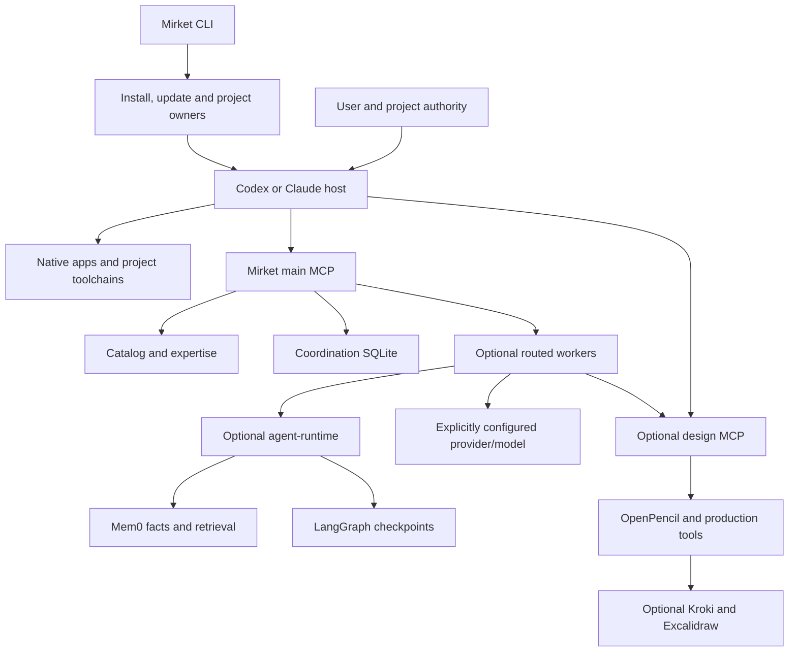

# Mirket system map

This describes the 0.0.1 source baseline. The owning code and registries are authoritative; the [generated inventory](harness-map/inventory.json) records every declaration and source hash. A declared tool does not prove that a package is installed, a desktop has reconnected, or a task produced useful output.

| Detailed view | Contents |
| --- | --- |
| [Inventory](harness-map/inventory.md) | Every role, profile, skill, source pin, facet, workflow and MCP tool |
| [Methodologies](harness-map/methodologies.md) | Role methods, prerequisites, acceptance and failure probes |
| [Dependencies](harness-map/dependencies.md) | Locked Rust, Node and Python records, image pins and environment references |
| [Machine-readable graph](harness-map/inventory.json) | Full registries, relationships, source hashes and contracts |

## Topology and ownership

The host owns permissions, session lifecycle, native tools and account access. Providers own usage and billing. Mirket owns installed guidance, selected packages, scoped worker dispatch and durable records. The main MCP cannot register arbitrary projects or grant host permissions. Design and agent-runtime are optional.

| Boundary | Owner |
| --- | --- |
| Catalog, profiles, roles and workflows | [registry/catalog.json](../registry/catalog.json), [registry/capabilities.json](../registry/capabilities.json), [src/catalog](../src/catalog) |
| Host setup and updates | [src/install.rs](../src/install.rs), [src/update.rs](../src/update.rs) |
| Project selection and publication | [src/project.rs](../src/project.rs), [src/project/recovery.rs](../src/project/recovery.rs) |
| Coordination, identity and evidence | [src/state.rs](../src/state.rs), [src/state/identity.rs](../src/state/identity.rs), [src/state/contracts.rs](../src/state/contracts.rs) |
| Main protocol and worker assignment | [src/mcp.rs](../src/mcp.rs), [src/router](../src/router) |
| Podman and design package | [src/podman.rs](../src/podman.rs), [src/packages/services.rs](../src/packages/services.rs), [runtime/design/tools](../runtime/design/tools) |
| Memory and checkpoint package | [src/packages/agent.rs](../src/packages/agent.rs), [runtime/agent](../runtime/agent) |
| Maintenance and release checks | [src/backup.rs](../src/backup.rs), [src/maintenance.rs](../src/maintenance.rs), [src/dev](../src/dev) |

## Expertise and selection

The catalog declares 347 entries: 54 embedded, 149 upstream, 139 references and five package-delivery descriptions. It also declares 63 profiles, 41 roles, 37 facets and 18 workflows. Profiles choose installed guidance. Roles define professional methods. Facets describe complementary boundaries. Workflows bind an outcome to an owner, permitted tools, required invocations, verification, tier floor, review budget and host checks. Saved-file export is separate from editable design production. Package-delivery entries are not runtime packages.

Selection begins with the task and project instructions. `catalog_search` and `capability_plan` find relevant guidance; `skill_read` supplies a selected embedded body. Mirket-owned routed workers receive bounded deliverables, eligible models and scoped tools. A role or model route never authorizes effects. Registration, preparation, live connection, invocation and useful output are separate observations.

## Runtime surfaces and dependencies

The main MCP exposes 27 tools for discovery, task coordination, routing, memory, recovery and runtime identity. The design MCP exposes 13 tools, including four lazy OpenPencil wrappers. OpenPencil has 29 read and 58 write operations behind those wrappers. Workers can select from 17 scoped native/design tools; each workflow narrows the actual set. See the [complete inventory](harness-map/inventory.md).

The design image supplies OpenPencil, Style Dictionary, Satori/resvg/SVGO, Sharp, Playwright/Chromium, Typst and Odiff. Ordinary diagram selection adds Kroki; Excalidraw requires explicit selection. Encoded video is not bundled. The agent image supplies explicit Mem0 facts with hybrid retrieval and LangGraph checkpoint recovery. Coordination SQLite, Mem0 memory and LangGraph checkpoints have distinct ownership and deletion semantics. The main MCP opens coordination state only for state-dependent calls; catalog reads and runtime identity remain available if that database is broken.

The locked inventory has 234 Cargo records, 409 npm records including the root, and 97 Python wheels. These are lock records, not installed services or independent capabilities. Native CLI builds target macOS ARM64, Linux x86-64 and Windows x86-64. The managed container controller is macOS ARM64 with Linux ARM64 images; native CLI portability does not establish container portability.

Mirket-owned app data lives under the selected user's `~/.mirket` root (`%USERPROFILE%\.mirket` on Windows): executable, cache, dependencies, coordination database, package receipts, workspaces, container data, sockets and scratch. The selected Podman client and helpers are copied into `~/.mirket/dependencies`; the private VM and host socket tree stay below `~/.mirket`. Host-owned Codex/Claude configuration and project-local selection files remain at their host/project boundaries. Container-internal `/tmp` and build-time staging are not host application-data roots.

## Method and evidence

The loop is outcome and constraints → selected expertise → bounded execution → discriminating checks → saved artifact or observed effect. Design work starts from an inspected target and respects its repair budget. Durable tasks are used when continuity or explicit tracking needs them. Mem0 recall supports relevant recurring decisions; LangGraph resumes an interrupted Mirket worker without resetting budgets or replaying uncertain effects. The host judges semantic quality and acceptance.

The generated inventory is a reproducible static source map. Run `python3 evals/harness-map/extract.py --check` with Python 3.11+ after source changes. `mirket dev check --project .`, `mirket catalog check`, disposable setup/doctor and selected native/package acceptance establish separate release claims. Current results belong in [release status](release-status.md); dated reviews are historical evidence.
