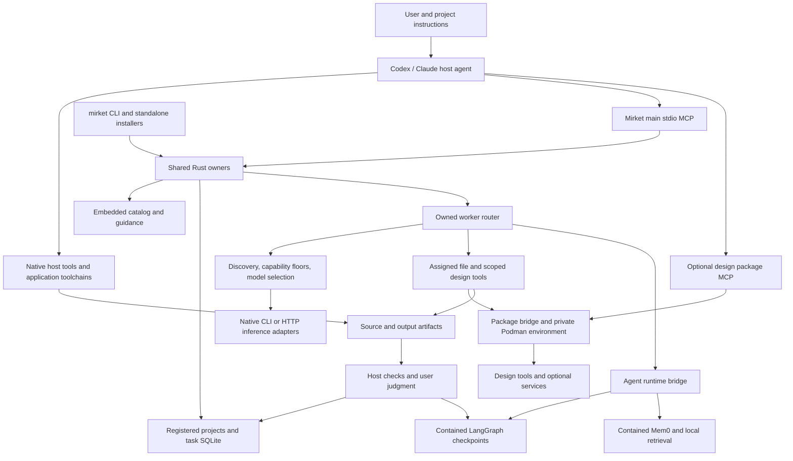

# Harness map for critique

Snapshot: **20 October 2026**, Mirket **1.0.11**, source revision `d8013f53969db336d813274d1fbfba53a89ad0e2`. This is a repository-grounded map of the harness and its assessment boundaries. It is not a dependency-freshness audit or certification of the installed desktop environment.

Read this map first, then use the [complete inventory](harness-map/inventory.md) and [machine-readable inventory](harness-map/inventory.json) to select individual nodes. The latter preserves complete registry contracts, dependency locks, source pins, reference hashes and relationship edges. The existing [architecture](architecture.md) remains the implementation ownership guide.

## 1. Evidence and scope

The extraction covers all five registry files, Cargo manifest/lock, design npm manifest/lock, Python input/lock, embedding/BM25 manifests, authored reference file paths/hashes, main MCP tool declarations, workflow contracts and test/evaluation file locations. Execution descriptions additionally trace selected implementation paths. It does **not** claim a line-by-line code review, semantic review of every skill/reference, live model evaluation, or validation of every third-party package.

Evidence labels used here:

- **Declared:** present in a registry, manifest, policy or guidance.
- **Implemented:** an owning code path was inspected; this is not proof of all runtime behavior.
- **Recorded:** an existing repository report describes an observation; it was not rerun for this map.
- **Observed here:** a check ran during extraction, with limits listed in section 11.
- **Unverified:** requires a later investigation or live consumer check.

The checkout was clean at entry and had no `.mirket/project.json`. User-specific memory, credentials, model configuration and task contents were not exported. Installed CLI identity was queried; no package, provider or host configuration was changed.

## 2. Topology and authority



The two production routes have different enforcement. A host agent can use its native tools under host permissions. Mirket's owned workers receive a bounded tool set and pass through Mirket's assignment, dispatch and evidence checks. Mirket cannot impose those checks on unrelated native host calls. Role text and catalog membership grant neither permissions nor account access.

The main MCP exposes 27 tools, extracted from [`src/mcp.rs`](../src/mcp.rs). The design connection runs through [`src/package_mcp.rs`](../src/package_mcp.rs). `agent-runtime` is an internal package (`host_connection: false`), not a third independent desktop MCP connection. See [runtime](agent-runtime.md) and [packages](packages.md).

## 3. Component ownership

| Component | Owner | Inputs → outputs / consumers |
| --- | --- | --- |
| CLI and installers | [cli.rs](../src/cli.rs), [setup](../setup) | Arguments and explicit choices → shared operations, presentation |
| Embedded delivery and discovery | [catalog.rs](../src/catalog.rs), [build.rs](../build.rs) | Registries, skill bodies, notices → metadata, readable documents, compiled identity |
| Roles and team plans | [teams.rs](../src/catalog/teams.rs), [capabilities registry](../registry/capabilities.json) | Lead, facets, reasons → bounded assignments and professional contracts |
| Worker workflow validation | [workflows.rs](../src/catalog/workflows.rs), [assignment.rs](../src/router/assignment.rs) | Task needs → guidance, tools, floors, mandatory invocation |
| Design reference discovery | [design_references.rs](../src/catalog/design_references.rs), [coverage](../src/catalog/design_references/coverage.rs), [selection](../src/catalog/design_references/selection.rs) | Query/context → scoped inventory matches, gaps or provisional candidates |
| Install/update | [install.rs](../src/install.rs), [update.rs](../src/update.rs), [target.rs](../src/target.rs) | Saved selections, verified candidate → host configuration/copies and receipts |
| Project selection | [project.rs](../src/project.rs), [recovery.rs](../src/project/recovery.rs) | Explicit root/skills/hosts → managed copies and recoverable sync journal |
| Task/evidence state | [state.rs](../src/state.rs), [contracts.rs](../src/state/contracts.rs) | Registered root, revisions, artifact identities → durable consistency records |
| Protocol | [mcp.rs](../src/mcp.rs) | Typed bounded requests → catalog/state/router/runtime operations |
| Model execution | [router](../src/router) | Resolved assignment + discovered model → action loop, artifacts, trace, handoff |
| Package execution | [packages](../src/packages), [podman.rs](../src/podman.rs), [package_mcp.rs](../src/package_mcp.rs) | Reviewed recipe and explicit selection → prepared generation, services, bounded calls |
| Memory and persistence | [memory.rs](../src/memory.rs), [agent_runtime.rs](../src/agent_runtime.rs), [durable.rs](../src/router/durable.rs), [runtime/agent](../runtime/agent) | Explicit facts and bound execution state → recall, checkpoints, recovery |
| Retention/backup | [lifecycle.rs](../src/lifecycle.rs), [backup.rs](../src/backup.rs), [maintenance.rs](../src/maintenance.rs) | Preview/observed identities and leases → bounded export, deletion or restore |
| Registered external tools | [tools.rs](../src/tools.rs), [process](../src/process) | Explicit executable path/hash and argv → caller-authorized execution; not arbitrary MCP conversion |
| Development/release/evaluation | [dev.rs](../src/dev.rs), [release.rs](../src/release.rs), [role_eval.rs](../src/role_eval.rs) | Source, fixtures and reports → checks, distributions and report aggregation |

## 4. Expertise layers: skills, roles, profiles, references

| Layer | Snapshot | Meaning and relationships |
| --- | ---: | --- |
| Global defaults | 14 skills | `registry/harness.json` selects common guidance installed by setup |
| Skills | 347 | 54 embedded; 149 upstream; 139 reference; 5 package entries |
| Roles/capabilities | 41 | Canonical ID, aliases, lead skill, optional support, prerequisites, acceptance, failure probe, professional method |
| Profiles | 63 | 8 starter, 50 specialist, 5 alternative installation bundles |
| Team facets | 37 | Task boundary → role assignments in produce/advise/review modes as declared |
| Owned workflows | 17 | Deliverable → default/alternative roles, allowed tools, required invocation, verification and tier |
| Source records | 47 | Reviewed upstream repositories, commit pins and licensing metadata |
| Authored reference files | 139 | Files below skill `references/` directories; includes structured data/specimens |
| Design-reference instances | 27 | A separate typed design-language inventory validated by catalog check |

The global set is: `skill-catalog`, `engineering-judgment`, `interface-design`, `marketing-writing`, `document-workflow`, `research-and-synthesis`, `document-parsing`, `office-authoring`, `agent-coordination`, `context-management`, `ci-maintenance`, `ai-system-evaluation`, `security-judgment`, `work-planning`. Other skills/plugins exposed by a desktop session are outside this registry inventory unless explicitly represented here.

The equal counts of 139 reference-delivery entries and 139 authored reference files are coincidental: these are different populations. A package catalog entry is also not the same thing as an installed optional runtime package.

The [inventory](harness-map/inventory.md) lists **every role, profile, workflow, skill, source, facet and authored reference path**. Full prose contracts, dependencies, caveats, adaptations, required companions and variants remain in the JSON. Skill dependency text is descriptive; `requires` relationships are distinct machine-readable selection edges. Do not treat every prose dependency as a package manager edge.

Selection path: user outcome → optional catalog/role discovery → selected lead/body → narrow reference when useful → explicit project selection if installation is needed. Profiles group installation; they do not load every member into every task. Role support is optional, not an automatic roster. Team planning starts no workers. See [roles](roles.md) and [skill-catalog](../skills/skill-catalog/SKILL.md).

Authored methods are the default. Matt, Superpowers and Addy whole-workflow alternatives are opt-in; exact IDs/source keywords preserve discovery without automatically combining competing planning or execution suites. References supply evidence and examples rather than authority. Embedded read routes, manually retrieved references and verified upstream payloads have different delivery paths; catalog presence alone does not mean installed, loaded or used.

## 5. Runtime dependency map

| Plane | Declared runtime/dependencies | Lock or identity owner | Main risk to investigate |
| --- | --- | --- | --- |
| Rust core | Rust 1.99.0; edition 2024; Tokio, rmcp, reqwest/rustls, bundled SQLite, serde, clap, hashing/archive utilities | [Cargo.toml](../Cargo.toml), [Cargo.lock](../Cargo.lock), [toolchain](../rust-toolchain.toml) | Version ranges versus resolved closure; native targets; archive/transport/state boundaries |
| Design JS | Node ≥22 <23; MCP SDK 1.32.1, Satori 0.62.0, resvg 2.6.2, Playwright 1.64.1, HyperFrames 0.8.149, Sharp 0.35.5, SVGO 4.1.0, Odiff 4.5.0; remaining direct dependencies in inventory | [package.json](../runtime/design/tools/package.json), [npm lock](../runtime/design/tools/package-lock.json) | Native modules, browser compatibility, installed versus reported versions |
| Design OS/tools | Digest-pinned Node image; Debian snapshot 20261005; Chromium, FFmpeg, fonts; Typst 0.15.1 with architecture-specific hashes | [Dockerfile](../runtime/design/tools/Dockerfile) | Base OS/browser vulnerability and font/render parity; architecture support |
| Design services | Official Penpot MCP 2.17.0 pinned source; Penpot services, Postgres, Valkey; Kroki and companion images | [design-stack.json](../registry/design-stack.json), [services.rs](../src/packages/services.rs), [Penpot build](../runtime/design/penpot-mcp/Dockerfile) | Service-version compatibility, persistence, startup identity and shared object scope |
| Agent Python | CPython 3.13 image; Mem0 2.2.1, LangGraph 1.2.16, SQLite checkpointer 3.1.2, FastEmbed 0.9.0, spaCy 3.8.13, English model 3.8.0 | [requirements.in](../runtime/agent/requirements.in), [hash-locked wheels](../runtime/agent/requirements.lock), [agent registry](../registry/agent-runtime.json) | Large transitive closure, native ARM64 wheels, lock refresh and unused-runtime surface |
| Retrieval assets | Quantized multilingual MiniLM ONNX, 384 dimensions, 128-token model limit; Qdrant BM25 assets | [model.json](../runtime/agent/model.json), [bm25.json](../runtime/agent/bm25.json) | Real query distribution, truncation, multilingual quality, contradictory facts |
| Containment | Explicit registered Podman; private environment and prepared generations | [podman.rs](../src/podman.rs), [machine.rs](../src/packages/machine.rs), [oci.rs](../src/packages/oci.rs) | Native platform support, cancellation, ownership and actual container health |
| Inference | Native Codex/Claude executables; OpenAI chat/Responses, Anthropic, Ollama protocol adapters | [discovery.rs](../src/router/discovery.rs), [execution.rs](../src/router/execution.rs), [native.rs](../src/router/native.rs) | API/CLI evolution, live capability accuracy, credentials and actual model quality |
| Skill ecosystem | External tools, SDKs, accounts or runtimes named by individual skills | `catalog.skills[].dependencies`, companions, caveats, source pins | Guidance can be available while its promised task prerequisites are absent |

The inventory preserves the Rust and npm resolved package records and Python locked wheel lines for later version/advisory comparisons. It is **not a full installed SBOM**: OS packages, forwarded Penpot's complete dependency closure and live host plugins need separate inspection. Reproducible pins establish identity, not freshness or safety. No current upstream release/advisory comparison was performed for this extraction.

Core release targets and optional runtime targets differ. The repository documents macOS ARM64, Linux x86-64 and Windows x86-64 core distributions; optional packages currently require the supported Linux ARM64 private Podman environment. Source portability or an amd64 branch in a Dockerfile does not establish end-to-end supported deployment. See [release-status](release-status.md).

## 6. Execution paths

### A. Installation and project delivery

CLI/standalone installer → common setup owner → validate destinations and existing managed bytes → transaction/journal → host configuration and skill copies → receipt. Update verifies a candidate and replays saved setup. Project init records target choices; add selects skills/profiles; plan previews; sync publishes managed copies; doctor checks integrity. Only explicit CLI registration admits tracking roots. Recovery preserves conflicts rather than overwriting drift. Owners: `install`, `update`, `project`, `target`, `paths`, `util`.

### B. Host-directed work

User/project instruction → host judgment → relevant guidance → native tool/app/toolchain → inspected output and relevant checks. Mirket catalog or task bookkeeping can support this path without owning execution. Host raster generation, external application access, shell tests and official Penpot object editing belong here when their tools/permissions are available.

### C. Owned worker execution

`spawn_subagent` / CLI agent path → `assignment::prepare` → canonical project and scoped design workspace → tool definitions/readiness → workflow and task/tool floors → live discovery → explicit model narrowing if supplied → vision check where required → candidate ranking → run envelope/lock → durable driver → bounded action loop → output verification → host handoff if required.

Implemented in [execution.rs](../src/router/execution.rs), [assignment.rs](../src/router/assignment.rs), [policy.rs](../src/router/policy.rs) and [tools.rs](../src/router/tools.rs). Important boundaries:

- Tier labels T1 deterministic / T2 synthesis / T3 architect are routing heuristics, not measured intelligence scores.
- Discovery has a 300-second default TTL and supports native/HTTP adapters; metadata and capability uncertainty affect eligibility. Raw model IDs come from discovery.
- Explicit model selection narrows candidates before capability probes/inference and preserves floors. Default ranking and failover are a separate path.
- The worker can use scoped file reads/listing/writes, image inspection and approved design tools. It has no general shell/browser-research/account tool merely because a role needs one.
- Source mutation requires observed identity and readback; readback alone is not build/test correctness. Source and applicable interface work require host verification handoff.
- Transport retry is bounded; uncertain tool effects are not blindly replayed. Model output must validate before an action is dispatched.

**Declared/runtime exception:** `editable-interface` lists official Penpot tools, including `execute_code`, `export_shape` and `import_image`. [`definitions`](../src/router/tools.rs) rejects these tools for scoped workers because shared editor objects lack project-level authorization. This is an intentional implementation boundary but a potential discovery/contract usability defect: the workflow declaration must not be interpreted as an executable worker capability. Verify preview and failure messaging in the critique.

### D. Design production

Task needs → inspected supplied image or minimal native specimen → frozen target → compiled tokens where required → medium-specific producer → current rendered evidence → bounded comparison/repair → host/user assessment.

| Output | Producer path | Evidence |
| --- | --- | --- |
| Browser UI | Native DOM + Playwright | Actual state/viewport capture, interaction checks |
| Static layout | Satori + resvg | Saved image/SVG and delivery-size inspection |
| Editable design | Host official Penpot MCP | Object/file operations and export; worker restriction above |
| Diagram | Kroki | Saved diagram plus semantic review |
| Video | HyperFrames | Lint → snapshot → render; frames/playback |
| Paged document | Typst | Saved PDF/pages and content/layout inspection |
| Vector artwork | SVG + resvg | Exact source and rendered pixels |
| Vector hygiene | SVGO | Optimized source and appearance check |
| Raster preparation | Sharp | Dimensions, pixels, encoding/alpha checks |
| Pixel comparison | Odiff | Equal/different-image diagnostics; not aesthetic acceptance |

The design gate uses the largest applicable workflow budget: 15 minutes/two final repairs for static/vector/diagram, 30/three for interfaces/paged work, 45/four for motion, with one target repair. See [design_gate.rs](../src/router/design_gate.rs). These gates enforce sequence, identity and bounds; medium suitability and source-to-render meaning still require judgment.

Host package tools share the package workspace. Worker paths are narrowed to a project-specific scope. Rich raster generation remains host-owned; Sharp transformations are not a generative-image producer.

### E. Task records and completion

Registered project → task start with selected metadata → skill delivery receipts → checkpoints with expected revision/idempotency key → acceptance/failure-probe artifact bindings → optional typed verification/contribution contracts → completion validation. Paths and hashes protect identity/consistency. They do not prove reviewer independence, semantic truth or human acceptance. See [task-evidence](task-evidence.md).

### F. Memory, persistence and recovery

Explicit fact + provenance → Mem0/local storage → active-fact recall → bounded context presented as data. LangGraph owns `recall → worker → effect → worker` and `worker → verification → end/continued verification` transitions; Rust owns inference and effects. See [workflow.py](../runtime/agent/workflow.py).

Durable envelopes retain request, bindings, snapshots and original budgets. Resume does not reset elapsed deadlines. Uncertain effects can block recovery; supported exact file writes use before/after identity reconciliation. Host verification binds inputs, check coverage and result artifacts. Retention uses preview/apply identities. Backup covers durable stores/traces, not project/design assets or all configuration. Relocation preserves namespace for the original renamed directory, not an arbitrary copied replacement.

## 7. Persistent state and identity

| State | Owner / scope | Critique boundary |
| --- | --- | --- |
| Managed binary/setup/configuration receipts | Home `.mirket`; install/update | Installed bytes versus already-running client |
| Project selection/copy receipt/sync journal | Project `.mirket`; project owner | Drift, partial publication and recovery |
| Registered roots/tasks/evidence | SQLite schema 4; state owner | Revision races, cursor stability, evidence changes |
| Worker envelopes/traces | Home run storage; router | Private inputs, retention, uncertain effects, immutable attempts |
| Memory/checkpoints | Private scoped agent-runtime data | Namespace, supersession, recall completeness, deletion boundaries |
| Design files | Shared host workspace and narrowed worker project subspaces | Cross-project paths and shared Penpot objects |
| Download/prepared package generations | Home package storage | Pinned identity versus actual loaded service |
| Backup/maintenance records | Backup and lease owners | Consistency, original-home binding, asset exclusion |

Compiled source identity includes implementation, skills, registries, runtime sources, manifests/locks and relevant notices through [build.rs](../build.rs). Main runtime identity and direct design identity are separate; forwarded Penpot identity is separate again. Observe each desktop connection after deployment rather than infer activation from version or filesystem state.

## 8. Strategies and enforcement strength

| Strategy | Where encoded | Enforced versus advisory |
| --- | --- | --- |
| Outcome-first, selective guidance | Host instructions, skill-catalog, role bodies | Advisory for host reasoning |
| One authored default; alternatives explicit | Catalog discovery metadata and guidance | Search behavior implemented; methodology choice still host-owned |
| Least necessary worker scope | Workflow registry, assignment resolver, dispatcher | Enforced within owned worker path |
| Capability-based model routing | Discovery, policy, adapter checks | Eligibility enforced; quality classification heuristic |
| Evidence before completion | State contracts, handoff, design gate | Identity/sequence checks enforced; semantic correctness external |
| Finite visual iteration | Design gate and execution deadline | Owned run bounds enforced; useful critique remains judgment |
| Explicit memory, bounded recall | Memory bridge/runtime | Storage/scope bounds implemented; relevance needs evaluation |
| Recover rather than replay uncertain effects | Durable state and tool reconciliation | Supported recovery paths implemented; generic effects remain limited |
| Preserve unrelated state | Install/project/update journals and ownership checks | Code and tests; requires adversarial failure-path assessment |
| Separate readiness from outcome | Doctor, runtime identity, acceptance/eval guidance | Tools expose evidence; consumers can still overinterpret receipts |

This classification matters: stronger wording in a skill does not create a runtime guard, and a runtime guard does not establish a better user outcome.

## 9. Feedback and verification loops

| Loop | Existing mechanism | What it establishes | What remains outside it |
| --- | --- | --- | --- |
| Metadata → validity | Catalog checks, role/workflow tests | References, contracts and dependency selection consistency | Useful guidance or good routing on real tasks |
| Source → regression | `mirket dev check`: fmt, Clippy, locked all-target Rust tests | Standard code gates on tested platform | Optional containers, JS suite, desktop activation |
| JS tool source → regressions | `runtime/design/tools/test` via Node 22 `npm test` | Owned tool behavior within test fixtures | Full service/native-client journeys |
| Runtime → contained acceptance | `mirket dev acceptance` with prepared ARM64 packages | Synthetic memory, workflow, output and recovery effects | Broad workload quality or user acceptance |
| Package → consumer output | Probe + actual calls + inspected artifacts | Schema/readiness and chosen invocation outcomes separately | Universal capability or unexercised service groups |
| Guidance → model outcome | Role-workflow, design-coverage, design-quality, illustration evals | Frozen reports, artifact guards, selected quality measures | General gains without representative independent trials |
| Retrieval → answer relevance | Recorded multilingual synthetic baseline | Selected facts/queries and measured process footprint | Real-project relevance, contradiction resolution, answer quality |
| Install → activation | Setup/doctor then each live connection identity | Different state layers independently | Automatic reconnection or other clients' state |
| Failure → learning | Traces, immutable attempts, eval reports, explicit facts | Inspectable evidence where retained | Automatic high-quality learning or policy improvement |

[CI](../.github/workflows/check.yml) runs the Rust gate, distribution packaging and disposable install/update checks on Linux/macOS/Windows runners. It does not run all optional design service journeys or the contained acceptance gate as part of that shown workflow. Test existence is not a current passing result.

**Recorded negative evidence to retain:** [16 October design-quality report](../evals/design-quality/RESULTS-2026-10-16.md) reports no demonstrated gain, a +0.1125 descriptive difference on a 0–100 scale, one improved and one regressed brief, `invalid_input` primary analysis, overwritten failed self-check evidence, and strict serialization/path mismatches. These are valuable feedback-loop observations, not a passing quality benchmark. Raw local trial evidence was not reopened for this map.

**Recorded runtime evidence:** [harness review](harness-review-2026-10.md) reports a 22-fact/seven-query synthetic retrieval baseline, a 98-distribution installed Python audit, fixture memory measurements and dated advisory checks. Those observations are scope- and date-bound; they do not replace a fresh installed SBOM or vulnerability check.

## 10. Critique entry points

These are investigation targets, not an asserted list of confirmed defects. The Penpot declaration/runtime mismatch above is directly source-observed; the other rows identify the evidence needed for a conclusion.

| ID | Boundary/question | Decisive next evidence |
| --- | --- | --- |
| C01 | Do advertised workflows correspond to executable owned paths? | Exercise `editable-interface` preview/spawn failure; audit all 17 workflows against dispatcher/readiness/required checks |
| C02 | Do roles imply tools that neither route supplies? | Join role prerequisites and skill dependencies with actual host tools and worker allowlists; run representative deliverables |
| C03 | Which dependencies/pins are stale or vulnerable? | Fresh registry/advisory queries against exact lock versions, OS/container SBOMs, source-pin diffs and compatibility tests |
| C04 | Are optional runtime gates actually required before release? | Inspect release artifact evidence and process enforcement beyond standard CI |
| C05 | Does routing select capable models at acceptable cost/latency? | Frozen representative tasks, explicit selected models, raw outcomes, token/cost/latency and failure data |
| C06 | Does added guidance improve outputs or just increase context? | Paired independent trials, retained failures, blind artifact assessment and actual guidance-delivery evidence |
| C07 | Can evaluation schema friction erase useful feedback? | Reproduce historical serializer/path rejection and missing-failure evidence without altering frozen primary results |
| C08 | Does retrieval handle real multilingual/stale/conflicting facts? | Consented representative project sets; candidate-limit/expiry/supersession probes; end-answer evaluation |
| C09 | Do finite budgets punish host waits or recovery downtime? | Bound execution versus waiting time in traces; test resume/deadline behavior and user-visible recovery |
| C10 | Are overlapping instructions or installations contradictory? | Compare global/project/host plugin copies, selection triggers and concrete conflicting behaviors |
| C11 | Are backup and relocation expectations wider than actual coverage? | Restore drill with explicit asset/configuration exclusions and an original-directory relocation |
| C12 | Are image inspection, readback and hashes treated as semantic verification? | Convincing-fake artifacts, broken source-to-render binding, mislabeled checks and acceptance bypass probes |
| C13 | Is missing tooling a catalog gap or an execution gap? | Separate absent expertise, absent producer, unavailable host connector, blocked worker dispatch and untested runtime |
| C14 | Are installed and loaded versions drifting? | Identity calls in each desktop, direct design runtime, Penpot service and loaded skill hashes |

For each later finding, retain: map ID/node; expected contract; exact revision/environment; reproducer; observed outcome; user impact; evidence path; confidence; remediation owner; regression/failure probe. Keep confirmed defects, documented limits, stale dependencies and untested hypotheses separate.

## 11. Extraction and verification

Regenerate the static appendices from the repository root with **Python 3.11+**:

```sh
python3.13 evals/harness-map/extract.py
```

The extractor uses only the standard library and Git revision lookup. It reads repository files, writes the two inventories under `docs/harness-map/` and does not import runtime modules, install dependencies, query providers or read private user state. Full source contracts should be reviewed when a generated table is ambiguous. The inventory records source revision and selected input hashes; regeneration does not automatically update this manually synthesized map.

Extraction platform: macOS ARM64. Catalog check passed: 347 skills, 63 profiles, 41 capabilities, 54 embedded bodies and 27 design-reference instances. Installed CLI reported 1.0.11 and matching installed/process executable bytes; that observes this CLI process only. The checkout aggregate source hash was independently recomputed using the `build.rs` framing and matched the installed CLI’s compiled source identity (`1e81a3d99054b05ac354dce604857a9a73ee75105697ad62a97799c250e6bf51`).

Observed extraction checks: all local links in the map and inventory resolve; 957 extracted relationship edges have valid typed skill/role destinations; 155 recorded input/reference hashes match; regeneration is byte-identical. Dependency inventory contains 234 Cargo package records (including the root package), 355 npm lock paths (including the root record), and 97 locked Python requirement lines. All-target setup and doctor passed in a disposable home, which was removed afterward. No optional packages were selected in that disposable installation.

Unverified here: current upstream freshness/advisories, actual desktop activation, contained runtime acceptance, complete design service journeys, JS tool suite, model task quality and semantics of every catalog entry. No claim about those follows from this map or the standard checks.

Final standard gate: `mirket dev check --project .` passed formatting, Clippy with warnings denied, and locked all-target Rust tests: 393 passed, 7 ignored, zero failures. Ignored tests remain outside this run’s evidence. `git diff --check` also passed. The extractor resides under `evals/harness-map/`, consistent with the repository’s prohibition on detached Python helpers in documentation/guidance directories.
