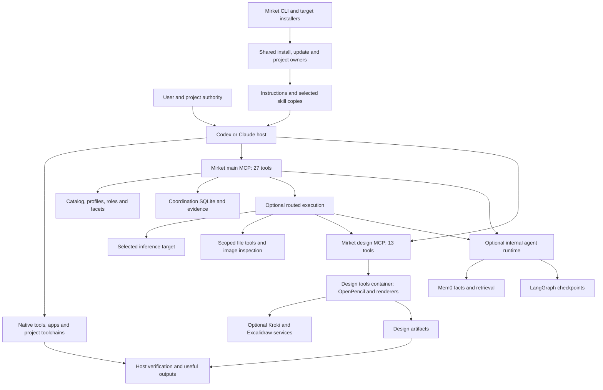
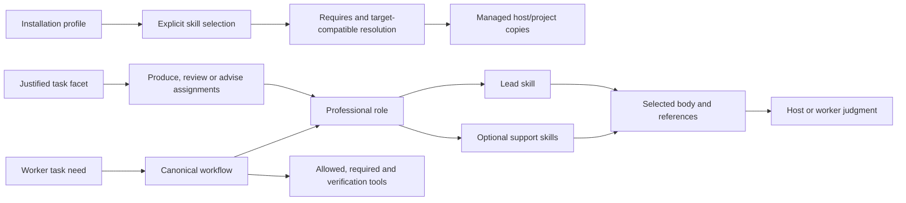
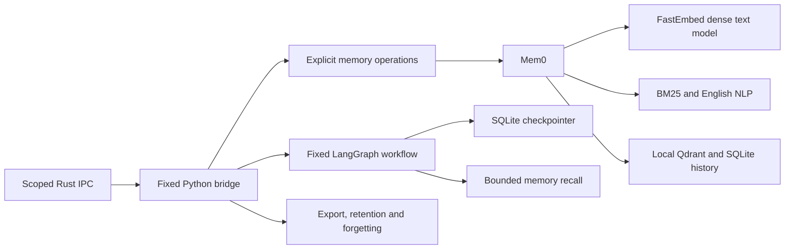

# Mirket system map

Snapshot: **21 October 2026**, consolidated `main`, with the pre-release adoption and inspection follow-up based on `c5ecde3`. This map supports the final harness review: it describes what exists, who owns each outcome, what it depends on, how it is selected and which claims still need evidence. It does not authorize further implementation or deployment.

The pre-release follow-up adds Mem0 recall disclosures to worker/recovery results,
focused recall/retention/resume guidance, passive actionable identity diagnostics,
and saved-document evidence for required OpenPencil inspection. The current
[decision record](runtime-integration-review-2026-10.md#pre-release-follow-up)
records the installed dependency closure and limits of the design-quality claim.

## 1. Read this map and its inventories

| Document | What it contains |
| --- | --- |
| This document | Topology, owners, execution journeys, state boundaries, environment, methodology, current evidence and review questions |
| [Complete inventory](harness-map/inventory.md) | Every role, profile membership, skill, source pin, facet, workflow, main/design MCP tool and OpenPencil operation |
| [Methodologies](harness-map/methodologies.md) | All 41 role contracts: perspective, priorities, method, decision rule, challenge, handoff, prerequisites, acceptance and failure probe; index into all 54 embedded skill bodies; all workflow rules |
| [Dependencies](harness-map/dependencies.md) | Direct and locked Rust/JavaScript/Python inventories, image pins, model assets, skill-declared external prerequisites and environment-name references |
| [Machine-readable inventory](harness-map/inventory.json) | Complete registry records, source hashes, typed expertise graph, runtime metadata, lockfile dependency fields and test-file index |

The source of truth remains the owning implementation and registries. These documents are a snapshot of those owners, not a second configuration system. The generated appendices can be checked for drift without starting runtimes.

### Identity and implementation status

| Layer | Snapshot and limitation |
| --- | --- |
| Prior implementation commit | `33f4cd2e61935a216cab820b23705acbcbb634b5` on `main`; subsequent changes are recorded with this map in Git history |
| Working source | `c0a8aa3ba4ded447888bd44b3e555cad419c47e255af7f6eb7a0b8b991a1bf7e`; calculated using the exact framing and roots in [source_identity.rs](../src/source_identity.rs) |
| Implementation included | Committed video retirement, explicit Excalidraw group/state-v4 migration, advisory reporting, owned tool dispatch and bounded quality-feedback repairs. Generated inventories now use content identity rather than Git HEAD. See [implementation record](harness-final-pass-implementation-2026-10.md). |
| Local candidate | 1.0.11, `aarch64-apple-darwin`, built outside Cargo output. The [integration review](runtime-integration-review-2026-10.md) records the subsequent cleanup and checks; the [implementation record](harness-final-pass-implementation-2026-10.md) retains the earlier committed candidate. |
| Installed executable | Passively hashed as `186a2311aa928238db6df3227876794a1dfd6b4bd052876eb9e732b2e58f1d3b`; differs from the candidate. Same version string does not mean same implementation. |
| Live desktop/container state | Not freshly activated or probed for this extraction. Earlier connection and artifact evidence remains dated evidence. No claim that the working-tree fixes are deployed. |

The earlier map's active Penpot topology is superseded. OpenPencil is the current editable-design engine. Historical Penpot evidence is retained as history, not counted as current infrastructure.

### Inventory at a glance

| Layer | Current declared count | Meaning |
| --- | ---: | --- |
| Catalog entries | 347 | 54 embedded, 149 upstream, 139 reference, 5 package-delivery entries |
| Default global guidance | 14 | Shared host guidance; included within the 54 embedded entries |
| Installation profiles | 63 | 8 starter, 50 specialist, 5 alternative bundles |
| Professional roles | 41 | Outcome/method contracts with lead and optional support skills |
| Team facets | 37 | Explicit task boundaries mapped to complementary role assignments |
| Workflows | 17 | 16 worker-owned; retained `motion` ID is host-owned with no worker encoder/tools |
| Main MCP tools | 27 | Discovery, coordination, execution, memory, recovery and identity |
| Design MCP tools | 13 | Four OpenPencil wrappers plus nine direct production/QA tools |
| Distinct worker tools | 17 | Four native scoped tools plus the thirteen design tools; a request receives a subset |
| OpenPencil operations | 87 | 29 read, 58 write, lazily described behind the wrappers |
| Runtime packages | 2 | `design` and internal `agent-runtime` |
| Catalog source records | 47 | Pinned provenance records, not active services |
| Local reference files | 139 | Authored references/data/specimens; coincidentally the same count as reference-delivery entries, but a different inventory |
| Design-reference instances | 27 | Typed examples inside the `design-inspiration` skill, not 27 tools |
| Dependency locks | 234 Cargo / 409 npm / 97 Python | Cargo includes root/build/dev; npm includes root and conditional/nested records; Python is a wheel closure. Not installed-process or unique-tool counts. |

## 2. Product and ownership boundaries

The retained core installs and maintains guidance/configuration safely, makes relevant expertise discoverable, and provides trustworthy identity, inventory, compatibility and recovery information. Durable coordination/routed workers, specialist container design production, and memory/checkpoint recovery are explicitly optional capabilities. Host-native apps, image generation, shell access, permissions, session lifecycle and billing remain host/provider-owned.



Mirket-owned inference children are not native host subagents. A professional role, team plan or required-tool list does not grant permission. The main MCP has no arbitrary shell tool and cannot register new project roots. The internal agent runtime has no host dispatcher or provider credentials.

### Source owners

| Boundary | Owner | Main consumers and responsibility |
| --- | --- | --- |
| Public command surface | [cli.rs](../src/cli.rs), [setup](../setup) | Common CLI library for native installers and administrative commands |
| Catalog and delivery | [catalog.rs](../src/catalog.rs), [catalog modules](../src/catalog) | Search/read, profile resolution, provenance, upstream verification, role/workflow/facet contracts |
| Host setup | [install.rs](../src/install.rs), [target.rs](../src/target.rs) | Managed instructions, skills, host config, destination preflight and rollback |
| Project publication | [project.rs](../src/project.rs), [recovery.rs](../src/project/recovery.rs) | Explicit selections, target copies, journals, conflict preservation and relocation integration |
| Update and release | [update.rs](../src/update.rs), [release.rs](../src/release.rs), [release gate](../src/dev/release_gate.rs) | Candidate identity, saved-selection replay, acceptance and publication safeguards |
| Durable coordination | [state.rs](../src/state.rs), [contracts.rs](../src/state/contracts.rs) | Registered roots, revisions, idempotency, delivery, evidence and task completion |
| Main protocol | [mcp.rs](../src/mcp.rs) | Typed bounded requests, resources, admission lanes and live identity |
| Worker assignment | [assignment.rs](../src/router/assignment.rs) | Actual task needs → expertise and non-expanding tool scope |
| Model selection and dispatch | [discovery.rs](../src/router/discovery.rs), [policy.rs](../src/router/policy.rs), [execution.rs](../src/router/execution.rs) | Discovery cache, capability floors, model binding, inference, retries and final actions |
| Worker artifact boundary | [tools.rs](../src/router/tools.rs), [design gate](../src/router/design_gate.rs), [handoff](../src/router/handoff.rs) | Scoped paths, expected digests, image context, visual ordering and host verification |
| Package transport | [package_mcp.rs](../src/package_mcp.rs), [packages](../src/packages/mod.rs) | Selection, bounded sessions, cancellation and package metadata |
| Environment and design lifecycle | [podman.rs](../src/podman.rs), [machine.rs](../src/packages/machine.rs), [services.rs](../src/packages/services.rs) | Registered client, private VM, pinned images, receipts, groups, owned services and workspace |
| Design execution | [server.mjs](../runtime/design/tools/server.mjs), [operations.mjs](../runtime/design/tools/operations.mjs), [openpencil.mjs](../runtime/design/tools/openpencil.mjs), [paths.mjs](../runtime/design/tools/paths.mjs) | Validated operations, bounded children, locks, staging and revision-checked publication |
| Internal agent runtime | [agent.rs](../src/packages/agent.rs), [agent_runtime.rs](../src/agent_runtime.rs), [runtime/agent](../runtime/agent) | Immutable image/models, isolated private IPC and data scopes |
| Memory and interrupted execution | [memory.rs](../src/memory.rs), [durable.rs](../src/router/durable.rs), [memory.py](../runtime/agent/memory.py), [workflow.py](../runtime/agent/workflow.py) | Separate fact/retrieval and checkpoint/effect recovery contracts |
| Durable maintenance | [backup.rs](../src/backup.rs), [maintenance.rs](../src/maintenance.rs), [lifecycle.py](../runtime/agent/lifecycle.py) | Leases, bounded archives, restore journals, retention preview/CAS/apply |

## 3. Expertise topology: profiles, roles, skills and facets

These are different mechanisms:



**Profiles group installations.** They do not start agents or imply that every skill should be loaded into context. Eight bundles are shown by default: `project-foundation`, `frontend-web`, `full-stack`, `operations`, `research`, `documents`, `marketing-strategy`, `motion-studio`. `catalog profiles --all` retains the other 55 and saved memberships. The [inventory](harness-map/inventory.md#profiles) lists every profile and its purpose/members.

`project-foundation` contains architecture review, debugging, test design and release operations. `portable-foundation` contains those same four plus explicit inclusion of the global guidance set. Their similar member lists do not make their installation contracts identical.

**Roles express professional outcomes.** Each of 41 roles has a lead skill, optional support, prerequisites, acceptance criteria, a failure probe and a professional method. All fields are reproduced in [methodologies](harness-map/methodologies.md#role-contracts). A role override supplies a perspective; it cannot expand a workflow's tools or erase required task-specialist guidance.

**Facets compose task-specific contributions.** The 37 facets map a justified boundary to produce/review/advise assignments. The team planner merges repeated roles and bounds the plan to eight facets/thirteen distinct roles. It returns a plan, not running workers. Exact assignments and contributions are in [team facets](harness-map/inventory.md#team-facets).

**Skills deliver guidance with different access routes.** Embedded bodies are readable through `skill_read` and installable. Upstream entries can be explicitly fetched and installed with pins, hashes, licenses and adaptations. Reference entries require source consultation. The five package-delivery entries describe browser/cloud/Vercel ecosystems; they are not five Mirket package implementations. Full prerequisites and caveats survive in the JSON inventory. A listed SDK/account/tool is not assumed present.

**The default methodology is selective.** Mirket-authored guidance is the default; Matt, Superpowers and Addy whole-workflow alternatives are opt-in. Selected competing workflows are suppressed from ordinary discovery unless requested by source or exact ID. Literal `replacements` in catalog records are payload text adaptations, not evidence that one skill replaces another.

**Discovery remains a proposal to the host.** Search ranks query metadata; it does not inspect installed-state availability or select a task automatically. Current results expose related workflows from canonical metadata. `capability_plan` returns canonical worker workflows and compact role-specific references instead of repeating full descriptions. Design-reference matching distinguishes exact scoped coverage from provisional lexical candidates. Reference coverage is not current-task acceptance.

The graph resolves relationship targets by their declared kind. `planning-with-files` is both a catalog skill and a source ID; its `source` relationship points to the source node. The final pass corrected the extractor's earlier ambiguous-name handling. There are 880 nodes, 1,447 edges and no unresolved declarations in this snapshot.

## 4. Runtime topology and useful outputs

### Core and host surface

The Rust CLI embeds the catalog, authored guidance and notices. Codex and Claude get a main `mirket mcp serve` connection; selecting design adds a separate `mirket package serve design` connection. `agent-runtime` is internal (`host_connection:false`) and is called behind existing main-MCP/CLI operations.

The 27 main tools fall into five groups; exact descriptions are in the [main MCP inventory](harness-map/inventory.md#main-mcp-surface):

| Group | Tools | Execution owner / consequence |
| --- | --- | --- |
| Expertise | `catalog_search`, `catalog_show`, `capability_plan`, `team_facets`, `team_plan`, `skill_read` | Catalog owner; skill_read can record delivery when task/revision/key are supplied |
| Task coordination | `project_list`, `task_start`, `task_status`, `task_history`, `task_validate`, `task_checkpoint`, `task_evidence`, `task_finish` | Coordination DB and bounded registered-root evidence reads; no check execution |
| Routed execution | `model_registry`, `route_task`, `spawn_subagent`, `resume_subagent`, `verification_handoff` | Discovery may contact targets; spawn/resume can run inference and assigned tools; handoff records host checks |
| Memory/recovery/retention | `memory_read`, `memory_put`, `memory_forget`, `workflow_status`, `workflow_forget`, `runtime_data`, `runtime_data_apply` | May launch the isolated agent runtime, open/migrate local stores, and mutate scoped data according to operation |
| Identity | `runtime_status` | This connected process and installed-byte comparison; not other clients' activation |

### Design package

One prepared design-tools image contains the following thirteen top-level tools:

| Tool | Outcome | Engine / dependency group | Important distinction |
| --- | --- | --- | --- |
| `openpencil_inspect` | File inspection or lazy upstream schema | OpenPencil 0.16.0 | Schema-only calls bypass the shared render lock; file inspection retains it |
| `openpencil_document` | New/imported editable `.fig` | OpenPencil + compiled tokens | New document and edit-existing are separate journeys |
| `openpencil_edit` | Validated saved revision | OpenPencil write operation | IDs can remap on serialization; overwrite requires current digest |
| `openpencil_export` | PNG at 2× or SVG from saved document | OpenPencil + export validation | Inspect exported pixels; a valid file is not semantic acceptance |
| `tokens_compile` | CSS, JS, TS, Typst and DTCG tokens | Style Dictionary | Canonical token owner; compilation itself writes outputs |
| `static_render` | Flexbox/text composition to SVG/PNG | Satori + resvg + SVGO | Layout authoring model distinct from authored SVG |
| `vector_render` | Editable optimized SVG and PNG preview | SVG + SVGO + resvg | Not a graph-layout engine |
| `browser_screenshot` | Local DOM pixels, interactions, layout and timing evidence | Playwright + Chromium; optional Odiff | Local workspace page; not unrestricted internet browsing |
| `kroki_render` | Laid-out diagram SVG/PNG | Kroki; Excalidraw companion for that format | Requires explicitly prepared/enabled diagrams group |
| `typst_compile` | PDF plus rendered page PNGs | Typst | Page inspection remains required; host office workflows are separate |
| `raster_transform` | Deliberate resize/crop/convert | Sharp | Internal staging preserves inputs; it does not replace transformations |
| `svg_optimize` | SVG hygiene, including larger supported inputs | SVGO | Overlaps internal optimization but has a distinct input limit |
| `odiff_compare` | Independent saved-image comparison | Odiff | Dimensions/layout failures are useful outcomes; renderer success does not replace this |

[Design registry](../registry/design-stack.json) groups these into nine named technologies. Four wrappers, nine technologies and thirteen tools describe different layers. OpenPencil's 87 lazy operations remain pinned in [the manifest](../runtime/design/tools/openpencil-tools.json).

Fresh core preparation acquires the Node build base and builds design-tools. Ordinary `diagrams` preparation adds Kroki only. Explicit `excalidraw` preparation adds the companion and Kroki using separate immutable receipts. Preparation does not enable groups. Service state v4 preserves v3 diagram selections as `diagrams,excalidraw`, retains prior ports and archives the old state only after the old containers are stopped. Existing full receipts remain accepted. Group changes still require a stopped transition, while compatible optional receipt additions do not force unchanged core shutdown.

Bundled HyperFrames/video and explicit FFmpeg installation are retired. Chromium remains for browser outcomes. The `motion` workflow ID and profile memberships remain, but encoded video now requires explicitly selected host tooling; it cannot route to a worker or silently become interactive browser motion. Existing scenes, outputs, images and checkpoints are not deleted. Source-bound old workers cannot dispatch under the changed generation. NLP remains in the optional agent runtime. No current Penpot/Postgres/Valkey service is part of the design topology.

### Internal agent runtime



Mem0 receives explicit facts with provenance, expiry, idempotency and supersession. `infer=False` and the `ExplicitFacts` adapter disable secondary extraction LLM calls. Dense and sparse retrieval plus English NLP are distinct parts of the dependency path. Removing spaCy is not equivalent to removing unused code. The current four-arm fixture did not establish a practical NLP benefit or a measured resource saving; it also did not justify assuming equivalent real-project recall.

Worker recall shares one Mem0/Qdrant/history handle across its bounded query batch,
then closes it before the next operation. The existing project lock, per-query
eligibility checks and checkpoint boundaries remain. The [runtime review](runtime-integration-review-2026-10.md#measured-recall-reuse)
records the warm batch latency comparison and its limits.

LangGraph owns interrupted workflow state, pending effect boundaries and host-verification transitions. Rust still owns model/tool permissions and exact-write reconciliation. Known safe pauses receive bounded cumulative inactive-time credit; crashes and uncertain effects retain conservative deadlines. Resume does not reset turn/repair budgets or silently replace the original provider/model contract.

## 5. Execution journeys

### Host-native work

User/project intent → host chooses relevant guidance → host-native app/browser/shell/project toolchain → saved artifact or source change → meaningful native verification. Mirket coordination and specialist runtimes are optional. Host raster generation, remote apps and external messaging are not Mirket worker capabilities.

### Install, select and maintain

CLI/installer → shared setup owner → destination/drift preflight → journaled publication → host configuration and skill copies → receipt. Project selection is separate: explicit init/register → add profile/role/skill → plan → sync → doctor. Upstream fetch verifies payloads; it does not execute helpers or install their dependencies. Updates verify candidates and replay saved choices. Recovery never means deleting customized managed files to make checks green.

### Routed worker

Declared `task_needs` → canonical workflow/role resolution → registered project and assigned design scope → guidance/tool availability → task/workflow/tool floors → target discovery → optional explicit model narrowing → vision conformance when needed → ranking → immutable run envelope and bounded action loop → artifact verification → host verification where required.

The router currently prefers the **strongest eligible** model, not the least costly adequate one. Effort selection separately chooses the lowest supported effort meeting its floor; T2/T3 normally require high-or-better when effort is advertised. Supported protocols are native Codex, native Claude, OpenAI Chat, OpenAI Responses, Anthropic and Ollama. Configured targets/discovered model metadata determine availability; no static model catalog in this map is an authorization to use one. Provider billing/usage stays in provider panels.

The 17 workflow contracts are: analysis, structured-response, source-implementation, source-review, visual-review, web-interface, editable-interface, static-graphic, diagram, motion, interactive-motion, paged-media, vector-art, raster-processing, vector-optimization, pixel-comparison and design-tokens. The exact default roles, floors and required/verification tools are in [the workflow table](harness-map/inventory.md#worker-workflows). Raster-processing and vector-optimization have T3 workflow floors even though their mechanical tools have T1 floors.

Worker file tools allow paged reads/listings, expected-digest writes and image inspection. Source-project writes and absolute writes inside the assigned design workspace are permitted after isolation checks. Workers cannot write sibling project scopes or get arbitrary shell access. Readback verifies bytes, not application correctness. Paged reads satisfy whole-file readback only when contiguous coverage matches the current digest.

### Visual production

Inspected target or minimal native specimen → frozen rendered evidence → production using canonical medium tools → actual pixel/page/frame inspection → bounded repair → saved artifacts and unresolved limits. Tokens compile before render paths. Independent image inspection and source-to-export identity matter; mandatory invocation alone does not prove contribution.

| Deliverables | Shared execution budget | Final repair limit |
| --- | ---: | ---: |
| Static, vector, diagram and default design case | 15 minutes | 2 |
| Browser/editable interface and paged media | 30 minutes | 3 |
| Motion, including interactive motion | 45 minutes | 4 |

Combined workflows take the largest applicable budget, never their sum. One target-repair opportunity is separate from final repairs. Per-tool outer timeouts and subprocess timeouts are separate controls: e.g. `typst_compile` has a 1,500-second outer tool limit while its two Typst subprocess calls each have 90-second limits. Full tool timeouts are in the generated inventory.

### Failure and recovery

Task revision/idempotency recovery, installer rollback, project publication recovery, worker checkpoints and durable backup/restore protect different boundaries. They cannot be merged merely because all persist state. Exact pending file writes can be reconciled from before/after digests; arbitrary uncertain external effects are not replay-safe. Host check evidence is identity-bound testimony, not authenticated human approval.

## 6. Persistent state and isolation

`HOME` below means the explicitly selected home boundary (`--home` when supplied), not a discovered user account. Paths identify the implementation layout; this extraction did not inspect private facts, tasks, credentials or project contents.

| State / location | Owner | Meaning and recovery boundary |
| --- | --- | --- |
| `HOME/.mirket/bin`, `setup.json`, install receipt/journals | Install/update | Managed executable and saved choices; preflight and rollback |
| `HOME/.codex/config.toml`, `.codex/AGENTS.md`, `.agents/skills` | Codex target adapter | Main/design connections, installed global guidance; unrelated settings preserved |
| `HOME/.claude.json`, `.claude/CLAUDE.md`, `.claude/skills` | Claude target adapter | Equivalent target-specific installation |
| `PROJECT/.mirket` | Project owner | Selection, publication receipts and recovery journal; selected skill copies in target locations |
| `HOME/.mirket/state.db` | Coordination SQLite, schema 4 | Projects/namespaces, tasks, revisions, delivery, checkpoints/evidence; separate from LangGraph |
| `HOME/.mirket/cache` | Catalog/discovery/build owners | Verified payloads, model metadata, downloads/assets; caches are not memory facts |
| `HOME/.mirket/runs/routed-*` | Worker executor/handoff | Run traces and host-verification evidence; not a billing ledger |
| `HOME/.mirket/execution/podman` | Environment owner | Private control state, registered connection and staging; control socket is outside design workspace |
| `.../staging/design/workspace` | Design package | Shared host design mount at `/workspace`; project worker scopes normally use `projects/<stable-scope>` |
| `HOME/.mirket/packages/data/design` | Design lifecycle | State and immutable base/optional-generation receipts |
| `.../staging/agent-runtime/data/<scope>` | Internal runtime | Only the selected project data directory mounted writable; facts, vectors, history and workflow checkpoints |
| `HOME/.mirket/packages/data/agent-runtime` | Agent package | Immutable recipe/image receipts |
| User-selected backup archive and restore journal | Backup/maintenance | Durable state, runtime data and traces; excludes project/design assets and runtime control state |

Project relocation preserves its registered namespace. It does not move source files or rewrite old execution bindings. Design workers use assigned subdirectories; direct host design tools retain the shared workspace. Local owner/permission checks remain meaningful even though the host retains ultimate permissions.

## 7. Runtime and build dependency map

The [dependency appendix](harness-map/dependencies.md) lists every locked record and catalog-declared prerequisite. This section identifies why the groups exist and how they are acquired.

| Group | Direct components / role | Acquisition and ownership |
| --- | --- | --- |
| Rust core | anyhow; clap; include_dir; flate2; reqwest/rustls; rmcp; rusqlite with bundled SQLite; serde/serde_json; sha2; tempfile; tar; tokio; toml_edit; zip | Cargo.lock, Rust 1.99.1 toolchain. sha2 also build-time; roxmltree is test-only. No Python/Node required for ordinary prebuilt CLI use. |
| Design protocol/validation | MCP JS SDK 1.32.1, Ajv 8.18.0, css-tree 3.2.1, saxes 6.0.0 | Exact design package.json and npm lock, installed during image preparation with scripts disabled |
| Editable design | OpenPencil CLI 0.16.0, transitive core/codecs/CanvasKit/Yoga WASM | Same reviewed npm closure; manifest and wrappers; no separate live editor server |
| Static/vector/token/QA | Satori 0.62.0; resvg 2.6.2; Style Dictionary 5.7.0; SVGO 4.1.0; Sharp 0.35.5; Odiff 4.5.0 | Same design image; native platform binaries and fonts are part of the outcome prerequisites |
| Browser/interactive motion | Playwright-core 1.64.1; Chromium | Encoded video is host-owned; no bundled encoder |
| Paged output | Typst 0.15.1 | Hash-verified release archive copied into the image; not an npm package |
| Diagram layout | Kroki 0.32.0 and Excalidraw companion | Two digest-pinned remote images; optional diagrams group |
| Agent Python seeds | Mem0 2.2.1; LangGraph 1.2.16; SQLite checkpointer 3.1.2; FastEmbed 0.9.0; spaCy 3.8.13; en_core_web_sm 3.8.0 | Six direct requirements, 97 hash-locked wheels; Python 3.13 Linux ARM64 image |
| Agent transitive groups | Local Qdrant client/storage, ONNX Runtime, tokenizers, NumPy, Pydantic, provider-client libraries and others | Wheel presence does not mean an active hosted provider. All exact distributions are listed in the appendix. |
| Dense model | Quantized multilingual MiniLM, 384 dimensions, 128-token model window | Five pinned files, 252,138,706 bytes; fetched during explicit preparation |
| BM25 assets | Qdrant/bm25 stopwords/config, pinned revision | 31 files, 81,436 bytes; separate from English spaCy model/wheel |
| VM boot | Private ARM64 Podman machine image | Pinned compressed boot blob, 937,980,979 bytes, verified before explicit initialization |

Design image construction needs GCC/libc development headers, curl/xz and CA certificates. The retired video closure was the last esbuild consumer, so its Go rebuild is removed. These build tools are distinct from normal host prerequisites. Runtime OS packages include DejaVu fonts and Chromium. The design recipe uses the dated Debian snapshot `20261020T000000Z` and pinned base digest. The agent image installs hash-locked binary wheels, checks dependencies and removes pip. Design removes npm/package-manager shims after building. Serving does not resolve packages.

Image digests pin an artifact, not its safety or useful output. Locked npm records include optional native binaries for platforms that are not installed in an ARM64 image. Python lock lines do not contain the transitive `Requires-Dist` graph; the extractor preserves this limitation instead of inventing dependency parents. OS installed-version inventories require the existing image audit/export mechanism; no image scan was rerun for this map.

## 8. Environment and external dependencies

| Journey | Required environment | What is optional / not implied |
| --- | --- | --- |
| Prebuilt CLI and guidance | Supported native binary, writable selected home/project, host config conventions | No design VM, Python, Node or model inference required just to read embedded guidance |
| Native build/check | Pinned Rust toolchain, compiler/linker, locked crates; Python 3.11+ for extraction/audits and 3.13 in native CI | Build-time requirements are not end-user runtime requirements |
| Native host integration | Codex Desktop or Claude Desktop Code and host-granted tools/permissions | Successful setup does not prove already-running connections reloaded |
| Managed container environment | **macOS ARM64 controller**, registered Podman and native machine helpers, Apple virtualization support | Core Linux/Windows tests do not prove managed VM portability |
| VM allocation | Default 4 vCPUs, 6,144 MiB RAM, 40 GiB disk allocation; VM memory must leave at least half host RAM available | This is allocation policy, not measured resident use or guaranteed free-space requirement |
| Core design service | Prepared images, explicitly running environment, shared workspace, owned network/containers | Core does not require diagram downloads on a fresh selection |
| Diagram service | Prepared/enabled diagrams group; loopback publication for Kroki port 8000; companion internal port 8004 | Excalidraw is not independently selectable today |
| Browser output | Chromium inside design-tools; bounded local workspace HTTP server on internal port 9002 | No general remote navigation or user browser login inheritance |
| Memory/checkpoints | Selected/prepared agent-runtime, running environment, writable private project scope | A read request can launch an on-demand container and create/open store state |
| Routed inference | Ready native CLI or explicitly configured endpoint/authentication, compatible model metadata | No provider/model substitution follows from this map; pricing is not the ranking objective |
| External catalog skills | Per-entry SDK, compiler, browser, accounts, assets, plugins or data | Guidance selection neither installs these nor grants account access |

### Resource and concurrency controls

Design-tools: 2,048 MiB, 2 CPUs, 512 PIDs. Kroki: 512 MiB, 1 CPU, 128 PIDs. Companion: 350 MiB, 1 CPU, 128 PIDs. Design startup checks selected service caps plus 512 MiB VM OS headroom. These are caps/checks, not observed consumption.

Agent containers: 1,536 MiB, 2 CPUs, 128 PIDs; read-only root, no network, dropped capabilities, no-new-privileges, 256 MiB temporary filesystem. Project data has a 512 MiB budget; private IPC is bounded to 4 MiB. Cross-process admission allows two worker sessions and one operation session; startup handshake has its own lock. A process-local MCP lane is not the same thing as this cross-process admission.

Multiple design MCP sessions share renderer capacity and publication locks. Schema-only OpenPencil inspection and token compilation bypass the shared render slot; output-specific validation/locking still applies where relevant. Browser/render children use the owned runtime guard and cancellation cleanup. Node permission flags on OpenPencil limit file access, but receipts and annotations are not an OS permission grant.

### Network boundaries

Acquisition can contact GitHub/codeload/release endpoints, OCI registries, Debian snapshots, npm, Python wheel hosts, spaCy model releases and Hugging Face asset pins. CI advisory checks contact OSV and scanner/image registries. Configured inference discovery can contact provider endpoints and invoke native metadata probes. Executing a worker contacts its selected target. Design uses the owned internal network/local workspace routes; the agent runtime is network-disabled after preparation.

No credentials or environment values are included in the map. The [environment-name index](harness-map/dependencies.md#environment-name-references) records source references only, including test-only controls; it is not a supported-settings schema.

## 9. Inspection versus effects

“Read-only” at the product level is not always passive at the process/filesystem level. Use source inspection for a passive review; do not discover live capabilities merely to fill a table.

| Operation | Effects relevant to review |
| --- | --- |
| Read tracked files, hashes, Git revision/diff | Passive source inspection; no runtime activation |
| `catalog search/show/read`, `capabilities plan/team` without task delivery | Local embedded discovery; declarations only |
| `runtime_status` on an existing connection / `info` | Observe that process's identity and installed bytes; no other-client claim |
| `model_registry`, `route_task` | Can read/write discovery cache, probe native CLIs/contact configured endpoints, and check assigned-tool readiness; no inference in route preview |
| Start main MCP / broad doctor | Protocol sessions and state checks can open databases; model discovery can start after handshake. Do not label the whole operation passive. |
| `memory_read`, `workflow_status`, `runtime_data` | May start agent container, acquire locks, create scope directories and open SQLite/runtime state despite read-oriented semantics |
| `package status/probe/serve` | Engine/receipt/session checks; probe/serve can launch package processes. They do not install dependencies or implicitly start the VM. |
| `setup`, `update`, `project sync`, `package prepare/install` | Managed writes, recovery/reconciliation, caches and potentially downloads/builds |
| `environment init/start/resize`, `package start/stop` | Explicit VM/service lifecycle effects |
| `spawn_subagent`, `resume_subagent` | Inference and scoped tool effects; resume is not merely checkpoint inspection |
| `runtime_data_apply`, forgetting, backup restore | Data mutation/deletion or restoration under explicit contracts and authority |
| `evals/harness-map/extract.py` | Reads source and Git metadata, writes four documentation appendices; `--check` compares without writing |

## 10. Methodologies and enforcement

| Method | Canonical representation | Enforced behavior | Judgment/evidence still needed |
| --- | --- | --- | --- |
| Outcome-first selection | Host payload, skill-catalog, role contracts | Catalog validates references and contracts | Whether this task benefits from a specialist or any tool |
| One default, explicit alternatives | Profile/discovery metadata and guidance | Discovery behavior and exact IDs | Avoid stacking competing methods in actual context |
| Independent professional contributions | Facets, team planner, optional contribution contracts | Assignment bounds and typed coverage if selected | Useful independence, disagreement quality and contribution |
| Minimal worker scope | Workflows + assignment + dispatcher | Required/allowed tools, canonical role guidance, path checks | Semantic fit of declared task needs |
| Capability/model routing | Discovery + policy + adapters | Floors, availability, explicit narrowing, identity, bounded failover | Actual quality, cost and selection efficiency |
| Render-first design | Design gate + medium guidance | Ordering, hashes, deadlines, review/repair bounds | Composition, typography, source/render fidelity and acceptance |
| Source verification | Expected-digest writes, paged readback, host handoff | Byte bindings, required check coverage, stale evidence rejection | Host execution correctness and meaningful tests |
| Explicit memory | Memory owner + local retrieval | Scope, provenance structure, expiry/supersession/forgetting, no extraction LLM | Fact quality, relevance and multilingual behavior |
| Budget-preserving recovery | Durable driver + LangGraph | CAS, original bindings, pause ceiling, pending-write reconciliation | Uncertain non-file effects and interrupted user intent |
| Safe maintenance | Install/project/update/backup owners | Drift rejection, journals, rollback, isolation | Correct operational decision to apply/restore/publish |

The detailed methods are available for every role in the methodology appendix. Authoring instructions are not equivalent to runtime enforcement. Runtime enforcement of invocation/identity is not proof of useful contribution. Completion is representative retained journeys with recovery and useful artifacts, not implementation of every catalog ambition.

## 11. Current evidence and remaining limits

| Evidence | Revision/scope | What can be concluded |
| --- | --- | --- |
| Pre-release follow-up | Based on `c5ecde3`; current source in generated inventory | 426 native and 70 design tests passed, plus disposable setup/doctor. After authorized activation of the matching design stack, all five full-acceptance checks passed and a candidate-bound receipt was created. Main CLI and existing desktop sessions were not updated. See the runtime review for dependency evidence and remaining limits. |
| Committed final-pass candidate | `33f4cd2`, source `da370a1529a8d062b3308fe24feb616f08288e74c1d623256588bb7b16c6ec63` | Formatting/Clippy and 424 native tests passed (8 opt-in ignored); rebuilt design image passed 70/70 with no skips; catalog and disposable all-target setup/doctor passed. No desktop deployment. |
| Initial integration review | [Runtime review](runtime-integration-review-2026-10.md), before batched recall | Contained Mem0/LangGraph suite passed, including persistence, isolation, supersession, restart, checkpoint CAS, bounded pause and host verification. Seven-query synthetic fixture has six answerable hits at rank 3 and one empty negative. Not natural adoption or answer quality. |
| Shared recall handle | Same review, final implementation; 22/128 synthetic facts, five alternating pairs per query count | Four-query median batch time reduced 59–61%; eight-query time reduced 72–73%. Records, ordering and coverage unchanged; score differences at floating-point roundoff. No end-to-end worker or cold-start claim. |
| Consolidated-branch local review | Prior final-pass baseline `4b97d97f…`; historical after implementation | Formatting, Clippy, 418 native tests passed; 9 explicit opt-in tests ignored. Catalog, disposable all-target setup/doctor, 13 dependency-audit unit tests and 5 remediation tests passed. No deployed activation follows. |
| Consolidated push CI | [Run 39543975339](https://github.com/codemirket/harness/actions/runs/39543975339), exact `cc8a258` | JavaScript and Linux/macOS/Windows native jobs passed. Dependency job failed on stale source exception; new local fixes have not run in remote CI. |
| Latest source-coordinate audit | Committed final-pass review, 732 coordinates; locks unchanged in subsequent cleanup | Source exception pins repaired after ZIP call-path review; nine Pillow 12.3.0 advisories remain. Reported fixes require 13.0.0, incompatible with current FastEmbed 0.9.0 constraint. No blanket exception or override added. |
| Simplification trials | [Report](harness-simplification-2026-10.md), [evidence](harness-simplification/evidence.json), prior candidate | 77/77 contained design checks and bounded real outputs; four retrieval arms; selective-preparation fake-engine checks; encoded-video recovery. Results are fixture- and revision-bound. |
| Discovery size | Same report, matched query | Graphic-design plan reduced from 12,280 to 10,224 serialized characters (16.7%). Not a token/cost/latency measurement. |
| Memory comparison | 23 facts / 15 queries / four fresh-index arms | Answerable recall@3=1 for all arms; semantic arms abstained on 1/2 negatives, lexical on 2/2. Small fixture, not general retrieval equivalence or an NLP-removal case. |
| Video | One named offline opportunity | First attempt failed, fourth invocation encoded with failure history retained. No natural selection or production-quality claim. |
| Earlier design quality | [16 October result](../evals/design-quality/RESULTS-2026-10-16.md) | No demonstrated quality gain. Preserve the negative result and its evidence defects. |
| Adoption | No current natural-selection campaign | Search tests, required-tool compliance and saved artifacts do not establish spontaneous useful selection. |
| Performance | No current matched cold-start/RSS/cost comparison | Historical warm calls, image nominal sizes and debug timings are not current before/after benchmarks. |

The previous local review logs remain outside shipped source at `.mirket/work/simplification-20261021/consolidated-review*` under the selected user home. They record the actual failing-before/passing-after package regression and current dependency findings. The initial extraction reused that evidence while rechecking source identity. Subsequent final-pass implementation checks are recorded separately; prior results are not relabelled as current.

CI reports source-coordinate and image advisories under the same advisory-only policy. Expired/source-stale reachability reviews remain visible and stop suppressing findings; malformed records, query/inventory/identity failures still fail; Node tests run from a copied dependency directory; native matrix builds/tests/packages and verifies disposable installs. Candidate-bound release acceptance, actual desktop reconnection and semantic artifact review are separate from all of those.

## 12. Final-pass questions supported by this map

These are review boundaries, not newly authorized changes. For each decision use outcome → owner → discovery → prerequisites → invocation → useful evidence → overlap/unique value → costs → removal consequences → disposition/confidence.

| Boundary | Current state to preserve | Decisive final-pass question |
| --- | --- | --- |
| Core guidance/configuration | One shared installer, catalog and identity system | Can an ordinary task finish with minimal discovery and no unnecessary optional runtime? |
| Profiles/roles/facets | Different installation and professional-planning responsibilities | Which repeated representations impose real maintenance/context cost? Preserve saved selections and portable-global distinction. |
| Discovery | Canonical workflows, compact role references, targeted outcome tags | Does the host choose useful tools on natural opportunities, without named-tool prompts? |
| OpenPencil | Chosen engine; four wrappers; lazy schemas | Do both new-document and existing-document journeys preserve content, IDs and useful exports? |
| Static/vector/SVG | Distinct layout, authoring and large-input optimization contracts | Can one retained path replace another on representative tasks without extra repair burden or lost input support? |
| Raster and image comparison | Intentional transforms and independent QA | A replacement must preserve crop/convert and saved-image/layout-failure contracts, not merely renderer success. |
| Diagrams | Fresh core excludes diagram images; ordinary diagrams exclude companion; legacy selections preserve it | Verify explicit companion acquisition and migration without changing user artifacts. |
| Video | Bundled encoder retired; saved motion ID remains host-owned | Verify clear retirement diagnostics and no silent tool/provider substitution. |
| Memory/NLP | Explicit facts, hybrid retrieval, no extraction LLM | Does ablation on real identifiers, languages, supersession and negatives justify simpler retrieval with migration/reindex intact? |
| Checkpoint recovery | Distinct from task coordination and memory | Can every retained interruption resume without budget reset, duplicate uncertain effect or provider substitution? |
| Router | Strongest-eligible ranking, independent effort floor | Do authorized model trials support a cheaper-adequate policy without unacceptable failures? |
| Dependency reporting | Pillow findings remain visible under the authorized advisory-only policy | Apply compatible low-effort fixes; retain scan, identity and inventory errors as failures. |
| Environmental support | Managed controller macOS ARM64; core CLI matrix broader | Are unsupported/unavailable cases explicit and recoverable without hidden activation? |
| Release/activation | Working candidate differs from installed binary | Verify candidate-bound gates and each intended live connection before treating these source changes as deployed. |

For any proposed removal, trace consumers in the graph and full metadata: profile membership, role leads/support, requires/conflicts, workflow tools/verification, package/image recipe, lockfiles, schemas, instructions, examples, tests/CI, saved-selection compatibility and retained artifacts. Removing an exposed wrapper may not remove its shared transitive dependency.

Natural trials need relevant task opportunities as denominators. Separate natural vs named selection; first attempt vs intervention; invocation vs correctness; compliance vs contribution; and harness execution vs host fallback. Include ordinary source/review, browser UI, new/edit-existing OpenPencil, static/vector, diagram, paged output, video if retained, memory, interrupted recovery, no-specialist and unavailable-runtime/platform cases.

## 13. Reproduction and extraction checks

Use installed Python 3.11+; this extraction used Python 3.13. From the repository root:

```sh
python3.13 evals/harness-map/extract.py
python3.13 evals/harness-map/extract.py --check
```

The first command writes `inventory.md`, `inventory.json`, `methodologies.md` and `dependencies.md` under `docs/harness-map`. The second compares without writing and fails when an appendix is stale. Neither imports runtime modules, fetches upstream bodies, inspects credentials, discovers models, installs dependencies or starts containers. Source symlinks are rejected when collecting fingerprint inputs. Graph endpoints are checked, while unresolved declarations are explicitly typed.

The JSON retains complete registry records and source hashes, not just table summaries. Its compiled-source framing covers the same roots as the build, while extra inputs cover the map generator, development instructions, architecture, CI and dependency admission. Documentation changes are not runtime source changes. Regeneration does not automatically rewrite this manually reviewed topology.

The initial extraction verified its 392 inputs and 398 local Markdown links/anchors, including a deliberate stale-output rejection. The final-pass implementation regenerates the appendices against the changed source; current counts and checks are recorded in the [implementation record](harness-final-pass-implementation-2026-10.md). The earlier source-ID ambiguity is fixed. Extraction checks establish consistency, not runtime activation or semantic completeness of every catalog entry.
