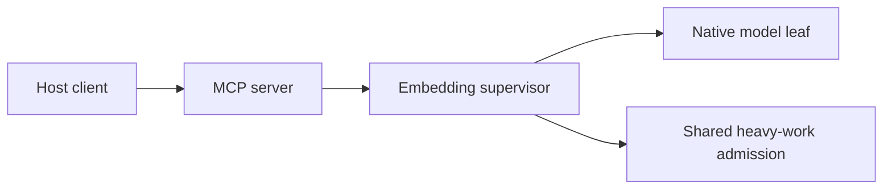

# Connection-owned embedding lifecycle

Each configured MCP server loads its embedding model lazily. A responsive Rust
supervisor owns one blocking native leaf, and that leaf reuses one verified model
for sequential requests. There is no model daemon or installation-wide broker.
Design and diagram jobs use separate finite workers.

The server serializes requests for its model. Only genuine contention reserves
one of the installation's eight waiting permits. A loaded model retains one of
the two heavy slots until its leaf has stopped; completing an inference does not
release that slot. A waiting request never owns a second heavy slot while it
waits for this connection's session.

The supervisor retires an idle model for waiting work, memory pressure or one
minute without inference. A cold load belongs to the initiating request through
its first inference, so another queued request cannot evict it immediately after
loading. Pressure is checked before cold loading and dispatch, and refreshed
while idle. Idle ownership/pressure checks run on a nominal 250 ms interval,
plus scheduling and cleanup; incoming pipe messages wake immediately. Pressure
alone does not interrupt active inference. The macOS
snapshot combines registered process-tree RSS and a read-only kernel pressure
interface under [installation-wide resource admission](m1-resource-admission.md).
Availability on the oldest supported OS and a Windows implementation remain
qualification gates.

Input, vectors and correlation identifiers travel through bounded anonymous
pipes. One reader owns each framed stream across cancellation. The supervisor
checks release/session identity, monotonically increasing sequence numbers,
source revision and model identity. It observes unsolicited output and bounded
diagnostics while the model is idle. There is no command, shell or ambient
runtime lookup in this protocol.

The request's sixty-second execution budget includes queueing and cold loading.
Cancellation, disconnect or expiry starts owned cleanup. A separate bounded
cleanup wait may follow the execution deadline. Dropping a caller does not abort
the reaper, and interrupted requests are never replayed automatically. A late
valid result racing cancellation is discarded before stop proof is consumed.

An inference result, leaf-reap proof and empty scratch removal are separate
facts. The supervisor clears its durable heavy-slot marker only after native
cleanup. The server then reaps the supervisor, checks the terminal stream and
removes only its original empty scratch directory, flushing the parent directory.
Unknown cleanup or unexpected files remain visible and are retained for
inspection. Killing the supervisor cannot establish permission to clear its
marker or reclaim an untracked leaf.

The selected MiniLM model passed the frozen multilingual retrieval-quality gates
in [the evaluation contract](memory-evaluation-contract.md). A later
[installed two-client run](m2-semantic-qualification.md) measured post-use RSS
and observed both model child trees retire after the 300-second idle deadline.
Those older idle runs did not measure scale or combined load. The later
[simplification qualification](simplification-qualification-2026-10-27.md)
measured 10,000 synthetic one-chunk heads and semantic/Design/navigation overlap;
100,000-head scale, Video overlap, Windows ownership and actual Desktop activation
remain unmeasured. Aggregate 8 GiB soft admission is now implemented. Its
native-suite, configured memory MCP, manual transfer and restore evidence is recorded in
[the resource admission contract](m1-resource-admission.md). That configured
journey passed with ONNX Runtime under OS network denial and
`ORT_DISABLE_TELEMETRY=1` on executable
`2ddba4ca99ce4a25e5444fd639f5b524244784e7d0df197184e8270d813d3404`;
it does not extend the earlier idle measurements below to a new benchmark.

## Verification evidence

The 300-second observations below are historical evidence for the prior idle
setting. On 2026-10-27, the selected MiniLM package and rebuilt macOS ARM64
binary passed a real 60-second idle-expiry run. Two requests reused one observed
leaf; the supervisor returned typed `idle_expired` with confirmed cleanup at
60.121 seconds, reaped the leaf, removed its heavy-slot marker and left an empty
scratch directory. Cold readiness was 5.685 seconds. The last live CPU sample
at 57.156 seconds showed no additional leaf CPU and 1.42 seconds of supervisor
CPU since idle start. These are single-run observations, not performance targets.
The report is outside the repository at
`/Users/nazmiyilmaz/.codex/task-state/harness-rewrite-implementation/simplification-20261027/warm-embedding-idle-rerun.json`
with SHA-256 `6ef4784a03043eead5ee94ee36f86222d63e81805bab399c320b0ab699afba8d`.
An initial fixture run failed because its sampling window still used the old
five-minute thresholds and sampled after successful retirement; its retained
report records that failure, and the corrected fixture passed the fresh run.

The disposable installed two-client fixture also passed with the selected
MiniLM payload and the current core. The sampled process-tree RSS sum was
28,816 KiB before use, 2,189,424 KiB after both clients used semantic recall,
2,189,472 KiB at 30 seconds idle and 58,432 KiB at 75 seconds idle. At 75
seconds only the two MCP server processes remained, and `doctor-core` was
healthy. The sum can double-count shared pages, so it is evidence of leaf
retirement and reduced process RSS, not a physical-memory peak or general
performance benchmark.

Two actual-model idle-expiry runs passed on 2026-10-24, using macOS 26.5.2 ARM64,
Python 3.9.6 and debug Mirket binaries. Each historical run loaded the then-pinned E5-small INT8
model once, served two sequential requests through the same observed leaf PID,
validated revisions, model identity and normalized 384-dimensional vectors, and
retained the locked heavy-slot marker throughout reuse. Both reached the real
300-second idle deadline, returned typed `idle_expired` with confirmed cleanup,
exited zero, and left neither the leaf nor its heavy marker. The fixture then
removed only its empty owned scratch directory.

| Observation | Earlier 25 ms loop | Current 250 ms idle checks |
| --- | ---: | ---: |
| Live idle CPU observation interval | 298.686 s | 298.726 s |
| Supervisor cumulative CPU delta | 20.87 s | 5.23 s |
| Leaf cumulative CPU delta | 0.01 s | 0.02 s |
| Observed idle-expiry stop wait | 300.129 s | 300.133 s |
| Cold ready | 6.139 s | 6.428 s |
| Two sequential request times | 337 / 233 ms | 317 / 227 ms |

These are paired observations, not a repeated performance benchmark. CPU deltas
come from `/bin/ps` cumulative user-plus-system time, ending before retirement;
they exclude post-exit accounting. RSS samples are not peak or aggregate memory
measurements. The unoptimized builds and two short queries do not establish warm
recall p95, large-scope latency, retrieval quality or a general CPU guarantee.
The supervisor subtree ran under the fixed macOS `sandbox-exec` network-denial
profile, with the observing fixture outside it; this is invocation evidence, not
packet-capture evidence.

The retained reports contain exact executable/source hashes, process identities,
stream bounds and observations:

- The selected MiniLM package passed the parent-disconnect path on 2026-10-25 with two requests through one observed model child, typed `parent_gone` cleanup, leaf exit and marker removal. Its report SHA-256 is `5db3d296d47eda45d9bab55421db9ca6c679060d27808a49a8db8956ca712e9f`.
- The same selected MiniLM package passed the real 300-second idle-expiry path. It served two requests through one child, held the heavy-slot marker while idle, reported typed `idle_expired` after 300.129 s, and confirmed child exit, marker removal and empty scratch cleanup. Its report SHA-256 is `f354475bdbb11c95bcdcc5d424bac08236fa0379b34516011f87227b93ee8a0a`. The last live sample at 298.708 s observed 5.28 s supervisor CPU and 0.01 s leaf CPU during idle; these are selected process samples, not a performance acceptance gate.

- `actual-idle.json`, report SHA-256 `329536114689dd8100bccef191cf77b65cb2daf6bc06efbf69a33eb2aea3adac`, binary `8139899ee1cf7229d8ecd44f3fc91595535032e4ab3f0319027f10ed15e57b9f`.
- `actual-idle-250ms.json`, report SHA-256 `23cef1dcfd047c4848c8bc1d422ab8e2fb6ad1844bdfec10cf354fd4954fb0e4`, binary `293f4cb6811550b2bd6f0d3c50e3f5e69ed6fde0fc7ea0d4f47381975960b78a`.
