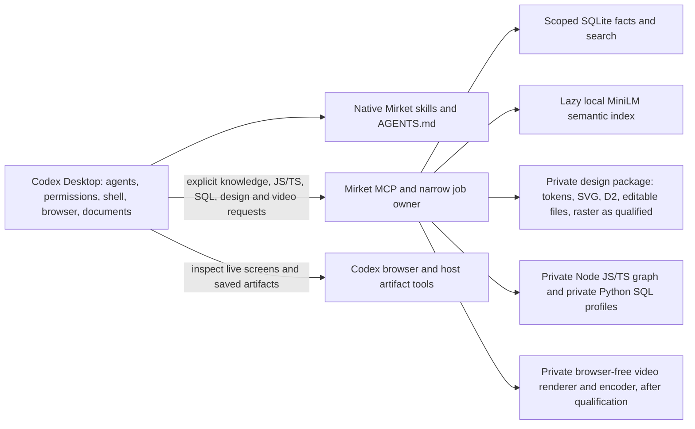

# Codex-native simplification review

**Status:** Historical simplification review, 2026-10-25. It records decisions 84–90, including a no-Chromium/browser-free direction that [decision 93](decisions.md#decision-93--restore-private-chromium-and-full-designvideo-route) subsequently reversed. [Decision 97](decisions.md#decision-97--acquire-bulky-tools-during-setup-stop-the-chromium-source-build) selected setup-acquired Chrome for Testing. The [revised consolidated plan](implementation-plan.md) owns current scope. This review is evidence of the earlier decision process, not an installation or publication instruction.

## The decision

The [previously approved implementation baseline](implementation-plan-2026-10-24-historical.md) made Mirket ship a complete private browser, document, design, video, and language-tool distribution on macOS ARM64 and Windows x64/ARM64. That was the principal cause of the open-ended qualification work. The rewrite [is not an installable release](../README.md); the current Codex Desktop installation still uses the older harness. Continuing to qualify every proposed engine is unlikely to produce a clean 0.0.1 soon.

**Working direction:** make 0.0.1 a Codex Desktop companion for *curated, source-backed project knowledge, bounded JS/TS and SQL navigation, meaningful design production, authored video export and focused skills*. Keep the already working Rust MCP/SQLite memory core and deliberately bounded private tool packages. Codex owns agents, permissions, code editing, shell/Git, browser interaction, document work, other language navigation and review. Mirket does not proxy Codex's tools. This changes earlier choices about Mirket-owned browser and document binaries; complete scope agreement comes before code removal.

This is a recommendation, not a claim that every Codex capability is available on every account, host, or task. The desktop browser is app-provided; Computer Use, memories, plugins and document sessions have availability or permission conditions. Bundled workspace runtimes are useful *inside this host session*, not a supported binary dependency for Mirket to embed or redistribute.

## What this Codex Desktop session already provides

| Capability observed or documented | Enough to replace | Boundary to keep visible |
| --- | --- | --- |
| Local project folders, transcripts, `AGENTS.md`, native skills, configurable MCP client and [subagents](https://learn.chatgpt.com/docs/agent-configuration/subagents.md) | Mirket's release-bound guide facade and any future duplicate model/task/worktree machinery | Native skills still need good trigger and evaluation cases. The rewrite already leaves agents and model choice with Codex; there is no existing Mirket model router to remove. [Projects](https://learn.chatgpt.com/docs/projects.md), [skills](https://learn.chatgpt.com/docs/build-skills), [MCP](https://learn.chatgpt.com/docs/extend/mcp.md). |
| Integrated terminal, file edit, Git/diff/review and managed worktrees | Mirket file read/replace, process command execution, Git/worktree ownership and general job receipts | Project-specific commands may still require the user's toolchain and host permissions. [Terminal](https://learn.chatgpt.com/docs/integrated-terminal.md), [review](https://learn.chatgpt.com/docs/code-review.md), [worktrees](https://learn.chatgpt.com/docs/environments/git-worktrees.md). |
| Automatically installed, separately profiled desktop browser with rendered inspection, interaction and screenshots; browser Computer Use is exposed in this session | Mirket private Chromium/Playwright for ordinary browsing, local page preview and visual UI verification | Browser is Desktop-only, account/policy-controlled, and does not promise the exact headless Playwright API or automatic file uploads. Keep project Playwright as a project dependency only where a test suite truly needs it. [Browser](https://learn.chatgpt.com/docs/browser.md). |
| Current first-party image generation plus UI/browser inspection | General-purpose raster ideation and visual comparison workflows | Does not replace deterministic pixel transforms, editable vector files, or a codec pipeline. [Image generation](https://learn.chatgpt.com/docs/image-generation.md). |
| Available documents, PDF, spreadsheet and presentation skills; bundled versioned Node/Python libraries for those tasks; local LaTeX editor/compiler; artifact sessions where enabled | A Mirket-owned general Office/PDF/OCR runtime for routine document work | Actual operation depends on task, session and file format. The document-control connector currently has zero connected document sessions. A bundled cache path is not a stable public runtime API. Verify saved artifacts with native workflows. |
| Optional [local Codex memories](https://learn.chatgpt.com/docs/customization/memories.md) and durable `AGENTS.md`/project documentation | Ambient cross-chat preferences and required guidance | Local memories are off by default, generated asynchronously from eligible chats, and do not expose Mirket's explicit per-record scope, source revision, correction, forgetting and restore contract. This is the one plausible Mirket runtime distinction. |
| This host's built-in web research, image generation, app/plugin connections and visualization capabilities | Research, first-pass visual concepts and live inspection | Tools and connections vary by account and policy. These complement Mirket's deterministic design package; they do not replace editable design files, controlled fonts/tokens or validated exports. |

The read-only `load_workspace_dependencies` call in this session reported bundle `26.1017.22136` with private Node, Python, Git, pnpm and packages for document/image/browser workflows. This is evidence of *current host task capability*, not an installation contract. The current callable tools also expose terminal commands, worktree/task control, image generation, browser computer use, tools for document/slide/sheet sessions and a built-in LaTeX compiler; session-backed operations still require an open or connected artifact.

The versioned bundle observed here contains Node **24.19.0** and Python **3.12.14**. Package metadata shows **Sharp 0.35.5, PptxGenJS 4.0.1, artifact-tool 2.8.99, Playwright 1.62.1 and pdf-lib 1.17.1** on the Node side; **python-docx 1.2.0, openpyxl 3.1.5, pandas 2.2.3, reportlab 4.4.9, pdfplumber 0.11.9, pypdf 6.10.0, pypdfium2 5.14.0 and Pillow 12.3.0** on the Python side. The review discovered these versions but did not run every artifact workflow or prove identical availability on another Codex installation. They should be used through supported host workflows, not hard-coded as private Mirket executable paths.

No equivalent host guarantee was verified for exact multi-language definition/reference graphs, offline seven-language OCR with source coordinates, native editable OpenPencil files, deterministic D2/TALA exports, imported-PDF transactional edits, or MP4/WebM/GIF rendering with supplied audio. Mirket retains its bounded JS/TS-family and SQL navigation, design and authored-video outcomes. OCR and general document work move to host workflows without claiming identical offline coordinates or arbitrary-PDF edit fidelity. The video renderer still needs qualification.

## Concrete cuts and tradeoffs

“Implemented” below means source exists and some local/disposable-home verification exists. It does **not** mean the rewrite is the active GUI installation or a complete three-platform release. “Candidate” means a proposal, prototype, or incomplete admission. The [runtime status](../src/server.rs), [release components](../src/distribution.rs), [Cargo dependencies](../Cargo.toml), [npm dependencies](../adapters/package.json), and [admission records](../packaging/admission) are the owning inventory.

The rewrite already assigns agents/models, shell/Git/builds and Office editing to Codex; there is no Mirket model router, shell sandbox or LibreOffice/UNO package to remove. The cuts concern the second tool platform Mirket has actually started building. Its release enum currently has six components: documents, diagram, design, semantic, Python navigation and C/C++.

| Mirket owner / dependency | Current state | Proposed 0.0.1 action | Deliberate loss or condition |
| --- | --- | --- | --- |
| `rmcp`, Rust CLI/setup/update, bounded memory transactions, SQLite/FTS, sqlite-vec + ONNX/FastEmbed/MiniLM | Implemented; Mac disposable-home memory and bilingual retrieval evidence | **Keep scoped facts and lazy hybrid retrieval.** Retain explicit record scope, source/revision, supersession, forgetting and recovery; initialize the semantic path on demand, not every session. Measure post-use idle and combined workloads before changing the model or lifecycle. | Native Codex memory is useful ambient context but is not a deterministic canonical record API. The model has real package/peak-memory cost, which the user accepted for its demonstrated bilingual recall. [Memory evidence](../docs/m2-semantic-qualification.md). |
| Mirket guides, release-bound `guides_list`/`guide_read`, reference ingestion and thirteen-guide program | Shared guides exist; full source adaptation and held-out evaluation remain open | **Move authored guidance to Codex-native `AGENTS.md` and selectively triggered skills.** Keep the rights/provenance catalog as authoring data, not runtime machinery. | Release-bound guide IDs and a central custom catalog disappear; test skill triggers/non-triggers in Codex. |
| Private Node 24 and the shared TypeScript adapter: Style Dictionary, SVGO, TS/JS/HTML/CSS source inspectors, Playwright core | Implemented adapters and Mac design qualification; the one npm lock currently mixes design with browser/code tooling | **Keep one private Node runtime for selected design operations and JS/TS-family navigation.** Prune browser and unselected source-inspection dependencies from the adapter/lock while retaining the pinned TypeScript language-service path. | Node and its selected dependencies remain a real packaged maintenance cost; no host-cache paths or global Node fallback. `playwright-core` leaves with Mirket browser tools. [Design qualification](../docs/m4-design-qualification.md), [adapter package](../adapters/package.json). |
| Mirket `file_read`, range expansion, text-replace-copy, JSON/TOML/XML/YAML/Python/shell structure tools | Implemented and tested on Mac | **Remove as public MCP tools.** Codex already reads/edits files and can run focused project commands. | Exact pointer/byte-span and no-execution guarantees cease to be a Mirket product contract. Host permission and normal review apply. [Public tool surface](../src/server.rs). |
| Selected-source TypeScript, Python/Jedi, C/C++/clangd+SDK navigation; SQLGlot profiles; proposed native TS7, rust-analyzer/compiler, Ty/Pyright, Bash LSP, PowerShell/PSES, Vue/Volar, Angular and Astro/WASI | Bounded JS/TS-family graph passes focused source/worker tests but its new-schema installed MCP remains open; five SQL dialects passed disposable Mac installed checks; broad matrix unfinished | **Keep only JS, TS, JSX and TSX selected-source inspection/navigation through the pinned TypeScript 5.9.3 adapter, plus SQLGlot's five bounded offline dialect profiles.** Remove Python/Jedi, C/C++/SDK and the other proposed analyzers from release obligations. Codex/project toolchains own navigation for all other languages. | Neither retained path proves whole-project semantics. The caller explicitly supplies JS/TS imports and SQL schemas; unsupported constructs refuse. New-schema JS/TS installed, Codex client and Windows gates remain. [TypeScript graph](../docs/m3-typescript-semantic-navigation.md), [SQL profiles](../docs/m0-sql-qualification.md). |
| Mirket private Chromium, Playwright, browser sessions/capture receipts/Readability | Adapter and local candidate; browser source/redistribution admission incomplete | **Stop packaging Chromium and remove Mirket browser operations, profiles, capture receipts and `playwright-core`.** Use Codex Desktop's separate browser for research and design inspection. | No Mirket-owned saved-profile or deterministic headless API contract. Project E2E tests can retain their own Playwright dependency. Historical browser candidate (superseded by the setup-acquired route). |
| Private CPython, pypdf/PDF operations and proposed Docling/Tesseract/Typst/OpenCV document/OCR stack; SQLGlot is a separate navigation consumer | Mac PDF/SQL source paths exist; extraction/OCR/Windows release gates open | **Keep the already selected private CPython runtime solely for retained SQLGlot navigation.** Move document creation, editing, extraction and PDF work to Codex/host tools; cancel the bundled OCR/document-engine roadmap. Separate SQL from the old `documents` release component without duplicating Python. Add a document helper only for a repeated measured host gap. | No Mirket guarantee of seven-language offline OCR with coordinates, imported-PDF edit fidelity or identical Office engines. SQL still carries its own private Python packaging/Windows gate. [Python runtime](../packaging/admission/m3-python-macos.md), [SQL profile](../docs/m0-sql-qualification.md). |
| D2 with admitted layouts, resvg, Style Dictionary, SVGO, controlled fonts; planned OpenPencil file/SDK and Sharp/libvips | D2, tokens, SVG optimization and SVG-to-PNG pass Mac disposable-home tests; editable design and raster preparation remain unqualified | **Keep one Mirket design package.** Preserve implemented token/vector/diagram operations. Continue OpenPencil as the editable-design candidate and Sharp only for concrete raster preparation/export needs; qualify exact dependencies before packaging. Use Codex's browser for live UI inspection, not a second browser. | Source reopening, visual fidelity, typography, export formats, project integration and Windows behavior still require evidence. An optimized SVG or renderer exit is not design acceptance. Do not bundle broad tool families merely because a design reference mentions them. [Design qualification](../docs/m4-design-qualification.md), [plan](implementation-plan.md#concrete-capability-and-evidence-contracts). |
| HyperFrames/Puppeteer/FFmpeg/codec build and animation references | Browser-backed local candidate; no admitted release payload | **Keep Mirket-owned authored-video export from editable vector/timeline source, but retire HyperFrames/Puppeteer as the active renderer direction.** Qualify one browser-free Lottie frame renderer and controlled encoder against the retained output contract. | HTML/DOM render parity is no longer a standalone-video promise. No replacement has passed the complete release contract. [Historical candidate evidence](../docs/m3-motion-video-qualification.md). |
| Cross-component heavy-job admission, process-tree supervisor, release manifests, multi-runtime licensing/update closure | Implemented for several finite workers; broad product still incomplete | **Shrink to retained memory, navigation, design and video jobs.** Keep process ownership, cancellation, source/destination checks and receipts only for retained local effects. Remove browser/profile and abandoned analyzer/document branches. | Setup/update still needs drift checks, rollback and data preservation. Avoid rebuilding a generic multi-engine scheduler. [Architecture baseline](implementation-plan.md#runtime-and-installation-topology). |

### Retained design workflow

The private package should earn its place through outputs Codex alone does not reliably produce. A design task starts from a selected brief/reference and real content; the skill asks Mirket for only the needed deterministic operation. The retained path is: project-owned tokens compiled by Style Dictionary; SVG cleanup/export and resvg previews; D2 source plus reproducible diagram output; controlled fonts and explicit local assets; and editable OpenPencil create/reopen/edit/export if its file-mode route qualifies. Sharp is a candidate for repeatable crop/resize/composite/format work, not a reason to ship every image feature up front. Codex supplies creative judgment, code integration, image generation when useful, and live browser inspection of responsive behavior. Mirket keeps saved-source and output revisions, bounded jobs and no partial replacement for its own effects. The actual design or screen must be inspected; hashes and tool receipts alone do not prove quality.

This is one design package, not a new browser, editor service or workflow engine. The exact OpenPencil export set, raster operations, fonts and platform package closure are still design-scope questions. OpenPencil's explicit file-mode route must be qualified without silently attaching to a user's running editor; a desktop route may have OS WebView prerequisites, which do not reinstate packaged Chromium. An editable design source should reopen and accept a representative component/layout change before the capability is claimed. A code/UI deliverable must work in its project and pass host browser inspection; an exported image alone is insufficient.

### Documents after this revision

Codex and its available host tools own reading, extraction, writing and editing for PDF, DOCX, PPTX and XLSX. The useful Mirket addition is a **native Documents skill**, not another Office/PDF engine: select the available format workflow, preserve editable originals, keep page/source references when extracting claims, reopen the saved artifact, inspect rendered pages and compare important table cells/formulas with the source or independent values. For scanned or visually complex files, ask the host to inspect relevant page images and mark uncertain text rather than promising complete OCR. Add a small deterministic helper only after a repeated, concrete failure cannot be handled by an existing host tool. No seven-language OCR model bundle, general extraction worker, or automatic imported-PDF reflow belongs to this revised scope.

The current lockfiles contain 226 external Cargo packages and 135 npm package entries; those are *current counts*, not a projected post-cut count. The [Mac design runtime manifest](../packaging/admission/m4-design-macos.runtime.json) is 82,095,495 bytes/6,245 files and [private Node](../packaging/admission/m0-node.md) is 122,703,465 bytes; **these remain** for selected design and JS/TS operations. The selected private [CPython runtime](../packaging/admission/m3-python-macos.md) adds 46,698,348 bytes for SQL, and [SQLGlot](../packaging/admission/m3-sqlglot.md) is a 792,162-byte wheel before its accompanying source/notice inventory. Prune browser and unrelated source packages from the shared adapter. The abandoned browser source candidate alone is about 379 MB of runtime files. The [disposable release startup study](../docs/m3-verified-startup-latency.md) used a 551,208,448-byte release with several components. The proposed 446,768,217-byte C/C++ package left the release path; its qualification files were removed from source after a recoverable source snapshot. The unadmitted [HyperFrames development closure](../docs/m3-motion-video-qualification.md) of 86,891,937 bytes is a historical comparison, not the projected cost of the replacement renderer. These figures have different inclusion boundaries and must not be added into one claimed package total. Actual savings must be measured after source and payload pruning.

The retained [semantic model qualification](../docs/m2-semantic-qualification.md) is also costly: 122 frozen bilingual cases passed, but the measured process peak was about 1.30 GB RSS, cold load 5.27 seconds and warm recall p95 227.5 milliseconds. The user chose this lazy hybrid path over FTS-only or Codex-only memory to preserve demonstrated English–Turkish paraphrase retrieval and explicit canonical facts. Loading on demand is a startup policy, not proof that memory returns to baseline after a request; measure post-use idle, two-client and combined design/video/navigation workloads before any optimization claim. Do not add a memory service or switch models speculatively.

## Replacement topology and bounded finish line

The `.mirket` home remains for Mirket-owned memory data, versioned executable and selected design/navigation/video payloads. Setup/doctor/update must touch only Mirket files and the one Codex MCP registration, preserve user edits and canonical data, and have an uninstall that leaves data unless explicitly removed. Codex-native skills use its supported skill discovery path; no parallel catalog protocol. No Claude integration, VM, packaged Chromium, document/OCR Python runtime or model router belongs to this working scope. One private Node serves design and JS/TS; one private Python serves SQL only.

After full scope agreement, pruning should remove browser and document/OCR public tools, payloads and associated ownership; retain only selected JS/TS-family and SQL navigation; move useful guides to native skills; and retain only memory/navigation/design/video effect safety. The finite memory acceptance sheet remains: save/correct/enumerate/read across two chats; linked-worktree sharing and clone isolation; stale/concurrent/lost-response mutations; forgetting after old-backup restore; frozen bilingual recall; two-client cold/warm/idle behavior. Navigation must complete the new-schema installed JS/TS graph and Codex-client journey, all five installed SQL profiles, stale/unsupported refusal and native platform checks without claiming whole-project coverage. The design sheet adds token output referenced by a real consumer, SVG before/after inspection, a saved D2 diagram, controlled-font rendering, and an editable OpenPencil create/reopen/edit/export case if retained after qualification. The video sheet requires saved editable source and supplied assets, deterministic selected frames/timing, verified audio synchronization and captions, inspected playback of each retained export format, browser-free operation, cancellation and cleanup. Host browser inspection checks actual responsive output; it does not require Mirket Chromium. Disposable install/update/rollback/uninstall must leave unrelated Codex configuration and user data unchanged. Run tests against the final narrowed artifact, rerunning only checks affected by repairs. If Windows access is unavailable, do not claim Windows release support. Stop when the agreed matrix passes or report the exact blocker. No publication follows automatically.

The old plan's browser, document/OCR and broad language-analyzer distribution obligations would be superseded by this revision; its scoped memory, bounded JS/TS-family and SQL navigation, design and video outcomes remain, with narrower tool inventories to be agreed. Source and evidence are retained until cleanup is reviewed, but unselected prototypes should not stay in release code as hidden fallbacks. The completed TypeScript graph and Apple SDK work remain preserved at the pause point; Apple SDK navigation is historical implementation evidence, not a selected release capability.

### Accepted video source and renderer qualification

The user selected an editable vector/timeline source for standalone video, with a bounded Lottie feature set. HTML/CSS/DOM animation remains live project work, inspected through the Codex browser, with no automatic parity in exported video. The qualification target is a project-owned Lottie composition (`.lot` or `.json`) and local visual assets, with supplied audio and timed captions as separate source assets. Keep any export-settings record minimal; do not build a second animation language or editor. Reopening and changing the source must visibly alter the rendered result.

The [HyperFrames candidate](../docs/m3-motion-video-qualification.md) uses Puppeteer and is historical evidence, not the active production direction. [ThorVG](https://github.com/thorvg/thorvg) is the first browser-free candidate because it documents native headless Lottie frame selection and modular loaders; its [CLI tools](https://github.com/thorvg/thorvg.cli-tools) demonstrate GIF conversion but not the full requested video/audio/caption pipeline. [Skottie](https://docs.skia.org/docs/user/modules/skottie/) is a native Lottie comparator if ThorVG fails representative visual fidelity. [rlottie](https://github.com/Samsung/rlottie/blob/master/README.md) is archived and unsupported, so it should not be a release candidate. A separately qualified [FFmpeg](https://ffmpeg.org/ffmpeg.html) build could encode rendered frames and mux supplied audio/captions. This is a comparison and qualification order, not an approved dependency or an assertion of measured package/performance advantage.

Run one bounded end-to-end qualification before selecting exact renderer/codec dependencies: author and edit a representative Lottie source, reopen it, render chosen frame times, verify typography and transparent layers, inspect MP4/WebM/GIF/PNG outputs, supplied audio and caption timing, and exercise offline/headless operation, refusal for unsupported Lottie features, cancellation and cleanup. Reject or explicitly bound dynamic expressions and remote assets rather than executing or fetching them implicitly. Measure package and resource cost, license/source closure and native macOS/Windows behavior. A renderer or codec receipt alone cannot pass the gate. If ThorVG fails the visual/authoring fixture, compare Skottie on that same fixture before changing the format or adding another framework.

### Accepted navigation scope

The user chose the narrow middle path: Mirket keeps the pinned TypeScript 5.9.3 selected-source path for JavaScript, TypeScript, JSX and TSX, plus the bounded offline SQLGlot profiles for `postgres`, `sqlite`, `mysql`, `tsql` and `duckdb`. These are exact queries over explicitly supplied saved sources, imports or schemas, not whole-project or live-database discovery. The [new TypeScript graph schema](../docs/m3-typescript-semantic-navigation.md) still needs installed public MCP and Codex-client verification; the [SQL profiles](../docs/m0-sql-qualification.md) passed Mac installed checks but not native Windows. One private Node runtime serves retained design and TypeScript work. One selected CPython runtime remains for SQL, without the document/OCR/Jedi closure. C/C++, Python, Rust, Bash, PowerShell, Vue, Angular, Astro and the remaining language analyzers leave the proposed Mirket release; Codex and project toolchains handle those languages. Their code and evidence remain untouched until the final scope is approved and cleanup can be reviewed.

### Accepted memory scope

Mirket retains scoped, correctable, source-linked facts with SQLite/FTS for exact and lexical retrieval plus the already qualified local multilingual semantic path for paraphrase recall. Initialize the semantic model only for relevant indexing/recall; preserve existing record identity, correction, forgetting and restore semantics. The selected model/ONNX runtime is [172,668,906 bytes](../packaging/admission/m2-semantic.md) and the measured Mac process peak was about 1.30 GB RSS. Those are known costs, not a reason to restart model selection without a failed acceptance workload. Post-use idle and combined-load evidence remain release gates. No new memory framework or vector service is selected.

### Accepted design outputs

The user selected responsive UI work, editable OpenPencil files, vector assets and D2 diagrams as Mirket-owned design outcomes. The implemented Mac core covers Style Dictionary tokens, SVGO, SVG-to-PNG with resvg and D2; controlled fonts/assets and a small set of deterministic raster operations may support those outputs. OpenPencil file create/reopen/edit/export and exact Sharp operations remain qualification work, not completed features. Codex's browser inspects working interfaces and host document tools own paged artifacts. No parallel browser, general page-layout engine, remote diagram service or animation editor belongs to the design package merely because a prior reference mentions it. The acceptance case must reopen and change an editable source, inspect resulting pixels and check a real responsive UI in the host browser; tool receipts alone cannot pass.

### Accepted native skillset

The user chose all thirteen focused guides as Codex-native skills. Preserve their specialist guidance and held-out trigger/output evaluation, while removing Mirket's custom MCP `guides_list`/`guide_read` facade, release-bound guide IDs and selection protocol. The [selected reference catalog](references.md) remains pinned authoring/provenance evidence, not a runtime installer or automatic dependency set. Existing Codex-native skills and host capabilities may coexist; the Mirket versions must have distinctive triggers, accurate ownership and useful task outputs rather than duplicate general host instructions. The thirteen areas remain Engineering, Verification, Research/context, Interface/visual design, Motion, Product/marketing, Documents/artifacts, Memory, Security/privacy, Reliability/delivery, Data/analysis, AI evaluation and Planning/coordination. No skill grants account, filesystem, model or external-effect authority.

### Consolidated plan for review

The major product-scope choices are now recorded in the [proposed consolidated implementation plan](implementation-plan.md). It names the retained tool/skill surface, current versus unqualified behavior, dependency and platform gates, cleanup order and actual Codex-client acceptance. Qualification may reject a candidate renderer or design operation without silently replacing the user's retained outcome; a material capability change returns for a product decision. Implementation and installation changes remain paused until the replacement plan is agreed.
