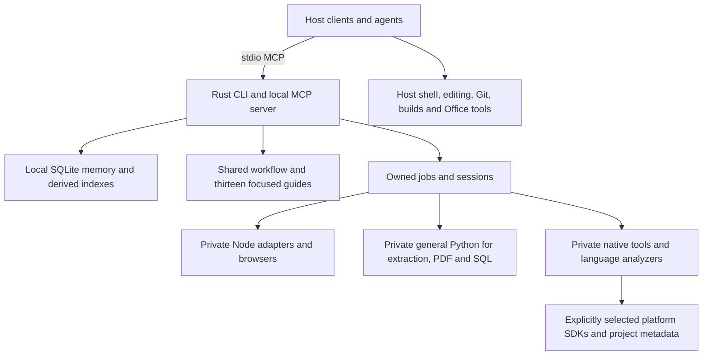

# Mirket rewrite — implementation plan
**Historical approved baseline, superseded for execution by the [proposed consolidated plan](implementation-plan.md).** Preserved from the verified 2026-10-25 plan-revision-2 source snapshot so dated reviews and prior decisions retain their original section targets. Later decisions restored selected browser/design/HyperFrames outcomes in a changed topology; use the active plan, not this historical sequence, for current implementation obligations.

Approved 2026-10-24; Codex-only host and exclusive language scope confirmed 2026-10-25 under decisions 80–82. **Execution paused after the 2026-10-25 TypeScript graph and Apple SDK navigation milestone for a Codex-native simplification review.** Decisions 84–85 keep Mirket design machinery and authored-video export, move document work to Codex/host tools, and abandon Chromium packaging; a browser-free video renderer and its editable source format still need agreement and qualification. The capability and distribution obligations below are the prior approved baseline, not a queue to resume while the review is open. See [the working simplification review](codex-native-simplification-review.md) for the revised scope and remaining choices. No further dependency admission, packaging or feature implementation is scheduled until that scope is decided.

This is the execution plan for the fresh `/Users/nazmiyilmaz/Projects/harness-rewrite` repository. It consolidates decisions 1–82 without replacing the user's choices. Complete-plan approval accepts the operating defaults and MIT license below; exact production dependencies remain separate admission batches. Keep the old repository, commit, installation and client settings untouched. No commit, push or publication is authorized.

## 1. What we are building

A capable local harness for Codex Desktop: selected expertise, durable project memory, source-aware navigation, browsing, design, documents and video. The host owns agents, models, permissions, shell execution, edits, Git and project builds. Mirket owns its local tools and their lifecycle.

Ship one complete private distribution of Mirket-owned tools for each of macOS ARM64, Windows 11 x64 and Windows 11 ARM64. Install under the user's home `.mirket`. No VM, WSL, container, cloud database, model router, agent scheduler, always-running broker, optional tool-pack manager or global-tool fallback. Headless is preferred where reliable; visible workflows remain supported where needed. These are host processes, not an OS sandbox.

Keep one primary implementation per capability. Retain every agreed capability; 0.0.1 is the clean release number, not an MVP allowance. If a selected engine fails a required behavior, resolve that boundary before building dependent features. Do not quietly cut scope or accumulate fallback engines.

## 2. Architecture and ownership

Use one Rust crate with focused modules and one TypeScript adapter package compiled to JavaScript. Use official MCP libraries, ordinary typed adapter messages and existing tool APIs. Do not implement another protocol, semantic engine or workflow framework. Recommend npm with one lockfile for the adapter package, and Node 24 LTS for qualification; freeze the exact patches in the dependency inventory. Node's published policy supports LTS for production, and 24 is currently LTS. [Node release status](https://nodejs.org/en/about/previous-releases).

The Rust owner resolves projects, validates requests, coordinates owned work, maintains state, performs setup/update and reports results. Tool processes receive explicit executable paths, working directories, arguments, profiles and caches. Keep native dependencies architecture-compatible within each process. On Windows ARM64, x64 browser/ML workers remain individually qualified exceptions; the core stays native.

Decision 79 assigns Office creation, editing, recalculation, rendering and export to available host tools. Mirket packages one general Python runtime for its extraction/PDF/SQL operations; it does not package LibreOffice, UNO or an Office interpreter. Host document capabilities and process lifecycles remain host-owned, outside Mirket job admission. Check the actual host tools and report gaps rather than promise a uniform Office engine. General PDF/SQL work must not initialize ML models. SDK access follows decision 74: selected external Apple SDKs for C/C++, and Windows SDK/MSVC components for Microsoft-targeted C/C++. SDKs are neither automatically installed nor bundled as OSS dependencies.

## 3. Product contracts to preserve

| Area | Required behavior |
| --- | --- |
| Memory | SQLite canonical facts, preferences and compact task state; FTS5 plus local semantic retrieval; explicit scope, revisions, sources, current/historical validity and supersession. Host-agent curation, no passive transcript harvesting or implicit LLM extraction. |
| Project identity | Use host workspace or explicit selection; ask only for ambiguity. Share repository knowledge across verified linked worktrees, with checkout-specific task/index state. Independent clones do not merge by remote/name. Verified moves preserve identity; uncertain moves/copies require clarification. |
| Navigation | The exclusive first-release targets are Python, Rust, TypeScript, JavaScript, C, C++, Bash, JSON, HTML, JSX, TSX, CSS, TOML, XML, PowerShell, Vue, Angular, Astro, SVG and YAML. SQL navigation uses the five qualified bounded profiles `postgres`, `sqlite`, `mysql`, `tsql` and `duckdb`; per-dialect limits remain explicit. Distinguish syntax/structure from qualified symbol search, definitions and references; return original revision-bound locations and explicit incomplete/unsupported results. No implicit builds, plugins, generators, macros or installs. |
| Browsing | Package Chromium as the sole browser engine. Temporary owned sessions by default, optional explicit saved profiles, exclusive profile use, no personal-cookie/profile import. |
| Design and motion | Editable design files, code/native visual outputs, tokens, controlled fonts, diagrams, images and accepted exports. CSS/WAAPI/Motion/Anime for authored motion; HyperFrames/FFmpeg for video and supplied audio. No automatic voice generation or transcription. |
| Office and PDFs | Host-owned Office editing/recalculation and source-based PDF pagination through verified host capabilities. Verified bounded edits in imported PDFs; explicit reconstruction for larger changes. No promise of general arbitrary-PDF reflow. Preserve unaffected content and verify saved text plus rendered output. |
| Artifacts | New output copy by default; honor explicit in-place requests. Detect changed source/destination, stage before finalization, and preserve originals on failure. Never replay an uncertain external effect automatically. |
| Data lifecycle | Keep durable memory until explicit forgetting. Up to seven daily/four weekly backups and required pre-migration recovery points under the aggregate 5 GiB cap. Scope-specific restore, forgetting precedence and protected last-good recovery points. |
| Permissions/network | Host permissions remain authoritative. Browsing uses authorized network access; authored rendering uses prepared local assets. Local memory/navigation/extraction cannot fetch missing packages or models. No automatic telemetry or update discovery. |

The [host/tool/evidence contracts](proposal.md#host-tool-and-evidence-contracts) define guide delivery, per-operation scope, jobs, ownership, artifacts and recall. They are required implementation behavior under decision 77. Exact SDK versions and field schemas are frozen per qualified slice, not assumed from a protocol URL.

The complete capability details remain in [the design](proposal.md), [decisions](decisions.md) and [toolchain evidence](toolchain-proposal.md). These references preserve details rather than introducing additional execution plans.

## 4. Practical starting defaults

These are configurable engineering starting points, not measured performance claims. Validate them on the reference machines. Tuning requires evidence and a recorded reason; a material product/scope change returns to the user. Never relax a correctness or data-preservation gate to meet a latency target.

| Setting | Proposed starting value and behavior |
| --- | --- |
| Platform qualification floor | macOS 15 on ARM64; Windows 11 25H2 on x64/ARM64, plus current supported releases in the test matrix. Exact client versions are captured in M0. If a required client/tool cannot run at the proposed floor, report that before changing it. |
| Evaluation machines | 16 GiB Apple Silicon Mac and 16 GiB Windows x64/ARM64 machines with SSDs. Record exact chip, OS, client and background workload. This is a reference configuration, not an asserted minimum RAM requirement. |
| Heavy jobs | Two concurrent memory-intensive jobs across the installation, including render/export/ML extraction, embedding rebuild and analyzer initialization; up to eight waiting. Count a job once even if it uses several categories; reserve analyzer/browser slots atomically with its admission so a queued job does not hold scarce resources. Excess work reports busy/retry. Bound internal fan-out. |
| Language analyzers | Up to two live language-server processes across clients. Reuse within the same owning connection and valid checkout/release only. Five minutes is maximum idle retention; reclaim an idle analyzer immediately for a valid waiter. Queue when both are busy; never substitute text search silently. |
| Resource admission | Soft target of 8 GiB aggregate Mirket process-tree memory on the 16 GiB references. Defer new heavy work when over budget or the OS reports severe pressure; do not kill active jobs to enforce an invented hard limit. Measure platform accounting and internal child fan-out. |
| Browser sessions | Up to two live owned sessions by default. Close after 15 minutes without tool activity or an explicit interaction hold. A visible user-interaction hold lasts up to 60 minutes and can be renewed; active operations are protected. Do not infer input activity if the backend cannot observe it. |
| Cancellation/disconnect | Explicit cancellation may allow up to five seconds for graceful shutdown, followed by owned-descendant termination. Abrupt disconnect may allow no grace: correctness relies on crash-safe ownership/commit records and next-launch reconciliation. No durable execution resumption; never kill by process name. |
| Deadlines | Queue wait: 60 seconds by default, separately reported from execution. Ordinary browser/navigation execution: 60 seconds; analyzer initialization/indexing and OCR/PDF: 10 minutes; video: 30 minutes. A caller may select longer bounded deadlines before launch. Long work uses bounded start/status/cancel/result calls; waiting does not require one long MCP RPC. Preserve evidence on timeout and never replay uncertain effects. |
| Embedding lifetime | Lazy per-server model loading; release after five idle minutes, earlier under pressure when no inference is active. Rebuilds use heavy admission. Measure concurrent Codex sessions after semantic use; no new model daemon. |
| Recall delivery | Default at most 20 result excerpts within 32 KiB of UTF-8 text, plus bounded source references and explicit truncation/coverage metadata. Critical applicable constraints take priority; provide pagination/focused reads for more detail. This is an output budget, not a model-token guarantee. |
| Logs | Seven days and 50 MiB aggregate, whichever trims first. Redact before persistence; no raw project/document/memory content by default. Bound child stderr/stdout separately. |
| Derived caches | 10 GiB aggregate target, reclaim least-recently-used eligible state. Exclude durable memory, saved profiles, protected recovery and active work. Preserve decision 65's 30-day unavailable-project grace; if protections prevent reclamation, report pressure and defer cache growth. |
| Temporary operations | Clean abandoned, confirmed-unowned scratch after 24 hours during ordinary maintenance. Protect recovery records and unfinished outputs; never delete user-designated artifacts. No cleanup daemon. |
| Retained releases | Active release plus one previous verified release, and at most one staged candidate. Retain extra files only while active ownership/recovery requires them. Use actual byte reservations for download, extraction and recovery; no assumed small installation footprint. |
| Backup scheduling | At an eligible operation boundary, create at most one due daily recovery point per scope; weekly points may reference the same verified snapshot without duplicate byte accounting. No fabricated missed-day backups. Reserve in-progress bytes under the agreed cap and defer if protected material leaves insufficient room. |

The proposed OS floors deliberately limit the initial test matrix. Current Playwright documentation supports macOS 14+ and Windows 11+, while Microsoft lists 25H2 as supported beyond the planning date; these are inputs, not proof of the full package/client floor. [Playwright requirements](https://playwright.dev/docs/intro), [Windows servicing information](https://learn.microsoft.com/en-us/windows/release-health/windows11-release-information).

Proposed measurement targets: warm focused recall p95 under one second on a 10,000-record scope; measure a 100,000-record scope as the scale case. When idle sessions have expired, target aggregate Mirket memory below 250 MiB with two Codex sessions connected and no sustained tool CPU activity. A cancellation should acknowledge within one second under normal load. Establish cold-start and per-artifact latency baselines in M0 instead of inventing universal export-time promises. Record benchmark repetitions, output quality and pressure/swap alongside timing; failures must be resolved or explicitly accepted before release.

## 5. Dependency inventory and admission

Component direction is selected. The user has authorized production dependency installation for this rewrite; each selected addition still needs exact pins, closure, rights and qualification evidence before it becomes part of a release. **Do not install an arbitrary version because its project name appears here.**

| Boundary | Selected direction / candidate | M0 admission or qualification output |
| --- | --- | --- |
| Core | Rust stable, rmcp, Tokio, Serde, Clap, SQLite/rusqlite | Exact Cargo lock, licenses/advisories, platform build and MCP fixture. Pin the toolchain; one crate. |
| Adapter | Node 24 LTS, TypeScript, npm | Exact runtime/compiler/lockfile, native-module closure and compiled adapter. No runtime npm/npx fetching. |
| Memory | FTS5, sqlite-vec, FastEmbed/CPU ONNX and the selected multilingual MiniLM-L12-v2 private model | The pinned macOS ARM64 model passed the frozen English–Turkish retrieval gates and installed MCP smoke. Preserve the exact runtime/model identity and currentness checks; Windows, scale and idle-memory qualification remain open. |
| Browser | Playwright with its matched Chromium; Readability | Exact Chromium inventory, private launch path and browser checks on every target. Qualify x64 Chromium processes on Windows ARM64. |
| Design/image/diagram | OpenPencil file/SDK; Sharp/libvips; resvg; SVGO; Style Dictionary; D2/ELK | Native closure, editable-file round trip, fonts/tokens and rendered artifact fixtures. Use the pinned Rust resvg library in the existing owned worker for rasterization; the published Node binding lacks a verifiable native build closure. Keep SVG optimization and token compilation in the private Node adapter. |
| Motion/media | HyperFrames, Puppeteer, Anime/Motion as applicable, FFmpeg/ffprobe | Exact library/API compatibility, controlled codec build, source/notices and deterministic seekable frames/audio. Reuse private Chromium only if tested compatible. |
| Office (host-owned, not a package dependency) | Available host format-specific tools and skills | Check actual create/edit/reopen/render/export and recalculation capabilities per Codex session; independently verify saved results and report missing operations. No bundled fallback. |
| General documents | One private CPython, narrow Docling pipeline, Tesseract, pypdf, pypdfium2; Typst | Compatible interpreter/native/model closure, seven OCR languages, extraction coordinates and offline output. Qualify the proposed x64 ML worker on Windows ARM64. |
| Imported PDF edits | Qualify an OSS editing backend for the bounded contract; no bundled Office route | Exact passing cases and refusal cases. Source-first regeneration and explicit reconstruction remain available; no custom PDF layout engine. |
| SQL | Admitted SQLGlot 30.24.0, no extras | Preserve the bounded offline `postgres`, `sqlite`, `mysql`, `tsql` and `duckdb` profiles, declared schema identity, Unicode/revision-bound spans and ambiguous-name refusals; macOS evidence does not qualify Windows. |
| Semantic analyzers | Qualified private candidates for Python, Rust, TypeScript/JavaScript, C/C++, Bash, PowerShell and the selected web frameworks | Exact runtime/server pins, passive-loading fixtures and separate per-language symbol/definition/reference evidence. Syntax parsing alone does not pass navigation. |
| Structural files/fonts | Bounded grammars for the selected configuration, markup and embedded web targets; curated Noto family and complementary math/symbol/display assets | Exact licenses/pins, original syntax/position fixtures and seven natural-language rendering coverage; no all-language bundle or inferred semantic support. |

The [toolchain review](toolchain-proposal.md) and [platform matrix](platform-qualification.md) contain inspected versions and source links. Those research versions are candidate evidence, not a completed lockfile. For each admitted component, record version/revision, artifact hash, architecture, resolved runtime dependencies, selected features/extras, native libraries/assets, assembly-only tools and build/download steps, license/notices, model/font rights, private paths and the qualifying test. Measure compressed, installed and staging bytes per target from the first slice; a narrow import does not prove a narrow package closure. Resolve a full closure before distributing it.

Request approval in coherent, concrete dependency batches under the project rule, explaining additions and tradeoffs; honor any approval that already covers the exact proposal. There is no need for one architecture question per library. Propose MIT for Mirket-authored code, with upstream licenses/notices preserved separately; confirm this through complete-plan review before adding a license file. Model weights, fonts, codecs and copied reference material receive their own rights checks.

## 6. Implementation milestones

The implementing agent owns integration and verification for each milestone. Native builds and tests cover all three targets from the start. Independent work may be delegated only when authorized and useful, with disjoint ownership; no extra coordination service is part of Mirket.

### M0 — Prove the shared path, then qualify risks

After complete-plan agreement, obtain the first exact dependency approvals and authorized Windows x64/ARM64 test access. Use disposable homes, client configurations and fixtures; preserve the existing installation. Unavailable target/client access remains a gate for that target, not a reason to claim support or block unrelated local work.

**M0a — Small shared path.** On each target, prove Rust stdio → one private child → saved artifact through the actual Codex Desktop surface. Record client/SDK versions, negotiated protocol and supported facilities. Exercise one thin Engineering guide and one Documents guide through canonical discovery/read, explicit scope, a useful bounded operation and saved-result inspection. Initial fixtures need not prove complete Office/navigation coverage. Test two owners, response loss after finalization, a job beyond the documented default host timeout, abrupt client death, unrelated-app preservation, and a synthetic two-release maintenance activation/crash/reconnect. Include byte/age receipt expiry and same-conversation stale-guide requests after activation; reject stale release binding before effects and reconcile retained receipts through the current release. No custom protocol stack, public release or real-data migration is needed.

**M0b — Bounded risk slices.** Qualify each risky dependency before expanding its consumers. Successful slices can feed M1/M2 while other experiments continue; M0 is not a requirement to finish every tool before foundation work.

| Order / experiment | Passing evidence | If it fails |
| --- | --- | --- |
| 1. Passive analyzers | The selected Python, Rust, TypeScript/JavaScript, C/C++, shell and framework routes: actual definitions/references, with sentinel fixtures proving no implicit project-code execution; host preparation → identified metadata → passive refresh. | One focused repair, then one justified alternative; report an actual policy/capability conflict. Do not expand the exclusive language list. |
| 2. Extraction | General Python and Windows ARM64 worker compatibility; bounded Docling/docling.rs comparison on identical seven-language/layout/table/source-location fixtures and complete footprint. | Retain one qualified extraction engine. Change the candidate only with exact dependency approval and evidence; keep one general Python runtime. |
| 3. Browser/design/video | Private Chromium, stale-target interaction, OpenPencil editable round trip and HyperFrames moving frames/supplied audio with explicit executable/assets. | Resolve the narrow operation/package boundary; no duplicate public browser surface or hidden fallback. |
| 4. PDF/SQL | Direct replacement removes the old PDF text object and preserves unaffected content; SQL resolves declared-schema bindings and refuses ambiguity. | Keep each bounded contract and explicit refusal cases. |
| 5. Memory/native closure | Native SQLite/vector/ONNX, offline packaged assets, multilingual/currentness filtering, model release after use and bounded concurrent workload admission. | Adjust the embedded candidate from measured correctness/resource evidence. |

Each slice exits with exact dependency/feature inventory, callable operations and inspection routes, positive/failure fixtures and explicit unavailable cases. Do not claim broad support from samples. Bound research to one focused repair and, when useful, one evidence-backed alternative comparison; no deadline waives a required behavior.

### M1 — Build the shared foundation

Implement CLI/MCP, configuration, project identity, guide discovery, typed adapter messages and the shared job/session lifecycle. Implement the [shared host/tool contracts](proposal.md#host-tool-and-evidence-contracts): explicit scope and release identity, separate RPC/operation identities, queued/running/terminal job states, effect knowledge and reconciliation, bounded evidence and saved-artifact inspection. Publish finite task-oriented operation schemas and useful errors; never label an incomplete lookup exhaustive. Keep stdout valid for MCP and bound diagnostic streams.

Implement platform process ownership, private environment/path resolution, locks, source/destination conflict checks and safe artifact finalization. Coordinate limits across Codex sessions through one installation ownership/admission record and OS locking, without a broker. Live children remain connection-owned; unresolved descendants retain exclusion until reconciled. Test immediate idle-slot reclamation, queue deadlines and model unloading after use. Verify concurrent clients, PID reuse, disconnection, queue cancellation, path aliases, Unicode paths and conflicting global tools. For local project identity, combine canonical paths and filesystem/Git identity; do not claim a cross-volume copy is a proven move. Codex Desktop must invoke a real useful tool through its actual supported integration.

### M2 — Complete memory and context

Implement canonical schema/revision transactions, explicit relationships, source-linked task state, hybrid retrieval, bounded recall and host guidance. Currentness/scope checks apply after retrieval as well as during candidate selection. Derived indexes are rebuildable and carry model/record revisions; exact recall stays available during semantic rebuild with coverage reported.

Implement backup admission/accounting, daily/weekly selection, scoped restore, non-rollback content-free forgetting authority across live/derived/managed recovery state, project moves and unavailable-cache cleanup. Implement expandable revision-bound evidence, explicit critical-constraint applicability/overflow and compact task correlation/continuation; do not infer host thread identity. Test English–Turkish paraphrases, exact code/path queries, misleading neighbors, contradictory/historical facts, concurrent corrections, interrupted indexing and restore. The Podman-to-host-tools decision reversal is a mandatory current-versus-historical recall fixture. Require zero cross-project leaks or resurrection of forgotten/superseded facts in the deterministic suite; measure retrieval relevance, answerability and downstream decision correctness separately on a reviewed set of at least 100 queries. Include old restore/import after forgetting, concurrent backup completion, changed source during expansion, a decisive exception outside the excerpt and critical-constraint overflow.

### M3 — Complete the tool and artifact workflows

Expand M0 adapters to the accepted browsing, design, diagrams, images, motion/video, PDF/extraction and navigation contracts. Exercise Office workflows through available host tools and the Documents guide, with per-session capability evidence; do not add an Office adapter. Validate every selected language/file family, Chromium workflow, artifact format and seven OCR languages with representative positive and discriminating failure fixtures. Include headless and explicitly visible workflows, saved-profile ownership, edited-file round trips, formulas with independently known values, Unicode spans and cancellation during output finalization.

Use local prepared assets for authored rendering, preserve legitimate browser networking, and disable unwanted telemetry/updaters per tool. No implicit package/model/font downloads. Report platform-specific limitations rather than substitute global tools. Do not build a generalized plugin framework to connect a finite inventory of known adapters.

### M4 — Author and exercise the guides

Complete the shared workflow and thirteen focused guides begun in M0a/M1 with activation conditions, outputs, evidence and stopping criteria. The original twelve capability guides remain; Memory is a separate, selectively loaded operational guide for explicit records, scope and recovery. Reuse permission and execution rules from the shared workflow. Author fresh guidance; inspect exact source portions and rights before adapting content. The [reference catalog](references.md) retains all 52 original sources and adds six focused method references under decision 77. Exact section-level rights and mappings govern reuse; restricted Anthropic DOCX text is link-only. References do not become runtime dependencies.

| Guide | Starting reference families; use only relevant portions |
| --- | --- |
| Engineering | superpowers, matt, ecc, archify, karpathy |
| Verification | superpowers, gstack, ecc; focused Trail of Bits methods and official tool documentation |
| Research and context | openai, anthropic, google; QMD search-to-source interface; langchain/langgraph as comparisons, not runtime frameworks |
| Interface and visual design | hallmark, taste, emil, impeccable, design-anatomy, better-design and selected C/G visual families |
| Motion | anime, motion, kyle-motion, lottiefiles-motion, scroll-craft, motion-primitives, kingy-motion; GSAP/Remotion as references only |
| Product and marketing | marketing, wondel |
| Documents and artifacts | openai, anthropic, google; native format/tool documentation |
| Memory | SQLite and selected context-management references; canonical Mirket memory contracts and recovery evidence |
| Security and privacy | openai threat modeling, ecc, targeted Trail of Bits/Sentry review methods and official permission documentation |
| Reliability and delivery | gstack, ecc, archify; official platform/build documentation |
| Data and analysis | focused statistical-analysis methods; openai, anthropic, google and database/tool primary sources; validate method examples independently |
| AI systems and evaluation | promptfoo, openai, anthropic, google; selected agent-framework comparisons |
| Planning and coordination | superpowers, matt, archify, codex-practices; adhd for requested communication preferences |

These are authoring starting points, not a claim that every source supplies every listed practice. Resolve exact section mappings while writing, without copying an entire competing workflow. For each adapted section record exact source revision/file/technique, reuse basis, removed host/dependency assumptions and an acceptance case. Classify adaptable, link-only, comparison-only or rejected portions. Exercise Codex Desktop with held-out trigger/nontrigger and mixed-task cases; compare shared workflow alone against shared workflow plus guide. Inspect output correctness, unnecessary calls/questions, loaded bytes and time. Start with two or three discriminating cases per guide and expand from failures; a guide load is not a quality pass. Add accessibility and analytical-validity checks, including keyboard/focus and dependent observations. Comparisons use clean isolated contexts with matched task inputs, host/model settings, tool access and budgets. Record available configuration identities and mark opaque provider versions unknown. Freeze criteria before held-out trials, retain failures and use deterministic checks or independent artifact/decision assessment rather than worker self-report. Repeat cases when variability could change promotion; separate exploratory tuning from held-out acceptance. Exclude contaminated comparisons and do not call one lucky trial a reliable gain. No new judge service or universal repetition quota is required.

No paid model calls or upstream evaluation helpers are authorized by this plan.

### M5 — Assemble, verify and prepare distribution

Produce complete per-target packages, thin scripts and the special installation prompt. Setup/update remain Rust-owned. Test fresh setup under disposable normal-user homes, existing/unrecognized `.mirket` conflicts, managed client-entry drift, actual MCP invocation, native trust behavior, uninstall preserving data and complete offline Mirket-owned local workflows. Host-owned Office capabilities are verified separately against the tools actually available in Codex Desktop, not guaranteed by the package.

Exercise staged/busy updates, client reconnect, active-session protection, interrupted migration/activation and post-activation writes. Keep one active release and no down-migration compatibility layer. Saved browser profiles need their own tool-format compatibility checks; retaining an old release does not permit reopening a profile already upgraded by a newer engine. Refuse unsafe rollback rather than restoring old data silently.

Use the simplified GitHub Release/checksum/native verification route from decision 76. Resolve publisher accounts/signing details at this point with explicit authorization for costs or account changes. Prepare artifacts and documentation locally; **publishing remains a separate user action/authorization**.

Run the full capability matrix on the oldest proposed OS floor and current supported OS versions where accessible, Codex Desktop, and each architecture. Measure the two-heavy-job configuration, warm/cold latency, process-tree memory, package bytes and cache/backup growth with normal host activity. Fix regressions; do not claim performance or platform support from source inspection or cross-compilation.

## 7. Repository and infrastructure

Keep the [agreed layout](proposal.md#7-repository-structure): one Rust crate, `adapters/`, `packaging/`, `scripts/`, `skills/`, `tests/fixtures/`, `tests/integration/`, `docs/` and CI workflows. Modules follow owners: CLI/MCP, config/project identity, memory, guides, tools/jobs, artifacts, installation and narrow platform boundaries. No scaffold is created during this planning turn.

Development/release infrastructure consists of Git, Cargo, npm, native CI/build environments and test machines for the three targets. Produce tools in controlled assembly jobs; end-user installations consume prebuilt content. Keep one Cargo lock, one npm lock and one exact packaging inventory. Store downloaded binaries in build/release output, not source. Credentials and private test data remain outside the repository.

Use an explicit reviewed build-script allowlist during dependency assembly where required; never execute upstream helpers incidentally during review. Runtime jobs never install dependencies. Supply source/notices required by redistributed components, and review actual reachable high/critical dependency findings before release. Do not lower gates, replace evidence with scanner counts or add an unbounded security program unrelated to shipped behavior.

## 8. Completion and scope of approval

The implementation is complete only when the agreed capability matrix passes on all three targets, Codex Desktop integration works, normal-user setup/update/recovery/uninstall preserve data, and the assembled package has reviewed dependency/asset rights and measured resource behavior. Record remaining limits precisely; an unavailable Windows machine or untested adapter is not a pass. Release publication is never inferred from completion.

Complete-plan approval authorizes the rewrite in the fresh repository, including M0 qualification and implementation within this design. It does **not** authorize changes to the old harness/installation, arbitrary new production dependencies, provider accounts, spending, commits, pushes or publication. Concrete dependency batches and unavailable test access are handled when needed; routine implementation choices within the approved architecture do not need another questionnaire.

Decision 77 applies the independent review corrections. The second review checks the revised planning baseline; it cannot establish runtime readiness. The remaining unknowns are assigned work: exact dependency closure, host facilities and platform floors in M0; internal schemas and identity/locking mechanics in M1–M2; backend fidelity and full language coverage in M3; source-to-guide mappings in M4; native signing and release measurements in M5. They no longer form a circular requirement to prove executable behavior before implementation may begin. Material capability failures still return for a decision before dependent work proceeds.
