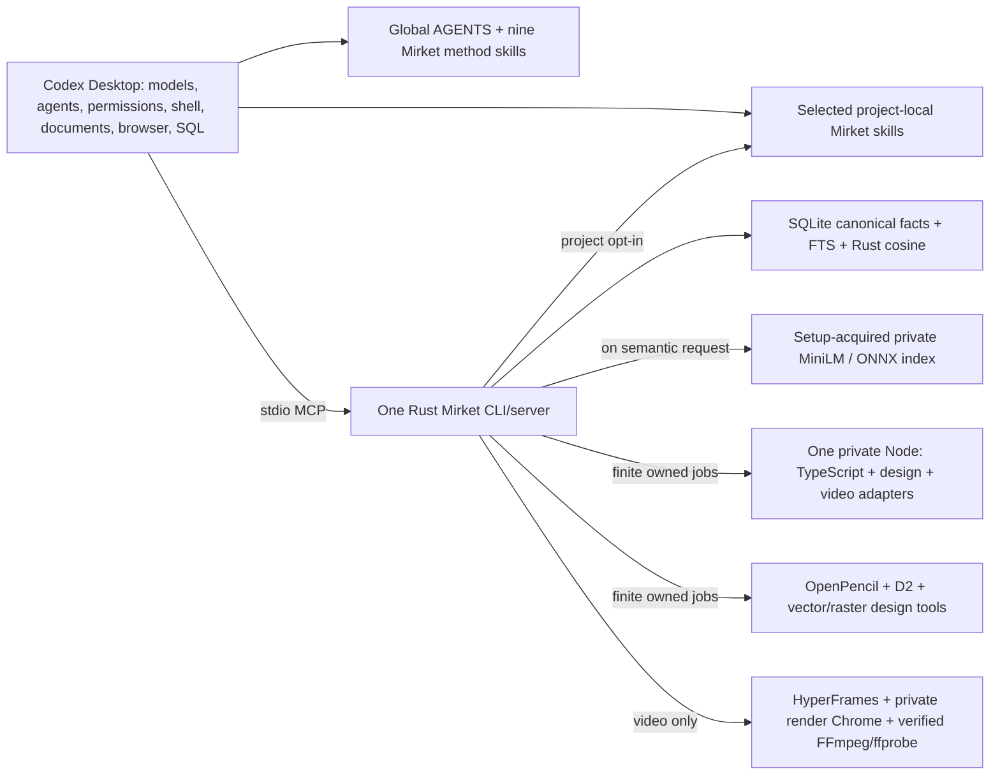

# Mirket rewrite — consolidated implementation plan

**Approved for implementation, 2026-10-25; simplification accepted 2026-10-27.** This plan incorporates [decisions 84–100](decisions.md) and the 2026-10-27 simplification decision, including setup-acquired browser and semantic assets, narrower language tooling, and explicit external native tools when private packaging is costly. It replaces the earlier broad execution baseline, which remains in the [historical plan](implementation-plan-2026-10-24-historical.md) and verified private snapshots. It governs the current `harness` repository (previously developed as `harness-rewrite`), not a claim that its current source or packages are release-ready. The former installation was separately retired and replaced on 2026-10-27. Preserve that live installation and unrelated Codex settings during development. Plan approval alone does not authorize commits, pushes or publication; the subsequent deep-review task permits focused local commits after verification, but no push, publication or live installation changes.

The user approved the [research-led improvements](research-improvements.md) on
2026-10-28. That plan adds conditional skill resources and outcome qualification
without expanding the ownership boundary or admitting new dependencies.

## Product boundary

Mirket 0.0.1 is a capable local companion to **Codex Desktop only** on macOS ARM64. Windows 11 x64 and Windows 11 ARM64 remain planned targets, gated until native installation, ownership, Codex-client, design and video qualification can run on those devices. No Linux, VM, WSL or second client is a release target. The proposed qualification floors remain macOS 15 and Windows 11 25H2; actual native tests must establish each supported platform. Installation lives under the user's home `.mirket`, through thin platform scripts and a maintained installation prompt. Codex owns model selection, native subagents and their lifecycle, permissions, terminal commands, code editing, Git/worktrees, general file read/edit and host document tools. Mirket supplies the required managed route for its own operations and coordination strategy, not a second agent spawner or permission authority:

| Mirket-owned result | Required boundary |
| --- | --- |
| Scoped project memory | Canonical SQLite facts and FTS; lazy local multilingual semantic retrieval with checked Rust cosine scoring of stored normalized vectors; explicit scope, source/revision, correction, supersession, forgetting, backup and recovery. No sqlite-vec native extension, passive transcript harvesting, remote vector database or memory daemon. |
| Bounded code navigation | Saved-source inspection, definitions and references for JavaScript, TypeScript, JSX and TSX using the pinned TypeScript 5.9.3 path. Caller-supplied imports and source revisions bind every result. Incomplete or unsupported analysis says so. |
| Private video browser | One setup-acquired, version-pinned Chrome for Testing build is available only to HyperFrames frame capture. It has no Mirket browsing, article extraction, interaction or screenshot MCP tools. Codex owns general browsing and live UI review. Google Chrome terms are disclosed before acquisition. |
| Strong design production | Editable OpenPencil source and checked exports, Style Dictionary tokens, controlled fonts/assets, SVG/SVGO/resvg vector work, Sharp raster transformations and private D2 diagrams. Deliver the selected design-system, web/icon/image, component-handoff and review outputs from the [original design contract](proposal.md#agreed-expanded-design-outputs); Codex authors project code and uses its browser or project tests to verify the live result. |
| Authored video export | Editable HyperFrames HTML/CSS/JS compositions with local vector/Lottie/media assets, supplied audio and timed captions. Use Mirket's setup-acquired render-only Chrome for frame capture after the exact version passes, then use an explicitly selected and verified FFmpeg/ffprobe pair for MP4, WebM, GIF and PNG sequences. A host-installed pair is allowed where private native packaging is costly. No separate ThorVG/Skottie pipeline is retained; HTML source is the video editing contract. |
| Native skill system and coordination | Nine concise global skills and global Codex guidance; an opt-in, project-local catalog of 58 focused skills. Skill IDs are descriptive and carry no `mirket-` prefix. The thirteen previously accepted subjects remain covered across these boundaries. Codex spawns any agents, while Mirket guidance requires task-appropriate coordination and forbids low-capability subagents for creative direction. The [skill-catalog plan](skill-catalog-design.md) defines installation, catalog coverage, source mapping and acceptance. |

Codex and available host tools handle general file read/edit, PDF, Office, extraction and scanned-document work; the Documents skill guides source preservation, page evidence, saved-file reopening, visual inspection and formula/table verification. Mirket exposes capability-specific operations, without generic file reads, range reads, text replacement or a duplicate job-result endpoint. Mirket does not bundle LibreOffice, a general PDF engine or OCR models. Codex and project toolchains handle SQL and other language navigation. Codex owns ordinary browser sessions and live UI review; project-owned browser tests may be used when a project needs them. The first release has no Claude adapter, VM, WSL, sandboxed command executor, model router, Mirket-owned agent scheduler/spawner, second general crawler, custom guide-discovery API or compatibility layer for the old harness.

The version number `0.0.1` does not waive any selected capability. When a candidate cannot meet an agreed outcome, report the specific failed contract and seek a product decision; do not silently remove the outcome or stack hidden fallback engines.

## Runtime and installation topology

**Distribution constraint clarified by the user, 2026-10-27:** Mirket may ship
third-party components only with established redistribution rights and their
required notices/source materials. A separately installed host dependency or
direct acquisition from its publisher is also acceptable when its terms permit
the intended use. Moving an installation outside the release archive does not
waive use, recipient licensing, attribution or payment obligations. Do not
mirror restricted packages, native binaries, caches or generated bundles that
contain their code. Bind an explicitly selected, verified runtime; refuse
missing or changed dependencies without PATH search or first-use downloads.
This packaging choice does not admit a new production dependency.

**Motion direction confirmed by the user, 2026-10-27:** HyperFrames is the sole
selected motion/video engine. Drop Remotion adoption, host-runtime integration,
comparator trials and migration work. Prior research remains historical
evidence, not an active candidate. Focus on HyperFrames author-visible preview,
saved-frame inspection, targeted repair and decoded-export verification, with
editable project source and Codex-owned model selection. Keep one task-level
review/repair budget and qualify the existing browser/FFmpeg closure and rights.

Keep one Rust crate and one compiled TypeScript adapter package. The Rust owner resolves project identity, validates scopes and revisions, maintains canonical state, owns finite design/video jobs, finalizes artifacts and owns setup/doctor/update. Node is a private release payload addressed by a verified path; it never falls back to a global installation or Codex's versioned workspace bundle. No private CPython, SQLGlot, Playwright or Readability runtime is selected. Setup-acquired Chrome for Testing serves only HyperFrames frame capture after exact API, pixel, lifecycle, archive-hash and platform qualification; do not silently add a second browser if it fails. On macOS ARM64, first-party setup also acquires the exact MiniLM model files and ONNX Runtime archive into the release's private semantic path; canonical SQLite state and inference remain local. Keep native design and media tools private when their prebuilt packages can be pinned and verified without a large custom build. For a burdensome native package, setup may bind an explicitly selected host executable after testing its required features and identity; doctor and job startup must detect drift, with no PATH fallback. The upstream Sharp prebuilt is the closed private package candidate: first-party setup may acquire six fixed npm archives into private staging, and the unused custom-build recipient stack has been removed. A host-installed FFmpeg pair was technically compatible, but its mutable shared-library closure makes the existing self-contained private pair the simpler Mac release candidate. Sharp and FFmpeg retain their source/notice and platform release gates. No long-running broker, Mirket model dispatcher or second tool protocol is required. Mirket process ownership, timeouts and cancellation protect its own effects; they are not an OS security sandbox and do not expand host permissions.

Setup installs only Mirket-managed binaries, nine concise global skills, a concise managed section of Codex global guidance and the single Codex MCP registration. The proposed registration marks Mirket required after a healthy setup; real Desktop startup/failure/recovery behavior is a gate, not an assumption. Project opt-in records selected native skills in `.mirket/project.json`; activation automatically copies only those skills into that repository's `.agents/skills`, with a readable diff, hashes, drift refusal and rollback. A release manifest and exact file hashes establish ownership; setup refuses collisions with unrelated skills in either native scope without silently renaming IDs. No passive status call or source scan writes project files. Setup validates every destination, detects managed-copy drift, stages atomically and can roll back without touching unrelated user configuration. Updates are explicit: download/verify while work continues, then activate in a brief maintenance window after Mirket sessions stop; a busy installation remains staged until another explicit update request. Preserve canonical memory and protected recovery points through update/uninstall; removal of data is separately explicit. Use one versioned GitHub Release per release, checksums and normal platform trust verification, without a custom Mirket signing/channel protocol. Publication, publisher accounts, spending and changes to the current user installation remain outside this plan's approval.

The Mirket download package contains the exact Mirket-authored core and selected payloads. A bulky third-party tool may be omitted from that download when the first-party setup flow can acquire an exact vendor build into private staging, verify release-pinned archive and file hashes, and complete the same release manifest before activation. Setup reports vendor terms and any failed acquisition; it never chooses latest at install time or uses a user's existing browser. This applies to Chrome for Testing and the selected Mac semantic assets. For a native tool whose private packaging is disproportionately costly, setup may instead bind one explicitly chosen, installed executable pair after validating the required capabilities and recording a drift-checkable identity. Doctor and job startup must refuse a changed or missing binding; first use never searches PATH or downloads a tool. The external route was evaluated for FFmpeg/ffprobe on Mac, but the self-contained private pair is currently simpler; video Chrome remains private. Corresponding source and relink materials required for Mirket-redistributed components may be immutable, hash-bound same-release downloads with recipient instructions; direct vendor downloads and host installations retain their vendors' terms. No end-user build, runtime npm/pip fetch, project hook, browser/package/model download or global-tool lookup occurs on first use. The reference catalog never installs its upstream projects. Keep video Chrome scratch, bounded logs and derived caches separate from durable memory and from personal browser state. Existing backup choices—seven daily, four weekly, protected pre-migration points and a 5 GiB aggregate cap—remain, with forgetting precedence over managed backups and restored older data.

## Concrete capability and evidence contracts

- **Memory:** test save/correct/enumerate/read across two Codex chats; linked worktrees share verified repository facts while independent clones remain separate; stale and concurrent writes refuse or reconcile without lost corrections. Forgetting must survive restore from old managed backups. Exact/lexical queries use SQLite/FTS; semantic queries use the already selected model lazily and preserve source/currentness filtering. Normalized stored vectors use bounded Rust cosine scoring without a sqlite-vec native extension. The frozen bilingual recall set must still pass. The warm model retires after 60 seconds of inactivity; measure two-client idle, cold/warm recall and combined load rather than inferring low memory from this timeout.
- **Navigation:** retain `code_inspect` and `code_navigate` only for JS/TS/JSX/TSX. TypeScript imports and declarations are explicitly supplied; no project scan, package execution or whole-project completeness claim. Prove original UTF-8/CRLF spans, same-name scope distinctions, stale revision refusal, unsupported construct refusal, bounded output and cancellation. Codex and project tools own SQL source navigation and query work; no `sql_navigate` MCP tool or private Python/SQLGlot component remains.
- **Browser:** Codex's browser and established project tools own public/local navigation, extraction, interaction, screenshots and responsive UI inspection. Mirket has no general browser-session MCP tools or Playwright/Readability payload. The pinned [setup-acquired Chrome for Testing build](../docs/m3-browser-setup-acquisition.md) is selected only when the Video component is admitted; verify official archive bytes, complete extracted manifest, render compatibility, owned cleanup and vendor terms. Windows ARM64 currently has only a `win64` candidate and requires native emulation tests.
- **Design:** restore the [expanded design-output contract](proposal.md#agreed-expanded-design-outputs) where the task asks for it: editable design source, SVG/icon sprites, raster/web/icon assets, tokens, diagrams, responsive component handoff and checked review exports. OpenPencil must create, reopen, change a representative layout/component and export without attaching to the user's normal editor. Style Dictionary output must be consumed by a real UI/asset; inspect SVGO/resvg and Sharp results, font/glyph/alpha behavior and D2 meaning/layout. Use Codex's browser and project tests for responsive, accessibility and interaction checks. Codex host tools still own paged document and presentation work; Mirket design exports do not claim universal PDF/PPTX editability. A successful renderer exit alone is insufficient.
- **Video:** use an editable project-owned HyperFrames HTML/CSS/JS composition with local vector/Lottie/media assets, plus separately editable supplied audio/caption sources; avoid another animation DSL/editor. Qualify the existing [HyperFrames candidate](../docs/m3-motion-video-qualification.md) against its setup-acquired render-only Chrome and an explicitly selected FFmpeg/ffprobe pair. The [Mac host pair](../docs/m3-host-ffmpeg-development-qualification.md) passed four development formats, but its mutable linked libraries favor the existing private successor for Mac; installed tests are still required. Exercise one Codex-authored composition from a brief and one imported/edited composition; verify changed source yields changed decoded output, frame/timing/content, typography, transparency only in tested codec/player combinations, MP4/WebM playback, GIF timing, ordered PNG frames, supplied audio sync/volume and burned or sidecar captions. Reject unsupported effects, dynamic remote dependencies and missing assets explicitly. Test offline/headless operation, cancellation, finalization, source/terms handling and native platform behavior. HyperFrames depends on Chrome/Puppeteer and FFmpeg; there is no browser-free HyperFrames path. Do not package a second renderer or browser without a demonstrated gap and another scope decision.
- **Skills and coordination:** test the nine global skills and all 58 opt-in project skills, preserving the thirteen accepted subject outcomes under the [catalog plan](skill-catalog-design.md). Each has a narrow trigger, output/evidence rule and rights record. Run static integrity, activation and representative nontrigger checks across the catalog; reserve matched held-out, no-skill outcome comparisons for high-risk effect, coordination and quality-critical skills, expanding from failures. The five authored cases per skill remain development examples. Exercise project opt-in, automatic sync, drift refusal, removal, different working directories and user-skill coexistence. Test creative delegation that must keep a capable lead and comparable reviewer, mechanical delegation that may use a narrower worker, and a task that needs no subagent. Codex retains model/agent authority; instructions cannot technically prevent every unsuitable spawn, so record observed compliance and gaps.
- **Host documents:** exercise representative Codex document workflows with the actual available tools and saved/reopened artifacts, including one scanned/visually complex refusal or uncertainty case. This establishes the observed host journey, not a Mirket-shipped document engine.

For all Mirket-owned effects, use explicit project scope, release identity, source/destination revision checks, bounded results, owned child cleanup and crash-safe finalization. Preserve originals on refusal, cancellation and timeout. A response lost after an effect requires reconciliation of the original job, not blind replay. Retain prepare/start plus job_status for finite effectful jobs: a server-issued operation ID cannot be recovered safely from a single call after response loss without a new caller idempotency contract. Keep concurrency finite (initially two heavy jobs and eight waiters across the installation) and measure queue time separately from execution. Resource limits are starting values, not measured performance claims or excuses to lower correctness gates.

## Execution route

1. **Freeze and prune the selected surface.** Preserve the verified source snapshot, then remove Claude, general document/OCR, Python/Jedi, C/C++/SDK, other analyzer and custom guide-facade routes from release code, manifests, lockfiles and current-product docs. C/C++ source qualification records were removed after a recoverable snapshot. Remove the general browser adapter and SQL navigator; retain setup-acquired Chrome only for the video candidate. Keep historical decisions/qualification evidence outside the current release surface; do not retain hidden compatibility/fallback branches. Reconcile the one Rust crate, one adapter package and exact public MCP inventory before adding more payloads.
2. **Prove the Codex-only shared path.** With disposable homes/projects, run the source build guard, Rust/adapter suites and a real Codex MCP call through a privately packaged release. Verify required-server startup and recovery, global instruction/skill installation, project opt-in/sync/rollback, managed drift, cancellation, lost-response reconciliation, two-client admission and unrelated-setting preservation. Keep the existing installation untouched during this stage.
3. **Finish memory and retained navigation.** Complete the TypeScript graph's installed and Codex-client path; remove private Python and SQLGlot release inputs, then verify SQL guidance through Codex/project tools. Recheck memory correction/forget/restore and frozen bilingual retrieval. Original spans and refusal cases are required on Mac; native Windows tests remain later platform gates, and source-level portability is not enough for them.
4. **Qualify render-only Chrome for Video.** Pin the exact vendor archive and terms in the Video release record, acquire it through first-party setup, and verify archive and complete installed manifest before activation. Exercise HyperFrames frame capture, cancellation and process cleanup on Mac. Repeat the native route separately when Windows targets enter qualification. Codex browser skills use actual host browser capabilities; no Mirket general-browser adapter or profile manager is selected.
5. **Finish the strong design package.** Keep proven token/SVG/D2 paths; qualify OpenPencil file mode, controlled fonts/assets and needed Sharp operations for the original expanded outputs. Verify editable source, saved exports and real components with Mirket, and responsive UI through Codex browser or project tests; do not attach to the user's normal design application.
6. **Qualify HyperFrames and FFmpeg with render-only Chrome.** Use the already documented Mac HyperFrames candidate as an experiment, not an admission receipt. Verify exact package/API closure, private Chrome for Testing frame capture, one explicitly bound FFmpeg/ffprobe pair per target, audio/captions/formats, offline assets, cancellation, source/terms handling and native-platform behavior. Mac development exports passed against both an explicitly selected Homebrew pair and a private neutral successor; retain the self-contained private pair for Mac and add installed exports before admission. A material failure returns for a product decision; do not silently add ThorVG, Skottie, a second Chrome or hosted renderer.
7. **Author and evaluate the native skill catalog.** Replace the thirteen guide drafts with nine global and 58 project-local Codex-native bodies under [the skill-catalog plan](skill-catalog-design.md). Review exact referenced sections and rights before adaptation. Test full-catalog static/activation coverage, then prioritize matched held-out outcome comparison for high-risk effect, coordination and quality-critical skills with Codex's bundled CLI/model path in disposable projects. Setup installs only the nine global skills; project activation installs only opted-in specialist copies. Desktop GUI activation is intentionally untested under Decision 103.
8. **Assemble and verify the first target.** Build the exact macOS ARM64 package with native test evidence on the proposed OS floor and current supported versions where available. Run normal-user install, design/video operation, Codex browser review where supported, memory recovery, staged/busy update, rollback and uninstall in disposable environments; exercise installed MCP, Codex app-server and Codex CLI model journeys. Measure package/staging bytes, cold/warm latency, idle/peak process-tree memory, pressure, cancellation and combined workloads on documented 16 GiB reference machines. Prepare local release artifacts and installation instructions for review; do not publish automatically. Record Desktop GUI behavior as untested rather than treating it as a required gate. Windows 11 x64 and ARM64 retain explicit native release gates and are not represented as 0.0.1 ready until those gates pass.

Each step ends with an inspectable result, its failure probe and a short list of remaining gates. A candidate gets one focused repair and one evidence-based comparator when relevant; it does not trigger a rolling search for new engines. Codex may use independent native subagents with disjoint owners and task-appropriate capability; the lead integrates and verifies. Creative direction and visual/motion judgment stay with a capable lead and comparable reviewers, never a low-capability substitute chosen for speed. If native target access is unavailable, mark that platform unqualified rather than claiming support or blocking independent local checks.

## Development checks and stop condition

Before Rust compilation run `python3 scripts/check-build-inputs.py`; then use the locked toolchain for `cargo test --locked --offline`, `cargo clippy --locked --offline --all-targets -- -D warnings`, and the adapter's locked TypeScript build/process tests. Exercise `tests/mcp-smoke.mjs` with explicit binary and private Node paths. The actual built `mirket` binary—not a stale Cargo target—is used for `setup --home /absolute/disposable-home --source /absolute/verified-release --user-home /absolute/disposable-user-home`, `doctor --home /absolute/disposable-home --user-home /absolute/disposable-user-home --json`, changed MCP examples and a Codex-client workflow. Core-only payload maintenance fixtures use the explicitly disposable `mirket dev setup-core`, `update-core` and `doctor-core` commands. All these checks must target disposable paths. Adapt checks when a removed public surface makes an old test obsolete; never lower the checks for retained behavior. The Mac release matrix is the capability table above plus installation/data-preservation, rights and resource evidence; Windows receives the same matrix as a later gated target. A scanner count, successful hash, source build or tool receipt cannot substitute for actual output inspection.

The macOS 0.0.1 rewrite is complete when every **retained** outcome passes its macOS and Codex-client acceptance matrix, its private package and setup-acquired tool identities are reviewable, and no excluded tool is reachable in the release inventory. Exact limitations remain visible. Windows remains an explicitly gated follow-on target until native Windows checks pass. An unqualified render-only Chrome/OpenPencil/video path or untested high-risk native skill output is not a pass. Completion itself does not authorize a commit, push, PR, publication, purchase, publisher-account change or modification of the live installation; separate explicit authorization governs those actions. The [working simplification review](codex-native-simplification-review.md) and [decision ledger](decisions.md) retain why this boundary replaced the old plan; this file is the single execution plan once approved.
