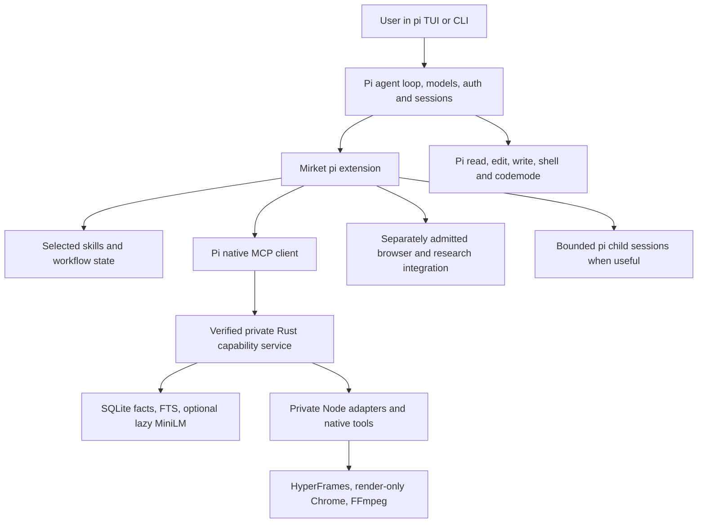

# Pi-only migration plan

## Current candidate checkpoint — local technical validation complete

The user approved the exact repaired external pi 1.4.0 / Undici 8.12.2 host
for the local candidate; `packaging/admission/pi-local-candidate.json` records
its exact hashes and exclusions. Live installation, redistribution, production
browser dependencies and publication remain unauthorized.

Current disposable root: `/private/tmp/mirket-pi-package-cleanup-vsju74ht`;
assembled package: `package-verified`; native release
`sha256:a88906e210d7874e10722fd6add4c86654e88dbb3021da273b1029e0279be5f2`.
The owned-child EOF/reap race reproduced before repair and passes afterward.
Full Rust tests/clippy and TypeScript tests pass. Fresh installed navigation,
editable design, semantic memory recovery, decoded video/audio, stale-input
refusal, in-flight cancellation and MCP protocol checks pass with this core.
A same-length payload tamper blocks doctor and native tools; restoring bytes
and SDK reload recovers. Duplicate extension-side native verification was removed;
the MCP service still verifies every native file before any operation/readiness.

The user approved separate startup gates: core-only 1.5 seconds, full native
package 2.5 seconds. Three isolated full-package samples were 1882.89, 1808.80,
and 1776.06 ms. The earlier failed measurements are retained. Full-package idle
measured 317.11 MiB aggregate and 33.16 MiB Rust at 30/60/120 seconds, no growth,
and shutdown in 0.08 seconds with zero children. Earlier failed 32 MiB observations
remain retained. The user approved 40 MiB for full-package Rust, retaining 32 MiB
for core-only and all other frozen idle limits.

P7's 24 author runs and one two-pair expansion are complete; no further author
runs are authorized by that evaluation budget. Four unchanged expansion sources
now export after the native cleanup repair. Independent saved-pixel inspection
confirms caption present at 1s and absent at 0/1.9s. An initial batched-image
misread was corrected through separate image inspection and byte-for-byte
comparison with the fully decoded final frame; no source/runtime change was needed.
Final candidate evidence is consolidated in
[the qualification record](../docs/pi-qualification-20261029.md). Core/full startup,
warm idle and shutdown passed their explicitly approved separate budgets. All
13,167 package files and 318 recipient files match their saved inventories.
See `docs/pi-heldout-comparison-20261029.md` for preserved comparative failures.

P0–P4 and P6 implementation/integration are complete for the documented local
macOS scope. P5 provider research/vision and local browser testing are complete;
production browser use is unavailable under the retained admission boundary.
P7's finite evaluation is complete with failures and no general superiority claim.
P8's local assembly/install verification is complete; live installation, public
release and redistribution were not performed. Per-skill 305-case completion,
broad motion-loadout quality and other platforms are not claimed.

The dated progress notes below preserve earlier state; this checkpoint and the
qualification record govern the current candidate.


Status: proposed implementation plan. The pi-only product direction is requested;
implementation, dependency admission and release qualification are not completed
by this document. Prepared 2026-10-28 against repository HEAD
`37dfffa2bd51905fd214e115704cf64835afa571`.

### Execution checkpoint — 2026-10-29

Research now has a tested provider-native route: `/mirket-research QUESTION`
uses pi's existing OpenAI authentication and `openai/gpt-6-astra` without another
search SDK, credential store or provider client. The user's “most natural route”
direction superseded browser-search selection; their later installed-pi/Astra
Medium authorization enabled the actual proof. The assembled package performed
five search/open actions, corrected an obsolete no-MCP claim against pinned
primary documentation, recorded a conflicting mirror and inaccessible URL, and
saved original answer text/citation spans with clickable sources. Evidence lives
in the disposable root's `model-research-proof.json`. Observed retrieval is not
an automatic claim-accuracy verdict. A 120-second deadline, eight observed-action
budget and 256 KiB evidence bound apply; the provider rejects `max_tool_calls`,
so these are client-side abort bounds, not a hard server-side request quota.
The initial unsupported-parameter failure is preserved. Browser interaction
remains unqualified; the exact batch in `packaging/admission/pi-browser.md` is
now approved for disposable local-fixture testing only, not production use.

**P0 passed. P1 removal and P2 package/lifecycle implementation are in progress.** The user
explicitly approved the exact disposable offline P0 batch, with hooks and
telemetry disabled. This approval does not cover production dependency use,
networked release use, live setup, paid models, commits, pushes or publication.

Checkout remains `main` at `37dfffa2bd51905fd214e115704cf64835afa571`.
The only pre-existing change was this plan. Rust host removal and TypeScript
consolidation are now uncommitted source changes. The full plan and existing
implementation contract were read. The user additionally approved the exact
P0 closure for offline extension development, with pi external and hooks/telemetry
disabled; this does not authorize networked release or paid model trials.

- [Admission and limits](../packaging/admission/pi-p0.md),
  [machine-readable qualification](../packaging/admission/pi-p0.qualification.json),
  [case specification](../tests/pi-p0.md). All 122 installed package identities
  and 15,247 regular archive files matched the frozen lock and inspected bytes.
  Installation was offline with hooks disabled; no lock regeneration occurred.
- Actual pi 1.4.0 SDK, CLI JSON, RPC and interactive PTY paths ran on macOS
  26.5.2 (25F84) ARM64 with verified private Node 24.22.1. The original compiled
  ESM fixture used external host peers and the existing Rust `dev serve` route.
- Direct status, deferred discovery, actual memory prepare/commit/read, and
  codemode composition passed. Stale-release `isError` was checked inside a
  resolved codemode result. Restart/resume reconciled a deliberately discarded
  commit response through its receipt without replaying the mutation.
- Reload replaced the service; RPC fork/resume and interruption/recovery passed.
  Two clients read shared canonical state; another project could not read it.
  Relocating session storage did not relocate the canonical state binding.
- Global selection, project replacement, `autoload:false` delta, unfiltered
  package load, collision diagnostics and untrusted-resource refusal passed.
  Overrides, disabled MCP, filtered commit, missing extension and a replacement
  `/mcp` command produced distinct evidence and no false readiness assertion.
- TUI `/mcp` showed the exact executable, state root and extension origin;
  `/reload` and Ctrl-D exit passed. This is terminal interaction evidence,
  **not saved-pixel visual QA or image-delivery qualification**.
- Three fresh CLI processes reached the first useful tool in 490.3, 476.8 and
  483.5 ms (warm filesystem cache). At 30/60/120 seconds the sampled aggregate
  RSS was 355.11/355.13/323.73 MiB; Rust stayed at 14.02 MiB. Only pi and its
  Rust child existed; no embedding/Chrome/FFmpeg worker. Node high-water RSS
  was recorded; continuous aggregate peak RSS remains unmeasured.
- Final owned process count was zero. The Node network trap passed its own
  refusal check and recorded zero unexpected attempts. Offline flags and this
  trap do not constitute an OS sandbox.

Preserved failed fixture evidence: projects under the real home allowed ancestor
`.agents/skills` discovery despite a disposable HOME; corrected runs use a fresh
`/private/tmp` ancestry. Missing/insecure state roots were correctly refused;
fixtures now create mode-0700 roots. Explicit SDK model selection and codemode
activation were needed. A resumed branch already exposes discovered tools, so
its discovery oracle checks the active tool set rather than requiring new loads.
The missing-extension case was isolated from the deterministic provider to avoid
mistaking a missing-provider failure for a missing-MCP diagnosis.

The original build guard, offline Rust build and existing MCP smoke passed before
pi admission. Rust/Node hashes and exact commands are retained in qualification.
Full Rust tests/clippy were not rerun for fixture-only work. Native creative-job
cancellation, model quality, visual/video outcomes and release packaging remain
later gates; codemode interruption is not evidence for those outcomes.

Before optimization, freeze P2 core regressions for this machine/toolchain:
three fresh-process first-tool samples each <=1,000 ms; aggregate status-only
RSS <=450 MiB and Rust RSS <=32 MiB at 30/60/120 seconds; growth from 30 to 120
seconds <=16 MiB; ordinary shutdown leaves no owned child within 3 seconds.
These are P0-based test budgets with headroom, not measured percentile claims
or budgets for semantic/creative workloads.

Current work retains native MCP: the experiment found no transport blocker.
P1 removed host configuration/guidance/skill-copy and reinstall/uninstall modules,
old installers and their dedicated tests; generic native setup/activation/recovery
remain. Old installation markers are refused without import. Active contracts
now target pi. The five unused TOML dependency packages were removed. Rust tests
passed after the source move. P2 consolidates runtime sources under `pi/` and
implements compiled extension registration and an assembled local package.
The five obsolete Codex model-trial launchers and their host-specific tests have
been removed. Their useful creative fixtures, caption/source/media oracles,
no-follow artifact snapshots, research claim controls and bound review validation
now live in `tests/*_oracles.py` and `tests/design_fixtures.py`. Thirty retained
oracle checks and the full 148-test Python suite pass. Old host event handling
is removed; image evidence now requires an actual successful pi image tool result.
P2 and fresh final-package gates are not yet closed.

Further disposable evidence is recorded in
[`pi-host-repair.qualification.json`](../packaging/admission/pi-host-repair.qualification.json):
- The exact repaired candidate was installed offline with hooks disabled;
  all 122 package archives and 15,251 regular installed files match their bytes.
- Actual unbundled CLI, RPC reload/fork/resume/codemode-abort and PTY lifecycle
  passed with the optimized Rust core. First nested doctor results took
  878.2/847.6/841.4 ms, within the frozen 1,000 ms gate. Aggregate idle at
  30/60/120 seconds was 278.14 MiB, with only pi and Rust; shutdown took 72 ms
  and left zero owned processes. These numbers bind the recorded package,
  before later setup/profile/authorization changes, not every future build.
- Assembled setup now refuses altered extension bytes before creating runtime
  state, verifies its inventory, and applies the core native pi filter while
  preserving unrelated settings. Repeated setup preserves existing state.
- Profile editing recognizes relative paths written by pi and refuses duplicate
  aliases. Actual package loading passed four mixed project combinations,
  `autoload:false` deltas and removal that preserves canonical memory.
- A five-minute exact-argument grant gates destructive forgetting and shared
  preference access. Direct and nested headless forgetting refuse without a
  grant; a user/controller command authorizes the exact intent. Project, release,
  argument drift, expiry and concurrent edits are tested. Interactive confirmation
  is implemented but its actual dialog remains unqualified. This is an extension
  policy, not containment of arbitrary shell or other extensions.
- Skill validation no longer enforces historical 9/52/7 counts as retention
  targets. It requires core guidance and finite upper bounds; provenance and
  body/resource validation remain in force. Automatic selection/model quality
  and all catalog cases are still open.

Storage gate: user-authorized cleanup reclaimed approximately 28 GiB (free space
12 → 40 GiB). Removed stale compiler intermediates/incremental data, general npm
and Electron download caches, Xcode DerivedData and an inactive oversized Nx log.
Source, built executables, evidence, live installs and the Podman VM were retained.
The path-level cleanup receipt is outside shipped source at
`/Users/nazmiyilmaz/.codex/task-state/mac-storage-cleanup-20261029.json`.

Full native package work now retains installed evidence under
`/private/tmp/mirket-pi-package-wjKGau/`. A timeout exposed an orphaned setup child;
setup now forwards interruption, waits for child termination and has a finite
600-second native staging window. Explicit `--resume` continues only the same
owned incomplete native setup; a full interrupted install recovered successfully.
Actual pi navigation/token/SVG outcomes passed. A second raster was cancelled by
receipt-lock contention during status polling. A deterministic failing test
reproduced this; bounded receipt-update locking now passes Rust tests/clippy.
Installed retest passed against release `a747a5ca4c0540a24c958a30ed490b0f1bcfa881fd5b613dbf446b5f238300ed`: both raster exports completed, and the saved blue/red PNGs were visually inspected with complete unclipped text. This is not pi vision delivery or full creative qualification. Actual pi video export now passes with 24 decoded frames, an independent PCM timing/gain oracle, remote-asset refusal and in-flight cancellation that confirms scratch cleanup and no published output. Three decoded frames were visually inspected; 1× playback, changed-source rerender and model-authored quality remain open. Evidence: `tests/pi-video-journey.mjs` and the disposable checkpoint.

The user authorized the installed pi Codex login and Astra Medium for comparisons. The local catalog resolves this to `openai/gpt-6-astra`, with text/image input. Use the existing OAuth credential in memory, disposable settings/session/catalog storage, and the repaired unbundled host for qualification. Do not change live pi settings or substitute another model. Actual model/vision preflight passed: effective `openai/gpt-6-astra`/`medium`, a real image tool result, correct dark-red/white-Mirket description and ready Mirket doctor. Record: disposable `model-vision-proof.json`. This proves image delivery, not comparative quality. Provider-native web search passed through pi request/stream hooks using this same authorized connection; no separate browser/search dependency has been installed.

P6 now has a compiled user-frozen workflow brief, persistent child/repair accounting, disjoint output reservations, explicit CLI resource/tool filtering, bootstrap checks and managed process cleanup. Unit tests cover overlap, scope escape and budget reset attempts. The actual CLI child isolation and assembled managed-child proofs passed with Astra Medium: exact saved file; actual host/runtime/model/effort bootstrap; in-flight cancellation with zero observed descendants; consumed-budget refusal; an independent image-reading reviewer detecting a deliberate color defect; and missing output reported incomplete despite a normally finished model turn. Actual offline CLI counterexamples refuse wrong effort, unowned writes, dangling links and recursive tools. Evidence: disposable `managed-child-proof.json`, `child-boundaries-proof.json`, and the children records. Two actual Astra Medium CLI children also completed concurrently with disjoint
outputs; a third fork was refused at the concurrency bound. Actual fork and
reload preserved consumed child/repair reservations, and exhausted-budget reuse
was refused (`child-shared-budget-proof.json`). Held-out comparison remains open. Installed pi semantic memory also passed cross-language recall, correction/history, stale-vector exclusion and authorized forgetting; the SQLite recovery snapshot was independently opened and removed after forgetting. The approved local-only browser proof now passes actual pi MCP navigation, keyboard,
responsive/reduced-motion fixtures, saved screenshots (visually inspected),
restricted tools, denied external navigation/redirects, and zero observed
descendants/profile cleanup. See the browser admission record; production browser
use remains unapproved. Additional P4 creative outcomes,
P7 matched model evaluation and P8 release gates remain incomplete.

Exact host binding now derives 15,249 unique file identities from 15,251
verified archive members (two overlapping members have identical bytes). The
extension checks the selected Node, unbundled CLI and full external closure via
the existing Rust crate; changed lazy Undici code, extra files and bundled CLI
entry are refused. No dependency was added. Fresh core package integration,
CLI/RPC/TUI lifecycle and preserved-state removal pass against the current
compiled candidate. Bounded parallel hashing reduced first-tool measurements to
1,263.6 / 1,148.8 / 1,140.5 ms. These fail the original 1,000 ms gate. The user explicitly approved a
1,500 ms core gate on 2026-10-29 while retaining full host verification; all
three runs pass that revised gate. Earlier failed measurements remain visible.
Evidence: `/private/tmp/mirket-pi-package-r4vQ5y/`; full native interrupted setup and explicit resume passed in
`/private/tmp/mirket-pi-package-recovery-9BodeP/`, and fresh memory restoration, changed-source video, navigation, token and raster
checks passed against release `2f000cec4738740b9ce1af0c01427a50dfa274dbb41a39882e7a365d76dda8ac`.
Memory restoration releases and observes client shutdown, reloads revision one,
reports incomplete semantic coverage, then rebuilds without resurrecting the
forgotten fact. Video changed-source pixels and stale-revision refusal passed;
saved middle frames were viewed (updated title and pale-blue panel). Earlier
slower measurements and failed recovery fixtures remain retained.

Final current source gates passed: guarded locked/offline Rust tests, clippy,
formatting, compiled TypeScript (78 passed, one skip), and Python (148 passed).
The fresh core idle run observed 455.6 MiB at startup, then 418.2 MiB at
30/60/120 seconds with no growth; the latter samples pass the frozen 450 MiB
warm-idle gate. Shutdown confirmed zero owned processes. The original idle
script incorrectly applied the warm-idle gate to time zero; that failed log is
retained, and the assertion now matches the frozen times. Fresh editable-vector
create/patch/reopen, stable identity, raster export and unsupported-layout refusal
passed; the saved export was viewed, as were both fresh blue/red raster outputs.

P7 fixtures and rubric are frozen in `tests/fixtures/pi-cohort.json`, copied with
hash-bound runner identities into the disposable `cohort-frozen-1` directory.
All 24 attempted cells failed OAuth refresh with `invalid_grant`, before any model
output or reported tokens. These are authentication attempts, not completed
author runs or quality evidence. The first runner incorrectly labeled a resolved
SDK prompt as completed despite an assistant error; its raw reports remain, and
`authentication-failure-audit.json` corrects that classification. The runner now
requires an actual normal final assistant result. No task or rubric changed.
The user reauthenticated and explicitly approved normal pi token-refresh writes
to its auth store on 2026-10-29. The resumed cohort uses pi AuthStorage against
that existing store; all other live-state protections remain. The frozen tasks
and rubric are unchanged in `cohort-auth-resumed`; successful author runs are
now in progress. The earlier authentication attempts are not model quality
failures. Do not claim the cohort passed before independent artifact scoring.

The fresh Video recipient source/notice packet now binds the current native
manifest. The assembler checks both lock hashes and all 259 unchanged dependency
entries across the pi package-root rename; a changed dependency cannot be hidden
by editing the layout receipt. Thirteen focused checks passed. All 318 recipient
files (125,606,766 bytes), 80 npm archives and notice index were independently
hash-verified. Twenty-one supplementary upstream archives remain unavailable
in the offline source root, explicitly listed in the retained index; no download,
source rebuild, new rights determination or distribution was performed.
Evidence: disposable `video-recipient/` and `recipient-verification.json`.

A second user-authorized storage cleanup shared byte-identical disposable
package payloads using APFS copy-on-write clones, checking source/target hashes
and preserving modes/times. It reclaimed 6,722,588,672 bytes without dropping any
package/evidence files. Receipt:
`/Users/nazmiyilmaz/.codex/task-state/pi-fixture-cow-cleanup-20261029.json`.

The exact repaired external host is now user-approved for the local pi release
candidate (`packaging/admission/pi-local-candidate.json`), after full closure,
bundled-entry refusal, model/provider, lifecycle and performance qualification.
The default bundled pi entry remains unsuitable and is rejected. This approval
does not cover live installation, host redistribution, browser production
dependencies or publication. The final assembled recipient/rights boundary
remains distinct from host admission. All raw
scripts, logs, failures and hash-bound evidence are retained outside shipped
source at `/Users/nazmiyilmaz/.codex/task-state/pi-p0-20261029/`; the qualification
record points to the evidence manifest. No live-state writes were performed.

## 1. Target and non-negotiable decisions

Mirket becomes a **pi package for product development**, with pi as its only
supported agent host. Use pi's own agent loop, provider authentication, model
registry, sessions, compaction, built-in editing/shell tools, package resources,
MCP client and terminal interface. Mirket supplies selected expertise, evidence
and review workflows, project memory, navigation and finite creative operations.

This is a clean replacement. There will be no Codex adapter, Desktop integration,
dual-host mode, renamed compatibility commands, old configuration importer or
automatic migration of an existing installation. Existing user installations and
unrelated settings are outside this repository change. Do not create backups or
archive copies as part of cleanup. Remove obsolete source and documentation;
ordinary existing Git history is sufficient.

Preserve useful engineering, not the current architecture by default:

- Keep one Rust crate for canonical memory, verified native runtimes, scoped
  operations and process ownership; keep one compiled TypeScript package for the
  pi extension and existing adapter operations.
- Keep SQLite/FTS and lazy MiniLM, selected TypeScript navigation, token/vector/
  raster/diagram operations, the bounded OpenPencil subset, and HyperFrames.
  Requalify them through pi. Remotion remains excluded.
- Keep the useful Hallmark/Taste methods, references, skill resources and
  evidence rules. Neither the number of skills nor their present wording is a
  migration requirement. Names remain descriptive, without a `mirket-` prefix.
- Pi owns the model and conversation. Use its APIs for model selection and
  children; do not build another provider client, agent loop or session format.
- Retain MCP as a standard **internal pi integration**, not as a second host
  product. Current pi supports it natively. Replacing tested Rust tool handlers
  with custom IPC would add a protocol without a demonstrated benefit.
- Treat “state of the art” as an outcome to measure: useful outputs, dependable
  recovery, good creative judgment and reasonable context/latency costs. Package
  popularity and more tools are not acceptance criteria.

## 2. Verified upstream baseline

The old `badlogic/pi-mono` URL now redirects to `earendil-works/pi`. The release
examined is **pi 1.4.0**, published 2026-10-21, commit
`4a080252f06caf63a525d7873c5d94d3c23887e0`. The npm host package is
`@earendil-works/pi-coding-agent`; Node minimum is 22.19.0. Do not implement from
old examples importing `@mariozechner/*` or `@sinclair/typebox`. The pinned host
uses `typebox`. These are observed source contracts, not yet installed-runtime
results. [Release][pi-release] · [package metadata][pi-package-json]

| Verified contract | Architectural consequence | Primary reference |
| --- | --- | --- |
| Pi packages declare extensions, skills and prompts; resource filters can select a subset. | Ship one package and let pi discover resources. Remove receipt-owned copies into another host's skill directory. | [Packages][pi-packages] |
| Extensions can register MCP servers; pi supplies stdio lifecycle, discovery, direct/deferred/codemode exposure and tool hooks. | Register the verified Rust service from the extension; keep `rmcp` and schema generation. No third-party pi MCP adapter or custom JSON-lines transport. | [MCP][pi-mcp] · [Extension contracts][pi-extensions] |
| Host-provided pi libraries and TypeBox are peers, not bundled runtime dependencies. | Compile against exact admitted development versions; use upstream's peer declaration convention and a separate tested-host compatibility record. Never ship a second pi runtime inside the extension. | [Package dependencies][pi-packages] |
| Sessions own conversation trees, model state, compaction and extension runtime replacement. | Store small workflow entries through pi; canonical facts stay in SQLite. A session branch is not a memory rollback. | [SDK][pi-sdk] · [Sessions][pi-sessions] |
| Skills use Agent Skills frontmatter and load bodies on demand; name collisions keep the first skill. | Strictly validate our package and detect collisions. A catalog receipt does not demonstrate skill selection. | [Skills][pi-skills-doc] |
| Pi runs with its process permissions; project trust controls resource loading, not tool containment. | Replace Codex approval assumptions with explicit operation policy. Describe limits accurately; do not claim an OS sandbox. | [Security][pi-security] |
| Core pi does not supply a built-in subagent workflow; upstream provides an extension example. | Adapt one bounded pi delegation extension if it passes evaluation. Do not preserve the fiction of Codex native spawning. | [Pi overview][pi-readme] · [Subagent example][pi-subagents] |
| Pi supports model/effort selection, image input and provider-backed image generation. | Reuse those facilities; validate actual provider/model capabilities and save generated images before QA. | [Models][pi-models] · [Extension types][pi-types] |

Pi 1.4.0 is the initial **qualification candidate**, not a promise to support all
future 1.x versions. Upstream API changes require a new compatibility run. MIT
licensing permits reuse subject to its notice requirements; all transitive and
optional runtime rights still need exact admission. [Pi license][pi-license]

## 3. Target architecture and ownership



| Owner | Owns | Must not duplicate |
| --- | --- | --- |
| Pi | Provider login/keys, model registry, model calls, turn loop, context, session tree, built-in file/shell tools, MCP client and package loading. | A Mirket model gateway, transcript store, replacement TUI or generic file tool. |
| Mirket extension | Runtime registration, health/status, selected skill profiles, workflow budgets/evidence, optional bounded delegation and approved research/browser connections. | Pi authentication, a generic permission platform, all-provider routing or automatic package installation. |
| Rust capability service | Scoped facts, revisions/intents, release integrity, native operation bounds, owned jobs, recovery and resource admission. | Conversation history, model selection, browsing or agent orchestration. |
| Project toolchain | Application builds/tests, formatting, SQL, document exports and project-specific browser automation. | Additional Mirket tools for workflows already covered well by project commands. |
| User / execution environment | Credentials, trusted repositories, external effects and any OS/container isolation. | Treating a prompt, cwd or extension hook as a security boundary. |

Proposed source layout, retaining one Rust crate and one TypeScript package:

```text
src/                         Rust domain core and pi-facing MCP service
pi/package.json              sole TypeScript package and pi resource manifest
pi/src/extension/            registration, lifecycle, commands and policy
pi/src/runtime/              current adapter operation modules
pi/tests/                    extension and adapter process tests
skills/                      authored SKILL.md files and supporting resources
skills/catalog.json          provenance, pairings, profiles and acceptance cases
packaging/admission/          exact runtime admissions and host compatibility
scripts/                     build, assemble, validate and package tools
tests/                       domain, pi integration and outcome trials
docs/                        current pi product documentation only
```

`adapters/` moves into this package with import/test updates; do not retain an
adapter-package alias. Assembly produces a self-contained local pi package with
compiled extension code, copied skill resources, notices and a runtime manifest.
Build output is disposable and untracked. Use `@codemirket/pi-harness` as the
proposed package identifier; verify registry ownership only before publication.
Package publication is not part of migration implementation.

### Process and tool contract

The extension registers `mirket` with `pi.registerMcpServer()` using a verified
absolute executable, explicit arguments, project cwd and Mirket state root. Pi
starts and disconnects the service; do not manually spawn a second copy. Extension
factory execution must not start workers. Bind session-dependent state during
`session_start`; release it idempotently on `session_shutdown`. Reload, resume,
fork and project switches invalidate the old binding. [Lifecycle][pi-extensions]

Registrations are ephemeral: register again for each extension runtime, and
unregister the owned server when releasing a binding. Test that this composes
with pi's own shutdown without double-close failures or orphan processes. No MCP
child may exist before the first session starts.

Keep one model-visible route per domain operation. Pi tool IDs become
`mcp__mirket__<operation>`. Start with `runtime_status` directly exposed and the
remaining capability tools deferred. Test codemode composition as well as direct
calls after discovery. Do not wrap all MCP tools in duplicate `registerTool`
aliases. Keep administrative restore/install actions outside model tool exposure.

Use the current 25 operations as the migration inventory, not as an immutable
public API. Derive parameter schemas, effects, pairing and expected output from
one maintained contract. Remove a tool only when its consumer and outcome have
an explicit replacement. Preserve prepare/commit and job status/cancel/result
semantics where they prevent stale writes or ambiguous retries.

Pi's file-configured MCP server of the same name overrides an extension
registration. Detect an override and report it; never attest that a replacement
server is the verified Mirket runtime. Built-in MCP disabled, `--no-mcp`, third-
party `/mcp` replacements and tool filters are distinct unavailable states.
An extension-only server does not appear in shell-level `pi mcp list`; use an
actual loaded session and `/mcp` for its integration health check. [MCP][pi-mcp]

Doctor must inspect the loaded registration/configuration origin and perform an
identity handshake against the expected release tuple before attesting readiness.
Differentiate an override, a disabled/filtered server and an unloaded extension.
A standalone native-runtime doctor checks payloads only; it cannot establish
pi integration health. Do not enable an overridden server's writes to probe it.

Validate these runtime boundaries explicitly:

- Interrupted tool call versus independently running job; kill/reconcile owned
  children before claiming cancellation. A dropped MCP connection cannot prove
  a render stopped. Never blindly retry a mutating call after reconnect.
- `isError` results inside codemode must be checked; a resolved JavaScript
  promise does not mean operation success. Preserve structured failure details.
- Late tool discovery, stale release, source revision changes, missing payload,
  two simultaneous pi clients, server restart and session switch during a job.
- Context/output limits must retain artifact locators and error details. Do not
  turn a truncated result or missing body into a successful verification claim.

## 4. Clean deletion and reuse map

| Current source | Decision | Required replacement / reason |
| --- | --- | --- |
| `src/codex_config.rs`, `src/codex_guidance.rs` | Delete entirely. | No Codex TOML editing, managed guidance blocks or recovery receipts. |
| `src/main.rs`, `src/lib.rs` | Remove Codex commands, imports, dispatch and host-specific help. | Small runtime administration CLI and pi-managed service launch. No deprecated aliases. |
| `src/installation.rs`, `installation_reinstall.rs`, `installation_uninstall.rs` | Remove Codex orchestration; retain reusable native payload verification/activation primitives. | Pi owns package registration/removal. Mirket owns only its native payload/state lifecycle. No old-install importer. |
| `src/server.rs`, `src/deferred_server.rs` | Retain standard MCP, revise host assumptions and status. | Pi is the sole qualified consumer. Keep verification before effect-bearing calls; catalog availability is not readiness. |
| `src/skill_sync.rs` | Delete host skill-copy/synchronization machinery after native package resource loading passes. | Pi-owned discovery/filters and package-relative resources; no writes to `.agents/skills` or another client's instructions. |
| `src/native_skills.rs`, `skills/catalog.json`, `scripts/assemble-skills.py`, `refresh-skill-catalog.py` | Retain provenance/validation/assembly; refactor selection and pairing. | Pi tool IDs, host requirements, new resource paths, actual evidence statuses. |
| `src/memory*.rs`, `embedding*.rs`, `identity.rs`, `scope.rs` | Retain and adapt caller/session context. | Keep correctness, forgetting, source currentness and isolation. No transcript harvesting or replacement vector database. |
| `src/engine*.rs`, `worker.rs`, `process*.rs`, `operation_store.rs`, `leases.rs`, `resource_admission.rs` | Retain bounded behavior; remove obsolete host coupling. | Tests through pi must prove scope, cancellation, crash recovery and output ownership. |
| `src/design*.rs`, `openpencil.rs`, `diagram.rs`, `video*.rs`, adapter operation modules | Retain useful domain operations. | New agent invocation and QA path; HyperFrames is still the only video engine. |
| `release*.rs`, `distribution*.rs`, `installed_payload.rs`, native assembly scripts | Retain integrity and rights controls; simplify release topology for pi. | Pair one pi package version with an exact runtime manifest; no Codex activation state. |
| `Cargo.toml`, `Cargo.lock`, `build.rs` | Remove dependencies/inputs with no remaining consumer. | `rmcp`/`schemars` stay for MCP. Remove `toml_edit` if its only consumer is deleted Codex TOML handling. Regenerate admission closure through repository tooling. |
| `scripts/install-macos.sh`, `scripts/install-windows.ps1`, `packaging/install-prompt.md` | Remove the existing Codex-target installation flow. | One explicit pi package/runtime setup path. No Windows installer until Windows has its own qualification. |
| `tests/codex-*`, `test_codex_coordination_trials.mjs`, Codex branches in trial runners | Delete or port meaningful assertions. | Pi CLI/TUI/RPC lifecycle and model trials; no cosmetic transcript renaming. |
| `tests/*mcp*`, installed smoke tests, memory/creative fixtures | Retain protocol/domain coverage and port consumers. | Add real pi session tests; protocol tests alone remain insufficient. |
| README, `AGENTS.md`, `planning/implementation-plan.md`, current docs and release manifests | Replace current-product contracts during implementation. | Pi-only ownership, setup, capabilities, limits and newly qualified release identity. Remove Desktop waiver and old release-support claims. |

Product-owned `MIRKET_*` environment variables may remain. They are not Codex
compatibility. Remove `CODEX_*` assumptions and `.codex` paths from executable
product behavior. Preserve third-party license names and truthful source
attribution; a blind global string replacement would corrupt provenance.

Recovery of **new** memory/jobs and deliberate runtime activation remain product
features. They must not be deleted as “legacy patterns.” Conversely, restoring
old Codex config or importing `.mirket/project.json` is outside the new product.

## 5. Installation, configuration and durable state

Use an explicitly selected pi installation. Do not install, fork or silently
upgrade pi as a side effect of loading a skill. Check host identity and version
before enabling Mirket. Retain private Node for native adapter subprocesses;
the extension runs in pi's own Node process. Test the two runtimes separately.
No Node search on PATH or unverified fallback for owned subprocesses.

The assembled distribution includes the complete verified adapter dependency
tree, including HyperFrames, Style Dictionary, SVGO, SAX and TypeScript, with
their licenses. The thin extension must not import that heavy runtime into pi.
Its host API imports stay external peers. The runtime manifest binds the Rust
binary, private Node, adapter entrypoints/dependency tree, optional native assets,
Chrome and FFmpeg/ffprobe to the package version and platform. Missing trees fail
setup before registration; local package loading does not install them for us.

Use pi's local-package installation path for the first qualified distribution.
It loads an already assembled package without an incidental dependency install.
The first-party setup action verifies/unpacks native assets and invokes the
selected pi executable to register that absolute local package. It also applies
the package's **core resource filter** before the first task. No install-time
network hooks, `npx latest`, upstream shell installers or model-triggered first-
use downloads. An npm channel can follow only after the exact packed dependency
closure is independently reproduced. [Package sources][pi-packages]

Proposed state ownership:

| Location | Contents and rule |
| --- | --- |
| Pi agent directory | Pi owns auth, settings, sessions, trust and its package registry. Respect `PI_CODING_AGENT_DIR`; do not assume `~/.pi/agent` in tests. |
| `<pi-agent-dir>/mirket/` | Native payload binding, canonical memory, managed recovery data, operation journals and task-budget ledger. No automatic reads/imports from `~/.mirket`. |
| `<pi-agent-dir>/mirket/config.json` | Mirket-owned runtime bindings, provider-role presets and policy defaults; no duplicate API-key store. |
| `.pi/settings.json` | Native package declaration and skill/resource filters. Modify only Mirket's owned entry with conflict detection; preserve unrelated settings. |
| `.pi/mirket.json` | Optional project-specific output roots, task limits and role choices. Data only, schema-validated, never executed; ignore unless project trust is established. |
| Package contents | Immutable compiled extension, resources, schemas and exact runtime manifest. No durable data or provider credentials. |

Pi's package update and Mirket native activation are separate operations. A new
extension must not talk to an incompatible runtime: verify their tuple before
tools are usable. Busy jobs pin their runtime; updates stage until a fresh
activation. Removing the package unregisters its tools but does not implicitly
erase memory. Explicit data deletion is a separate operation, not a backward-
compatibility feature. [Environment controls][pi-env]

Do not automatically import existing global `.agents/skills`. Pi may discover
them independently; doctor must expose duplicates and origins. Clean-room tests
use a disposable HOME as well as a disposable pi agent directory, so inherited
skills or credentials cannot create false passes.

Bind the Mirket state root from the actual pi agent-directory setting or an
explicit validated override and record it in the runtime tuple. Session storage
is independent: test `PI_CODING_AGENT_SESSION_DIR` and `--session-dir` as well as
`PI_CODING_AGENT_DIR`. Never derive durable memory location from a session file.

## 6. Skills, profiles and tool pairing

Audit all 61 current skills against their new owner. Preserve the source-method
map, licenses and resource hashes, but rewrite Codex-only routing and unsupported
promises. A description saying “use the host browser” becomes a concrete tested
pi browser route or an explicit unavailable prerequisite. `allowed-tools`
frontmatter is not permission enforcement.

Use one explicit `pi` manifest containing all shipped resources. Our first-party
setup writes the retained core subset into the owned package object in pi's
settings; pi supplies the filter mechanism, not a built-in Mirket profile selector.
Project profiles select additional skills through those same settings. A
`/mirket profile` command may generate that owned filter and request reload;
it does not copy skill files
or maintain a second selection database. Project replacement of a global package
entry must preserve the desired core resources. Plain unfiltered `pi install`
can expose every manifest skill: document that behavior, and make doctor report
the effective loadout instead of claiming the lean setup was applied.

Test both project replacement of a personal package entry and the
`autoload: false` filtering-delta form. Reject conflicting edits to the owned
object; do not also persist a selected profile in `.pi/mirket.json` or another
registry.

| Skill family | Migration action | Discriminating check |
| --- | --- | --- |
| Runtime operations / project memory | Exact pi tool names, readiness and scope rules. | Actual commit/read/correction; absent model still gives honest lexical results. |
| Planning / code change / debugging / critical review | Use pi built-in tools and project commands; keep outcome-led methods. | An induced code defect is found by an independent test, not by reviewer agreement alone. |
| Evidence research | Add explicit search/browser prerequisite, source diversity and contradiction handling. | A topic with misleading popular results and a newer authoritative correction. |
| Agent coordination | Replace native-Codex claims with the qualified pi delegation route and its limits. | No-delegate task, overlap refusal, cancellation and exact requested model/effort. |
| Art direction / interface composition / critique / vector art | Preserve useful Hallmark/Taste methods; separate static composition from motion. | Saved-pixel review catches glyph clipping, poor spacing, hierarchy and unsuitable assets. |
| Motion / UI transitions / scroll / video production | Pi authors source; project library handles live motion; HyperFrames handles exported video. | Live responsive UI and decoded export each pass their own rubric. |
| Remaining project skills | Map every required/conditional capability to pi, project command or admitted integration. Retain only useful guidance. | Mixed-project selection, missing dependency, misleading verification and a held-out task. |

The existing seven profiles are candidates, not fixed product categories. Test
at least a frontend+backend product, a design+video project, a library+docs
repository and a data+UI project. Resolve overlap by selected capabilities rather
than forcing one exclusive project label. Avoid loading every skill for every
task. Generate pairing tables and catalog hashes from the same repository tools.

Keep reference methods distinct from code/assets/runtime rights. Preserve the
selected [Hallmark][hallmark] and [Taste][taste] pins; no removed reference or
retired skill bundle returns merely because the host changed. Do not mark the
catalog's 305 planned cases complete until their corresponding evidence exists.

## 7. Capabilities formerly supplied by Desktop

### Browser, research, documents and images

Pi's basic tools are not an equivalent of Desktop's browsing and document
integrations. Close these gaps deliberately instead of changing the owner label.

| Need | Proposed pi path | Admission / outcome gate |
| --- | --- | --- |
| Broad current web research | Select the simplest qualified pi route after checking provider-native support, a bounded search/fetch integration and isolated browser discovery. Keep queries, URLs, access dates, extracts and disagreement in a bounded evidence record. | Real discovery and source inspection, stale sources, inaccessible pages, rate limits/auth failures, source diversity and claim-to-source checks. Credentials depend on the selected route; missing access must remain explicit. |
| Interactive browsing and live UI QA | Official Playwright MCP as an optional pi-managed peer, using an explicit browser executable and isolated owned profile. Reuse project Playwright for deterministic application tests. | Freeze exact package/transitive closure and native browser binding; test navigation, screenshots, accessibility state, responsive layouts and shutdown. |
| Saved-image inspection | Pi `read` with a vision-capable model; return/save image artifacts from tools. | Actual image reaches the selected model. A path in a transcript or TUI preview alone is insufficient. |
| Artful raster generation | Pi's provider-backed image-model API, with a small explicit save-to-project adapter only if needed. | Provider authorization, output saved as bytes, reopened pixels and usable asset rights. No second image-provider SDK. |
| Documents / spreadsheets / slides / SQL | Retained scoped skills plus project-installed render/export/database tools. | Execute and reopen representative outputs. No inherited claim that Desktop document connectors are present. Add a dependency only for a demonstrated workflow gap. |

The upstream [pi-skills collection][pi-skills-source] is a useful pattern source,
not a package to install wholesale. Its inspected browser launcher uses a fixed
debug port and optionally copies a personal browser profile; its dependency list
includes both Puppeteer and Puppeteer Core. Do not adopt those defaults. The
proposed official [Playwright MCP][playwright] route already fits pi's standard
transport. The source inspected reports version 0.0.83 with alpha Playwright
dependencies, so it is a **candidate requiring closure review**, not an admitted
production dependency.

Browser/research sessions must be separate from the render-only Chrome used by
HyperFrames. Never silently copy personal cookies or use the rendering profile
for web research. Authenticated sites require an explicitly selected user session
or a dedicated login. External content is evidence, not executable instructions.

### Models and bounded parallel work

Model policies use exact provider/model IDs available through pi and record
requested versus effective reasoning. “Astra” is a user preference, not a portable
pi model identifier or an availability guarantee. Resolve it to an accessible
model before a trial; do not downgrade silently. Pi may clamp effort to what a
model supports, so inspect the effective value. [Model selection][pi-models]

Provide explicit roles: lead, creative reviewer and mechanical worker. Defaults
inherit the lead's model/effort. Creative work requires image-capable judgment
and a reviewer of comparable tested capability. Lower-cost workers are optional
for independent mechanical tasks whose correctness is exposed by tests.
Explicit user model choices prevail; insufficient capability is reported rather
than silently overridden. No automatic per-turn model router.

Adapt the [upstream subagent extension][pi-subagents] into one optional, bounded
pi extension module. Use the **pi CLI in JSON print mode**, one process per finite
child task, following the upstream sample rather than introducing an SDK agent
host or RPC controller. Bind the executable/entrypoint identity, exact
model/effort and explicit cwd; keep provider authentication inside pi. Start with
maximum two concurrent children and one delegation level. Child task context
contains deliverable, file ownership, allowed effects, budget identity and checks;
do not forward the entire parent transcript by default.

Do not copy the sample's cheap scout/reviewer role choices. Prevent recursive
delegation in managed children, disable uncontrolled resource autoloading in the
child launch, and explicitly load the required Mirket package/MCP/policy and
selected resources. Restrict tools by actual pi exposure rules: `--tools` alone
does not necessarily remove callable MCP tools. Test direct and codemode paths.

Require a child-session bootstrap record of loaded package/runtime IDs, project,
active model, effective effort and task budget before accepting its results.
Read actual pi session state, not an author's self-report. Missing model/auth,
unsupported effort and explicit user overrides are separate test cases. These
observations establish pi's effective configuration, not a guarantee about a
provider's internal computation. The optional delegate module is qualified only
after real child loading, cancellation and budget-sharing trials pass.

The lead integrates saved artifacts and resolves reviewer disagreements against
the frozen rubric. Persist one shared task budget outside branch-local session
entries, keyed by project and task ID. A fork, reload, child or new specimen must
not reset counters. Enforce concurrency/depth/budget in the managed delegate
entry point; propagate abort, terminate owned process groups and inspect their
effects. A shell-launched arbitrary process remains outside this guarantee.

### Authorization and quality controls

Replace inherited “Codex will ask” assumptions. Pi project trust permits loading
project resources; it does not authorize every external effect. Scoped local
reads and user-requested output creation should proceed without repetitive
prompts. Destructive memory deletion, privileged runtime changes and external
publication need the configured explicit operation authorization.

Implement gates for Mirket-owned operations using exact operation IDs, effects,
project/output scope and expiry, rather than shell substring rules or trusting
MCP annotations. Interactive mode uses `ctx.ui.confirm` for a required decision.
Headless/RPC mode must
receive explicit authorization through the supported control path or fail closed;
an unavailable UI must not imply consent. Policy is not an OS sandbox and does
not promise to contain all built-in shell or third-party extension behavior.

Freeze a task brief, allowed outputs, artifact manifest, review rubric and shared
repair budget before high-risk creative work. Default to two repair rounds for
the matched evaluation; users can explicitly set another task budget. Save the
initial artifact, independent findings, repairs, final artifact and remaining
defects. A bounded completion hook may require missing evidence before claiming
verified, but must stop at the budget and report incomplete rather than looping.

## 8. Implementation sequence and exit gates

Each phase is complete only when its exit gate passes. Work on one migration
line, with small reviewable changes; no shippable dual-host intermediate product.
Integrate before proceeding across a dependency boundary. Owners below are file
ownership roles, not a requirement to spawn an agent for every phase.

| Phase | Work and owner | Exit gate | Depends on |
| --- | --- | --- | --- |
| P0 — Prove the host contract | Integration lead: admit exact pi development/test closure; make a disposable extension register the current Rust service; test package peers, resource filters and real memory tool calls. | Pi 1.4.0 discovers, executes, reloads and disconnects the service; direct/deferred/codemode behavior and resource filters match the plan. Reject custom IPC unless this experiment demonstrates a concrete blocker. | Plan acceptance and exact dependency admission. |
| P1 — Establish the pi-only boundary | Core owner: replace active product contract; delete Codex modules/commands/receipts; split reusable installation primitives; remove unused dependencies. | No executable Codex integration, old config parser or compatibility alias remains; Rust domain tests pass. No user files touched. | P0. |
| P2 — Package and lifecycle | TypeScript/package owner: consolidate adapters, add extension, native manifest binding, local package install, doctor, session/project binding and cancellation. | Fresh disposable install, restart, reload, project switch, package removal and stale/missing-runtime failures pass. No workers start from extension factory execution. | P1. |
| P3 — Skills and pairing | Skill owner: audit every body/resource/route, native filters, profile union and provenance refresh. | All retained skills validate and load from the installed package; forced and automatic selection tested; missing prerequisites never become false completion claims. | P2. |
| P4 — Domain outcomes | Runtime owner: port memory/navigation/design/video consumers and remove stale host assumptions. | Actual pi-to-artifact journeys and failure cases in section 9 pass, including recovery and decoded video. | P2; P3 pairing contract. |
| P5 — Fill host gaps | Integration owner: admitted search/browser route, image-model save path if required, document/toolchain capability detection. | A real research task and live UI review work through pi; absent credentials/browser/vision report accurate limits. | P2; exact admissions. Can run independently of much of P4. |
| P6 — Coordination and QA | Workflow owner: role presets, bounded children, one task ledger, authorization, evidence-aware completion. | Role choices, budget exhaustion, child cancellation, disagreement, unauthorized effects and false verification adversarial tests pass. | P2/P3; P4/P5 for creative trials. |
| P7 — Held-out evaluation | Independent evaluator: frozen vanilla-pi comparisons and blind artifact scoring; integration lead repairs shared defects within the fixed budget. | No critical correctness/scope regression; retained guidance has a demonstrated safeguard or measured benefit. Failures remain visible. | P4–P6. |
| P8 — Final deletion and release candidate | Release owner: remove obsolete docs/config/tests/artifacts, rebuild admissions/package, run full gates and clean-room install. | Fresh pi release manifest and outcome evidence, exact platform/runtime identity, zero stale product claims. No publication without a separate request. | P7. |

P0 is intentionally small: it settles the highest-cost architectural assumption
before rewriting installation or every skill. If the native MCP route passes,
do not spend another phase designing a replacement protocol.

## 9. Qualification matrix

| Area | Success evidence | Required counterexamples / recovery |
| --- | --- | --- |
| Package/host | Actual installed pi loads compiled ESM, peers and intended skills once; `/mirket doctor` and `/mcp` identify the same verified runtime. | Wrong host version, missing peer, duplicate package/skill, same-name MCP override, MCP disabled, untrusted project, offline setup. |
| Lifecycle | Restart/resume/fork/reload retain appropriate state and rebind cwd; inactive sessions release resources. | Switch project during operation, crash mid-commit/export, abrupt exit, concurrent clients, stale extension callback after reload. |
| Memory | Canonical facts/corrections/supersession/expiry/forgetting; independent retrieval and answer oracle; lexical and semantic journeys through pi. | Similar facts in different projects, stale vectors after forgetting, incomplete index, model absence, managed backup restore, concurrent correction and index refresh. |
| Navigation | Selected-source definition/reference and syntax results with exact revisions and UTF-8/CRLF spans. | Wrong project, stale source, unresolved imports, unsupported language and incomplete selected project. |
| Design | Consumed token outputs, reopened editable vectors, raster export and saved-pixel inspection; live UI interaction checks. | Clipped descenders, missing fonts, wrong spacing, alpha defects, narrow viewport, keyboard/reduced-motion failures. |
| Video | HyperFrames editable source → actual saved export → decoded frame/audio/caption checks → 1× playback review. | Source change changes pixels, no remote assets, cancel/restart, denied authorization, out-of-scope output, timing/caption/audio regressions. |
| Research | Real search/fetch/browser receipts tied to claims, dated sources and a checked contradiction. | Trend-heavy misleading results, stale authoritative page, inaccessible forum/login, injected page instructions, blocked search page and unsupported citation. |
| Coordination | Useful independent child output, explicit requested/effective model and effort, lead-owned integration. | No-delegate task, overlapping ownership, weak creative delegate, reviewer disagreement, missing auth, user model override, interruption with live descendants. |
| QA/budget | Initial/final artifacts plus independent oracle and bounded repair evidence. | Self-reported verification without pixels/tests, unnecessary repair, regression after repair, new specimen/child/fork budget reset, reused evidence for changed output. |
| Distribution | Exact package/runtime tuple, inventory/notices, fresh setup and removal preserve unrelated files. | Tampered payload, incompatible native binding, busy activation, missing offline assets, dependency hooks and forbidden automatic downloads. |

Start the model cohort with **12 frozen tasks**: two each for code/debugging,
research, memory-supported answers, UI/vector design, motion/video and
coordination. Run each against vanilla pi and the selected Mirket loadout: 24
author runs. Match exact model/provider/effort, input, initial repository/assets,
available prerequisites, wall/token budget and external-effect policy. Baseline
creative runs receive the same renderer and assets; the treatment is guidance/
workflow, not access to an otherwise missing tool.

Use blind independent scoring for visual/research judgment and executable
oracles for code/retrieval. Report quality, remaining defects, elapsed time,
tokens/cost, tool count and repair count per pair. Run no extra cohort merely to
obtain a favorable result. A shared failure permits one targeted expansion of
at most four additional pairs after the cause and amended hypothesis are written
down. Larger experiments require a separately scoped follow-up.

Retain a skill when it supplies a concrete demonstrated safeguard or useful
workflow, or wins on quality/performance under the frozen rubric. Remove
redundant instructions and repeated non-contributing bundles. A tie in two
tasks cannot establish universal uselessness, and a pass in this cohort cannot
establish universal superiority.

Performance qualification records cold startup, first useful tool latency,
lexical/semantic retrieval, peak RSS, warm idle at 30/60/120 seconds, two concurrent
clients, renderer process count and shutdown. Compare vanilla pi, pi+Mirket core,
and pi+semantic/creative workloads on the same machine. No model, Chrome or FFmpeg
process may start for idle status-only use; startup must not embed or scan a
project. Freeze quantitative regression budgets after P0 measurements and before
optimization; publish actual distributions rather than inventing a fast-start
claim from source inspection.

## 10. Build, rights and release gates

Before Rust compilation run `python3 scripts/check-build-inputs.py`. Keep:

```text
cargo test --locked --offline
cargo clippy --locked --offline --all-targets -- -D warnings
cargo fmt --check
locked TypeScript package build + adapter/extension tests
Python packaging, catalog, admission and evidence checks
MCP protocol smoke with explicit private Node and binary paths
actual pi CLI/TUI/RPC integration and installed-outcome tests
```

After moving `adapters/`, update these commands and their owning scripts once;
do not keep both old and new build layouts. Rebuild lock inventories and skill
provenance through repository-owned tooling. Tests must execute the actual packed
artifact, not only the source tree. SDK tests alone are insufficient: SDK sessions
do not automatically load pi's built-in MCP/codemode extensions. Configure them
explicitly when using the SDK and also test the CLI path. [SDK][pi-sdk]

Proposed admission batches:

| Batch | Scope | Approval evidence required before addition |
| --- | --- | --- |
| A — Pi host/API | Pi 1.4.0, exact compile/test peers, TypeBox and any adapted upstream example code. | Lock closure, MIT notices, scripts/native dependencies, telemetry/network defaults, ESM peer loading and host compatibility. |
| B — Existing native stack | Reassembled SQLite/ONNX/MiniLM, Node, HyperFrames, FFmpeg/ffprobe, render Chrome, design and optional OpenPencil/D2/raster assets. | Current licenses/notices/source obligations, hashes and runtime compatibility. Prior admission is an input, not qualification of the new assembled product. |
| C — Browser/search gap | Exact browser/search closure after selecting the research route; neither candidate nor provider is currently admitted. | Pin a suitable released candidate and its transitive versions; review the observed alpha dependency issue, installation hooks, browser rights, public search access and service terms. |

Do not redistribute a component whose terms are incompatible. Host-side download
is not a blanket license workaround: document the exact allowed installation,
use and recipient obligations. Use explicitly selected host bindings when that
is permitted and materially simpler, with identity checks on every owned job.
No new production dependency is admitted merely by appearing in this plan.

The initial native qualification target is the available **macOS 26.5.2 ARM64**
environment, with fresh pi-specific evidence. Linux, other macOS versions and
Windows remain unqualified until separately tested. Remove the obsolete Desktop
GUI waiver; pi's actual TUI interaction, image delivery and cancellation need
their own tests. Provider credentials and vision capability are external trial
prerequisites; keep credential-free integration tests progressing if those are
temporarily unavailable.

## 11. Definition of finished

The migration is ready for release review only when:

1. The installed product has one supported host, pi, and no reachable Codex
   integration, Desktop assumption or old configuration compatibility path.
2. One pi package and one Rust runtime contract are sufficient for documented
   setup. All required native artifacts are verified and reproducible.
3. Every retained skill has a truthful owner/prerequisite/output/evidence mapping;
   unused or redundant guidance is removed, with hashes and provenance current.
4. Actual pi sessions complete the core memory, code, design, video and research
   journeys. Missing optional integrations are explicit, not false success.
5. Model choices, authorization, task budgets, cancellation and project isolation
   pass their adversarial cases within the stated enforcement limits.
6. Held-out outcomes and saved-pixel/decoded-export evidence support the quality
   claims. Unrun catalog cases and unqualified platforms remain labeled.
7. Current documentation, package contents and release manifest describe the same
   pi product. No historical implementation report or temporary trial artifact
   ships merely to preserve continuity.

No user decision is needed to finish this plan. During implementation, ask only
for an exact unapproved dependency batch, unavailable credentials/test host, or a
demonstrated conflict that changes the product scope. Do not pause routine work
for naming, file layout or other reversible implementation choices. Commits,
pushes, publication and changes to a live installation require their own scope.

## 12. Sources and planning evidence

Primary pi sources below are pinned to the inspected release commit; search
results and older forks are not implementation authorities. Local inspection
covered the active contract, Rust/Node manifests, host registration, skills,
MCP server and runtime status. Independent local review checked deletion/reuse
ownership, dependency packaging, registration lifecycle, profile filtering and
child-session observability. No new runtime was installed or executed for this
plan.

[pi-release]: https://github.com/earendil-works/pi/releases/tag/v1.4.0
[pi-readme]: https://github.com/earendil-works/pi/blob/4a080252f06caf63a525d7873c5d94d3c23887e0/README.md
[pi-package-json]: https://github.com/earendil-works/pi/blob/4a080252f06caf63a525d7873c5d94d3c23887e0/packages/coding-agent/package.json
[pi-license]: https://github.com/earendil-works/pi/blob/4a080252f06caf63a525d7873c5d94d3c23887e0/LICENSE
[pi-packages]: https://github.com/earendil-works/pi/blob/4a080252f06caf63a525d7873c5d94d3c23887e0/packages/coding-agent/docs/packages.md
[pi-extensions]: https://github.com/earendil-works/pi/blob/4a080252f06caf63a525d7873c5d94d3c23887e0/packages/coding-agent/docs/extensions.md
[pi-types]: https://github.com/earendil-works/pi/blob/4a080252f06caf63a525d7873c5d94d3c23887e0/packages/coding-agent/src/core/extensions/types.ts
[pi-mcp]: https://github.com/earendil-works/pi/blob/4a080252f06caf63a525d7873c5d94d3c23887e0/packages/coding-agent/docs/mcp.md
[pi-skills-doc]: https://github.com/earendil-works/pi/blob/4a080252f06caf63a525d7873c5d94d3c23887e0/packages/coding-agent/docs/skills.md
[pi-security]: https://github.com/earendil-works/pi/blob/4a080252f06caf63a525d7873c5d94d3c23887e0/packages/coding-agent/docs/security.md
[pi-sdk]: https://github.com/earendil-works/pi/blob/4a080252f06caf63a525d7873c5d94d3c23887e0/packages/coding-agent/docs/sdk.md
[pi-sessions]: https://github.com/earendil-works/pi/blob/4a080252f06caf63a525d7873c5d94d3c23887e0/packages/coding-agent/docs/sessions.md
[pi-env]: https://github.com/earendil-works/pi/blob/4a080252f06caf63a525d7873c5d94d3c23887e0/packages/coding-agent/docs/environment-variables.md
[pi-models]: https://github.com/earendil-works/pi/blob/4a080252f06caf63a525d7873c5d94d3c23887e0/packages/coding-agent/docs/models.md
[pi-subagents]: https://github.com/earendil-works/pi/tree/4a080252f06caf63a525d7873c5d94d3c23887e0/packages/coding-agent/examples/extensions/subagent
[pi-skills-source]: https://github.com/badlogic/pi-skills/tree/90bb51cae36515a648515b633a81c0c6efc8c74d
[playwright]: https://github.com/microsoft/playwright-mcp/tree/0c4107acbecb75472b23c05c0e42471a0011874f
[hallmark]: https://github.com/Nutlope/hallmark/tree/13ac0ec7e148655948100b6396439e481361d690
[taste]: https://github.com/Leonxlnx/taste-skill/tree/f624f37a8c650b9cc550253104925efe4c8de246
