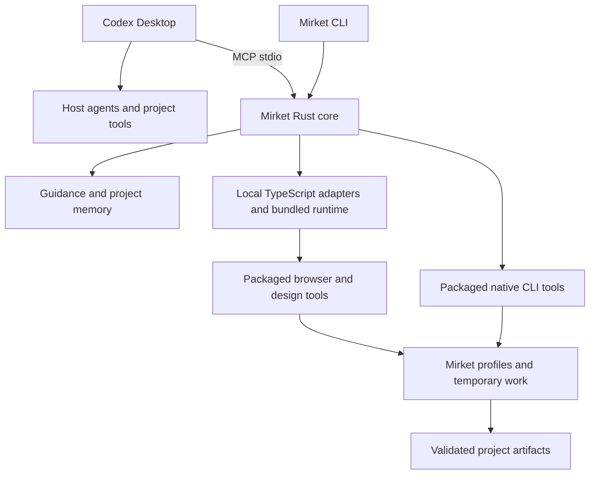

# Rewrite design — supporting architecture and rationale

**Historical architecture rationale, 2026-10-24.** This document records the broad design that led to the [historical approved baseline](implementation-plan-2026-10-24-historical.md). Decisions 84–94 subsequently narrowed document and navigation work, changed native skill delivery and restored private browser/design/video scope in a Codex-only topology. Use the [proposed consolidated plan](implementation-plan.md) for the current execution boundary; the older mechanisms below are evidence, not instructions to resume them.

2026-10-24. The active direction is host-owned agents, macOS Apple Silicon and native Windows in the first release, a Rust core with TypeScript adapters, privately packaged Mirket-owned tools in one complete release and host-owned Office workflows, and reliable headless operation where available. The VM plan is superseded. The mechanisms below remain proposals unless marked agreed. Implementation is underway under the approved complete plan. Version 0.0.1 names the clean release; it is not a reason to omit capabilities required for a good harness.

The [platform qualification matrix](platform-qualification.md) covers macOS ARM64, Windows 11 x64 and Windows 11 ARM64 under decisions 69–71. Upstream native artifacts exist for much of the foundation; browser/ML helper exceptions, bounded PDF editing and SDK prerequisites remain concrete qualification work. Source availability is not runtime verification.

Decision 72 accepts the [PDF feasibility review’s](toolchain-proposal.md#pdf-backend-feasibility-and-proposed-scope-clarification) source-based repagination, bounded direct edits for imported PDFs and explicit reconstruction when needed. This narrows decisions 57–58; the exact direct-edit backend and supported cases remain to be qualified.

Decision 79 assigns Office creation, editing, recalculation, rendering and export to available host tools and supersedes decision 73's private Office runtime. Mirket retains one general Python for its extraction/PDF/SQL libraries; its proposed x64 execution on Windows ARM64 remains subject to qualification. No LibreOffice, UNO, Office Python or Office process supervisor is packaged. Verify actual host capabilities and report gaps; the package does not guarantee identical Office backends across Codex sessions.

## 1. Product and environment topology

**Agreed SDK policy (decision 74):** the [analyzer prerequisite review](toolchain-proposal.md#analyzer-runtimes-and-external-sdk-prerequisites) records private analyzers/runtimes plus explicitly selected user-installed Apple SDKs for C/C++, and Windows SDK/MSVC components for Microsoft-targeted C/C++. This extends decision 52. No automatic prerequisite installation or global tool selection is proposed. Project preparation remains host-owned under decision 32, and passive loading must be verified for each backend.

Mirket is a local companion to Codex Desktop: focused guidance, project memory and specialist tools. Host clients own agent orchestration and model execution.

| Responsibility | Owner and placement |
| --- | --- |
| Models, agents and coordination | Host client, within its supported facilities and permissions |
| Ordinary shell, Git and project builds | Host-native tools and project toolchains |
| CLI/MCP, project selection, guidance and memory | Mirket Rust application on macOS and Windows |
| Browser/design adapters | Mirket TypeScript code, using a packaged runtime for each supported OS |
| Specialist tools and Chromium | Mirket-owned binaries, modules and native libraries in package content; C/C++ may use explicitly selected external platform SDKs/toolsets (decision 74) |
| Profiles, settings, caches, temporary work | Mirket-owned writable locations, separate from versioned program files |
| Source and final artifacts | Explicitly selected host project/output locations |
| Credentials | Host/client mechanisms; no automatic import of personal browser profiles or blanket forwarding of environment secrets |



CLI/MCP share application modules. Each Codex session may launch its own stdio process; live children and sessions belong to that connection while persistent memory/caches have explicit shared-state rules. No background broker is added. Qualify exact host/SDK versions and a common supported protocol in M0a. Current MCP 2026-07-28 changes negotiation, roots and optional task facilities; neither the old URL nor the newest specification proves desktop support. Use official SDK negotiation and explicit application handles, not custom protocol compatibility. [MCP changes](https://modelcontextprotocol.io/specification/2026-07-28/changelog).

**Agreed (decision 69):** macOS Apple Silicon and native Windows are first-release targets. Decision 70 selects Windows 11 x64 and ARM64 alongside macOS ARM64. Exact supported Windows builds and macOS/client versions remain open. Both require native installation and actual capability/client verification; Windows must not depend on WSL or a VM. Private package paths and state directories prevent accidental application conflicts only when tools honor them. They are not an OS access-control boundary: tools still share the host OS, user permissions and hardware resources. Preserve native browser/OS protections; do not disable them merely to make an adapter work. No VM or replacement custom sandbox is proposed.

**Agreed diagnostics (decision 53):** bounded local operational logs with secret redaction and inspectable, user-requested diagnostic exports. No automatic crash/performance uploads or reporting backend. Exclude credentials, saved authentication and raw project/document/memory content from ordinary logs and default exports. Configure bundled telemetry off where supported and verify actual tool behavior, including bounded child-process output; resolve incompatible reporting explicitly. Host-client reporting is outside Mirket's ownership. Retention/size defaults are proposed in the implementation plan; exact export fields remain implementation work.

The Windows release work includes native CI/build artifacts, script/bootstrap trust, client integration, process-tree cleanup, locked-file/update behavior, path normalization, private tool profiles and complete dependency/license inventories. Shared application contracts stay identical; platform-specific prerequisites are declared. The Mac 16 GB performance reference remains; choose and measure a Windows reference separately. No Windows runtime or client integration has been tested yet.

## 2. Implementation language

**Retain Rust core and TypeScript adapters**, moving the adapters from the discarded guest plan to local child processes. Agreed: one Rust crate and one TypeScript adapter package/lockfile. Decision 36 selects compiled adapter JavaScript running on a privately packaged, pinned Node.js LTS runtime; the exact version remains open. No global npm/Bun/Node installation should be required to use packaged tools.

Use a small JSON request/result contract with shared fixtures. Keep CLI/MCP thin and tool-specific behavior in focused adapters. No generic plugin framework, model router or agent scheduler. Additional runtimes need an actual capability justification. Decisions 49 and 79 retain one private general Python for extraction/PDF/SQL; its exact libraries and native distribution require qualification. Office runtimes remain host-owned.

Resolve the Node executable from the active Mirket release, independently of PATH or user runtime installations. Build TypeScript and assemble dependencies during release production; tool calls do not install packages or fetch missing modules. Verify native-module resolution and actual adapter behavior on macOS ARM64. No Bun fallback is selected. Package-manager choice, exact versions and redistribution closure remain pending. Other tool runtimes require their own concrete review. [Node.js release policy](https://nodejs.org/en/about/previous-releases) recommends supported LTS releases for production.

## 3. Package ownership and infrastructure

**Agreed:** one complete release includes all selected specialist tools and their required distributable runtimes. It may contain multiple binaries/app bundles. Decision 68 selects the current user’s home `.mirket` installation root, delivered through installer scripts and a maintained installation prompt. Windows uses the same home-folder convention. Exact internal paths and release payload archive format remain open; the DMG-first workflow is not selected. Decision 74 permits explicitly selected user-installed Apple SDKs for C/C++ and Windows SDK/MSVC components for Microsoft-targeted C/C++; Mirket still owns packaged analyzers and does not install or redistribute those prerequisites. Use one installation/update path, with no optional-pack manager or first-use dependency downloads. Tools start only as needed; session ownership is specified below and idle budgets are proposed in the implementation plan. The following implementation choices are proposed:

- Ship a complete prebuilt payload per supported OS/architecture, targeting macOS ARM64 and Windows 11 x64 and ARM64 in the first release; each needs independent tool/client qualification. Include versioned binaries, compiled adapters, required native libraries and approved assets. Maintain exact component versions, provenance, redistribution notices and integrity metadata. Rely on declared OS system components, not global Homebrew libraries or undeclared Windows runtimes.
- Resolve managed tools by package-relative absolute paths. Never silently fall back to PATH, the user's Chrome, a global OpenPencil app or an unrelated npm cache. This rule concerns Mirket specialist tools, not the user's ordinary project toolchains.
- Launch with an explicit working directory, supported tool-specific profile/config/cache paths and controlled child environment. Do not edit the user's shell configuration, default browser, file associations or unrelated app settings to make tools work.
- Keep writable state outside versioned program files: projects, profiles, caches, logs and operation directories have clear owners. A private application copy alone may still share bundle-ID preferences, keychain entries, IPC endpoints or single-instance detection; verify each GUI tool before claiming coexistence.
- Use on-demand child processes, bounded outputs/logs and explicit cleanup. Browser sessions span tool calls under the agreed ownership and cleanup policy. Avoid an always-running supervisor unless a concrete session requirement demands one.
- **Agreed update policy:** apply updates only on an explicit `mirket update` request, after verifying the complete release. Active jobs retain their existing executables, adapters and assets until finished; keep those resources available. No automatic idle-time installation or incidental component update during tool calls. Preserve memory, profiles, project artifacts and unrelated files through interruption/recovery. Coordinate shared-state migrations with active clients/jobs; decision 75 selects maintenance-window activation for every update, as detailed below. Decision 66 permits update discovery only on explicit check/update requests, with no startup/background checks or independent bundled-tool updates. Check-only behavior retrieves release metadata without downloading or activating payloads; unavailable/unverified sources yield unknown status, not an up-to-date claim. Decision 67 selects one stable channel; prereleases require explicit exact-version selection without a persistent preview subscription. Verify compatibility on subsequent stable transitions and do not silently downgrade. Manifest/trust and version-transition details remain to be specified.
- Produce and verify distribution artifacts in CI; do not compile tools or run upstream installers during ordinary tool calls. Respect native signing/notarization requirements and nested executable signatures; exact release mechanism remains open.

**Agreed installation scope:** privately packaged tools and state belong to the current OS user under their home `.mirket` directory. Ordinary installation and updates require no administrator access, system-wide installation or privileged helper. Keep writable state separate from release contents and limit client configuration changes to the intended user's clients. Native tool/OS permissions still apply. Verify install, update and removal under an ordinary non-administrator account; removing package binaries must preserve durable data unless its deletion was explicitly requested.

Proposed installed content (root agreed; internal names illustrative, not created):

```text
<user-home>/.mirket/
  bin/                    # stable CLI entry point; platform mechanism to qualify
  releases/
    <version>-<os>-<arch>/
      bin/                # mirket or mirket.exe
      runtime/            # private runtimes required by this platform
      adapters/
      tools/
      assets/
      skills/
      manifest.json
      notices/
  state/                  # durable memory, project identity and configuration
  profiles/
  backups/                # aggregate 5 GiB configurable default
  cache/
  operations/
  logs/
```

Installer-script proposal: shell on macOS and PowerShell on Windows, limited to platform detection, obtaining/verifying the selected complete payload and invoking its `mirket setup`. Keep installation, update, rollback and client-configuration ownership in Rust. Do not require globally installed Node/Python, compile tools on the user's machine, overwrite unknown `.mirket` contents or introduce a second installer implementation. Native signing and bootstrap trust remain qualification requirements.

The supplied installation prompt guides the user's host agent through platform detection, existing-state inspection, official bootstrap selection, setup and verification with `mirket doctor` plus actual client invocation. Version it with the installation contract; it must use documented commands and verified artifacts, preserve host permissions and report actual outcomes. Final prompt text and URLs follow verified release mechanics; no installer is being executed or published during planning.

Keep portability focused: one shared Rust core and adapter contract, with small platform-specific implementations for process lifecycle, filesystem/locking/activation, home/path resolution and client integration. Separate OS/architecture manifests expose actual tool availability. Windows x64 and ARM64 each need native-dependency, executable-locking, paths-with-spaces/non-ASCII, permissions and cancellation tests. Detect actual host architecture even from an emulated caller. The Rust core is native per target. Decision 71 permits explicitly inventoried, privately packaged x64 helper processes under Windows emulation when no suitable native ARM64 build exists, subject to output, compatibility and performance verification on ARM64. Keep each process’s native dependencies architecture-compatible, report emulated components accurately and do not introduce automatic native/x64 fallback backends. A portable programming language does not establish tool or client parity. No VM, universal payload or speculative platform framework is introduced.


The user asks for no overlap with ordinary host applications. Acceptance must demonstrate separate binary selection and application state, not promise zero OS-generated files, zero resource contention or a sandbox. Tools that cannot meet the required separation must have an explicit alternative or a disclosed limitation before selection.

### Installation, activation and recovery contract

**Agreed activation policy (decision 75):** stage updates while work continues, but activate every release through a short maintenance window with no active Mirket sessions or state users. Keep one active release rather than concurrently serving old and new versions. This refines decision 29 without cancelling jobs or introducing backwards-compatible state formats. The user-visible tradeoff is a brief client reconnect; a busy installation may keep a verified update staged until another explicit update request.

#### Ownership and installation

Keep one Rust installation/update owner and the existing per-user `.mirket` root. Thin platform scripts obtain the authenticated bootstrap and invoke that owner. The maintained installation prompt selects the documented commands and reports results; it must not invent repair scripts or duplicate installation logic. The simple release workflow below uses established hosting and platform verification. A checksum alone does not authenticate a publisher.

Use immutable versioned release directories and separate writable state, profiles, caches, logs and operations. A small activation record identifies the complete selected release; resolve all tools from that release for the lifetime of a session. Do not update individual runtime files in place. The stable launch entry must work for Codex Desktop on all three targets; its exact executable/script form and any replacement procedure remain qualification work, not a second supervisor or daemon. Do not require developer-mode symlinks on Windows.

Fresh setup validates destinations, available space, native architecture and client configuration before committing changes. Stage and verify the complete package, then run bounded local installation checks with disposable state and no project execution or network dependency fetching. Existing unrecognized `.mirket` contents, including the old harness, are a conflict to report; there is no legacy importer or implicit replacement. Patch only the intended client entry, preserve unrelated configuration, and detect edits made after inspection. A partial setup must describe which steps completed and recover only its own changes.

Use local storage with qualified locking and replacement semantics for managed installation/state. Network or cloud-synchronized homes require explicit feasibility review; project source locations have a separate support contract. SQLite documents that WAL requires same-host shared memory and does not support network filesystems. Windows replacement operations have sharing/access requirements and documented failure states, so Unix rename behavior is not a sufficient implementation specification. [SQLite WAL constraints](https://sqlite.org/wal.html), [Windows replacement semantics](https://learn.microsoft.com/en-us/windows/win32/api/winbase/nf-winbase-replacefilew).

#### Explicit update and activation

| Phase | Behavior and observable outcome |
| --- | --- |
| Check | Only an explicit check/update contacts the release source. A check fetches metadata only; report available, no eligible transition, or unknown with the evidence time. Preserve stable/exact-prerelease rules and reject implicit downgrades. |
| Stage | An explicit update may download a complete compatible target release to an owned temporary location while existing work runs. Verify authenticity, inventory, platform requirements and space before marking it staged. Interrupted/invalid downloads never become launch targets. |
| Request activation | Stop admission briefly while checking installation-wide ownership. If any Mirket session, owned tool, profile user or state operation is active, release the admission gate and report staged/busy. Do not cancel work, keep clients blocked indefinitely, or activate later in the background. The user closes sessions/disconnects Mirket clients and explicitly resumes the update. |
| Enter maintenance | Once no users remain, hold exclusive activation ownership. New launches report maintenance/retry instead of opening shared state. Validate the observed active release again. Use bounded OS locks plus owned process/session identity; do not infer ownership from a PID or process name alone, or treat a stale text marker as a live lock. No always-running coordinator is added. |
| Prepare state | Create and verify required pre-migration recovery material within decisions 60–62. Migrate only affected Mirket state with recorded progress. Do not run old/new servers concurrently, overwrite project files, upgrade user SDKs or alter unrelated app settings. If space or recovery prerequisites fail, keep the old installation usable. |
| Activate | After candidate checks and state preparation succeed, commit the selected release through a platform-qualified operation and report its exact version. Release the gate only when release/state consistency is established. Clients then reconnect through their normal mechanism; actual MCP invocation is a separate verification step from CLI health. |
| Reclaim | Reclaim only owned, unreferenced staging and obsolete release files after checking active use and recovery requirements. A locked Windows file is deferred, not grounds to kill a process or delete a different path. Keep the previous verified release while required for recovery; exact retention/space limits remain to be set. |

This policy intentionally treats idle connected Mirket servers and explicitly retained browser sessions as users of the old release. It does not close the host application's conversation or terminate unrelated processes. Instructions must explain how to stop/reconnect the Mirket integration in Codex Desktop; automatic client respawn during maintenance is a required test. No seamless hot-update promise is made.

Package-space admission covers staging, unpacked payloads, the active release, required previous release and temporary state migration material. The 5 GiB memory-backup cap remains separate from installed tools and caches; protected recovery points must not be deleted merely to make an update fit. Report required/available bytes and leave ordinary use available when staging cannot proceed.

#### Recovery and removal

Record a compact update transaction in the existing operations area: old/candidate release identities, affected state, recovery locations and completed phase. This is installer recovery state, not an agent journal or new workflow service. Startup reads this local record without checking upstream. If interruption leaves activation uncertain, do not admit normal state access until the owner establishes a consistent release/state pair. Recovery can complete a known safe step or undo the unfinished migration using its verified recovery material; ambiguous or destructive cases require an explicit action.

Before successful activation is exposed to clients, failed preparation must preserve or restore the previous state and release. After the new release has accepted writes, never automatically restore an older memory snapshot to make an old executable run. Recovery then requires a compatible forward repair or an explicit restore with its consequences shown. Retaining an old binary does not establish schema compatibility, and this plan does not add down-migrations or a permanent dual-format layer. Known forgetting records continue to govern every recovery path.

Use SQLite's supported backup mechanism for consistent database snapshots rather than copying only a live database file. A multi-scope migration needs coordinated quiescence and recoverable per-scope progress; an individual database transaction is not an atomic transaction across all memory stores, configuration and profiles. Browser profile formats and other mutable tool state also need a declared transition/recovery contract; a memory backup is not a backup of those resources. [SQLite backup API](https://sqlite.org/backup.html).

Uninstall stops only explicitly selected Mirket-owned activity, removes verified owned client entries and program files, and preserves durable memory, saved profiles and backups by default. Deleting retained data is a separate explicit request. Detect client-entry drift instead of deleting a user's changed configuration. No cleanup action removes external SDKs or project files.

#### Required release tests

Exercise two Codex sessions racing with update, a saved browser session blocking activation, client auto-respawn during maintenance, crashes at each phase, disk-full conditions, wrong/corrupt packages, concurrent client-config edits, Windows executable locks and SDK absence. After each interruption, prove which release/state pair serves requests and that current records, forgetting policy and unrelated files survive. Test post-activation writes followed by a failed rollback request: new data must not disappear. Verify real reconnect and a useful tool result in Codex Desktop on macOS ARM64, Windows x64 and Windows ARM64.

The source review supports these constraints; no installer, migration or client-reconnect path has been implemented or executed. Decision 75 accepts maintenance-window activation and its interruption/reconnect behavior. The surrounding implementation details remain proposals where not already agreed; exact platform mechanisms, trust/signing, retention/resource numbers and qualification evidence remain subsequent planning and implementation work.

### Simple release and installation workflow

**Direction under decision 76:** keep release engineering small. Use established hosting, platform verification and the existing Rust installer. The following is the simplified working design; exact publisher accounts and paid services remain unselected.

1. **Build one version.** CI produces the complete macOS ARM64, Windows x64 and Windows ARM64 packages, plus the existing thin shell/PowerShell scripts, checksums and dependency/license inventory.
2. **Publish one GitHub Release.** Attach all three packages to the same version and use GitHub's release immutability. Keep exact version URLs in the maintained installation prompt. The repository identity and URLs will be set during release preparation. Publication still needs explicit authorization. [GitHub immutable releases](https://docs.github.com/en/code-security/concepts/supply-chain-security/immutable-releases).
3. **Install into `.mirket`.** The prompt guides download, verification and setup. Save scripts before execution, verify the expected version/target and SHA-256 hashes, and use the Rust CLI for substantive setup. Keep expected bootstrap hashes in the versioned installation instructions. Use standard OS signature/publisher checks for native executables; do not introduce a separately downloaded verifier or a global package-manager dependency.
4. **Update explicitly.** Query the official GitHub release metadata only on request, select an eligible stable version or the explicitly requested prerelease, verify its package, and use decision 75's stage/maintenance/reconnect flow. Never silently downgrade. Unreachable or invalid metadata produces unknown status; installed tools continue working.

Treat the official distribution account and trusted installation instructions as the distribution trust boundary. Checksums detect changed bytes but do not independently authenticate a publisher when an attacker can replace both the package and checksum. Retain standard platform signing as the release-preparation route: Developer ID/notarization on macOS and Authenticode on Windows. Qualify the actual packaged tools and bootstrap on clean machines; do not bypass OS protections or promise that signing removes every warning. Provider enrollment and any fees are deferred operational decisions, not authorizations granted here. [Apple distribution](https://developer.apple.com/developer-id/), [Windows signing](https://learn.microsoft.com/en-us/windows/apps/develop/smart-app-control/code-signing-for-smart-app-control).

Keep a plain inventory containing version, target, source revision, required platform versions, package hashes/sizes and licenses. Validate archive paths and ownership before extraction. Test damaged downloads, wrong targets, interrupted setup, native publisher verification and the already agreed update recovery behavior.

Remove the separate Mirket signing-key system, Minisign dependency proposal, signed channel index, sequence/expiry protocol and custom key-rotation workflow. There is no custom release service, runtime attestation client or extra end-user verification tool. GitHub-generated provenance can remain release evidence without becoming a new installation subsystem. This simpler trust model relies more directly on the official distribution account and native signing; do not claim the independent manifest authentication offered by the discarded proposal.

No installation, account creation, purchase or publication is authorized. Finish platform signing details when the actual packages and publisher identity exist, rather than extending architecture planning with speculative provider choices.

### Browser and design feasibility

Chromium is the sole browser engine in the complete release. Verify its workflows on macOS ARM64 and report build/version and headless or visible mode. Private profiles remain separate from personal browser sessions; existing ownership and cleanup rules apply. Measure package size and bound runtime concurrency. Chromium coverage does not establish every branded browser/device/OS combination.

Decision 83 selects privately packaged Chromium only. Playwright is the proposed integration and documents matched browser builds and package-local browser paths. Pin a compatible Chromium build with the selected integration version and configure its path per Mirket process, not globally. Avoid an additional headless shell if the full build meets the required headless/visible workloads; verify rather than assume. Exact version and distribution closure remain pending review. [Playwright browser management](https://playwright.dev/docs/browsers)

Headless is preferred only where actual output and behavior are correct. Visible operation remains available for requested inspection or a capability that needs it. Use Mirket-owned browser profiles and endpoints in both modes; do not connect to existing personal browser sessions. Verify Chromium sandbox configuration explicitly because Playwright exposes a separate option whose documented default is false. No host isolation claim follows from enabling it. [Browser launch API](https://playwright.dev/docs/api/class-browsertype)

OpenPencil's CLI documents explicit file operations, and omission of a file can connect to a running desktop app. Prefer explicit file mode for automated editing/export so it cannot accidentally select the user's editor. Its CLI/SDK is a candidate, not a verified dependency. Check the runtime, native modules, fonts, actual export fidelity and macOS ARM64 package before committing to it. [OpenPencil CLI](https://openpencil.dev/reference/cli), [export behavior](https://openpencil.dev/programmable/cli/exporting)

No assumption that a desktop app is fully headless or self-contained: OpenPencil's desktop app uses the system WebView. A GUI path may require supported macOS components and separately verified app-state separation. [OpenPencil platform requirements](https://openpencil.dev/getting-started)

These API documentation sources verify technical choices; they do not change the retained A–G guidance catalog. No dependencies or binaries have been installed or approved by this research.

### Agreed performance reference

Decision 46 selects a 16 GB Apple Silicon Mac for evaluation of the full agreed feature set, using bounded concurrency and leaving capacity for the host client and representative normal applications. This is not a measured performance result or a strict minimum-memory requirement, and it does not reduce capabilities.

Benchmark records must identify chip, OS, client versions, workload sizes and concurrent applications. Measure cold/warm latency, idle/peak process-tree memory, pressure/swap, CPU, package/cache size and responsiveness for browser, analysis, memory, document and video work, including representative combinations. Decision 47 selects throughput-first bounded concurrency. Set concrete resource/parallel-job/idle limits and acceptance thresholds from the workload requirements and validate them after implementation. Do not extrapolate simultaneous-operation capacity from isolated tool success.

### Agreed heavy-work concurrency

Decision 47 selects throughput-first operation: multiple heavy render/export jobs may run concurrently by default, accepting greater memory pressure and potential interface slowdown. Bound and expose configurable concurrency; queue excess work with visible state and cancellation. Do not silently impose a single-heavy-job default.

Determine actual parallel-job counts and resource budgets through combined-workload measurements on the 16 GB reference, including each tool's own worker/thread/process fan-out and the active host client. Preserve job ownership, browser-profile exclusivity and output integrity. Verify cancelling one job does not affect others and resource exhaustion/partial artifacts are reported accurately.

This is tool-job scheduling within the agreed local runtime, not another agent scheduler or permanent broker. No unmeasured throughput improvement is claimed.

## 4. Runtime and state topology

Propose a small operation lifecycle: validate request → prepare work paths → launch selected packaged tool → collect bounded output → verify artifact → finalize → clean up. Temporary work directories organize effects; they do not restrict the child process's OS access.

- Track only Mirket-owned processes and descendants. Cancellation stops those processes, not all processes matching a tool name. Check concurrent-client cleanup and GUI/browser process reuse explicitly.
- **Agreed save policy (decision 59):** edited documents/designs default to a new output copy, preserving the original; honor explicit in-place/overwrite instructions without repeated confirmation. Return the actual saved path, detect conflicting source/destination changes and preserve linked-asset references. A failed or cancelled operation does not replace final output with a partial file. Refuse unexpected overwrites or changed destinations. Do not replay actions with uncertain effects automatically, including a switch from headless to visible mode.
- Pick structured arguments, explicit input files and controlled local endpoints. Avoid selecting an arbitrary running browser/editor by default port or active-window identity.
- Temporary sessions by default plus optional explicitly selected saved profiles are agreed. Named saved profiles can be explicitly reused across projects. Live sessions span tool calls and belong to the initiating client connection, with explicit close, bounded idle cleanup and cleanup on owner disconnection. The implementation plan supplies proposed idle/hold/concurrency defaults; the contracts below define ownership and recovery. No separate agent execution journal or durable model scheduler is proposed.
- Decision 45 selects authorized asset preparation followed by local rendering for authored design/documents/video. Ordinary browsing retains its agreed network behavior. Local-development endpoint access, credentials and renderer-specific network controls still need concrete contracts. Decision 44 permits additional font downloads only by explicit choice; existing authorization should be honored without redundant prompts. A headless mode is neither an offline guarantee nor an authorization mechanism.

Memory proposal: per-project host-local SQLite outside source checkouts, containing canonical records, provenance, exact/keyword search and derived semantic indexes; a small global configuration for project paths. Bounded logs and binary artifacts remain files. Embedded hybrid retrieval with current/historical validity and bounded context delivery is selected in decision 20; exact component versions remain pending. Agent-curated saves through explicit memory tool calls are agreed. Project-local facts plus a separate shared user-preference scope are agreed; durable retention is agreed in decision 21. [SQLite deployment guidance](https://www.sqlite.org/whentouse.html)

### Host, tool and evidence contracts

Decision 77 applies the independent-review corrections below. They refine accepted outcomes within the existing Rust owners; they add no service, agent lifecycle or general execution framework. The implementation plan owns milestone order/default budgets, this section owns shared invariants, and toolchain/platform documents own backend qualification.

**Host and guide delivery.** Use a canonical portable `SKILL.md` corpus with exact IDs, concise activation/nonactivation metadata and relative focused references. Install thin managed native entries/indexes through Codex's qualified skill mechanism; they load selected bodies through Mirket's release-bound read route. Keep one authored body, not independent native/MCP copies. If the Codex mechanism cannot support that route, qualify native delivery from the same corpus before expansion. Do not rely on the new MCP Skills extension without demonstrated support. Setup detects name collisions and managed-copy drift. Reads/results identify release and guide revision; stale entries resolve only matching guidance or report reconnect/update required. No cached guide may silently describe another tool release. Operational requests carry the expected full release identity supplied by the guide/tool contract read; reject missing or mismatched identity before effects. Discovery, current-guidance and scoped receipt-inspection calls remain available for recovery. Supporting reads resolve against the same guide revision. Do not silently refresh the expected identity and replay: the host must obtain current instructions. Use the full release identity initially, without a cross-release compatibility layer. Test release A guidance retained in the same conversation after maintenance activation of B, including a new root-addressed edit that has no old live handle. Test offline exact-ID lookup, ambiguous/trivial selection, reference resolution, actual activation and update/reconnect in Codex Desktop.

**Scope.** Every project operation supplies an explicitly selected root or resolved project/checkout handle; a single unambiguous configured root may be defaulted. Return resolved scope. Root lists are hints, not task identity or permissions. Same-checkout task records use an explicit caller correlation key where needed, not an inferred/authenticated host thread ID. Live handles bind owner connection, project/checkout where applicable, tool/release and source identity. Cross-project saved-profile selection remains explicit; it creates a new scoped live session rather than retargeting an existing handle. Removing a root blocks further implicit use; it does not delete memory. Host transcripts, task events and subagent identity are unavailable unless actual host integration supplies them.

**Operations and results.** Maintain a finite capability-to-operation inventory with stable names, schemas, bounded inputs/outputs, source object/range addressing, prerequisites, effect class, supported edits and an inspection route. Keep browser inspection, web submissions, asset acquisition and local rendering distinguishable to host permissions. Asynchronous start is a lifecycle shape, not one opaque public dispatcher: retain effect distinctions at actual host tool-policy boundaries and test an inspection-allowed/submission-denied policy. Do not expose arbitrary Node/Python/shell dispatch as an innocuous tool. Reuse backend object models and typed patches rather than inventing a universal document language. Errors state the missing prerequisite, coverage and next useful action. No `approved: true` argument substitutes for host permission.

**Jobs and uncertain effects.** Use bounded start/status/cancel/result calls over the existing job owner. Each logical operation has an ID distinct from its RPC IDs; repeating a start with the same ID and identical intent returns the known operation, while changed intent is rejected. Explicit retries after reconciliation use a new operation ID. States distinguish queued/running/cancelling and terminal complete/partial/unsupported/error/cancelled; effect knowledge separately records not-attempted, confirmed (with what happened) or unknown. Cancellation acceptance is not rollback. The documented OpenAI MCP default call timeout is 60 seconds; qualify short RPC response budgets in each actual client. Do not depend on a ten/thirty-minute RPC, an unqualified MCP Tasks extension or durable process resumption. [MCP timeout configuration](https://developers.openai.com/codex/mcp/).

Record the local commit boundary and minimal intent/result receipt before publishing output or committing a durable mutation. Reconcile response loss by operation ID and actual path/revision. A bounded inspection route permits the selecting host to inspect a receipt after reconnect or release activation without reviving process handles or old executables. State migration preserves readable receipts or explicitly reports unavailable evidence without replay. Retain ordinary completed receipts for up to seven days subject to a proposed 50 MiB installation budget; byte pressure may evict them sooner. Receipt absence never establishes a fresh start. M0a/M1 must choose a bounded issuance/expiry rule that distinguishes a valid fresh operation identity from an expired or replayed one independently of ordinary receipt presence. IDs outside retention are explicitly expired/unknown and are never automatically rerun. Test byte-cap eviction before seven days and age expiry, then reconnect/retry the old ID without repeating its effect while a genuinely new operation can still start. Do not add permanent per-operation tombstones or an indefinite replay guarantee. Preserve unresolved ownership/commit receipts until reconciliation, with new mutations requiring receipt capacity deferred if protected records exhaust the budget. Keep read-only inspection, status and reconciliation available to resolve that pressure. Receipts exclude artifact bodies and credentials; memory receipts carry only opaque identity/revision and obey forgetting exclusions. User-designated saved artifacts are not receipt-cache files. Staging and external effects with unknown outcome stay inspectable; browser submissions are never automatically replayed.

**Ownership and shutdown.** All live analyzers, adapters, browsers and jobs are connection-owned; reuse only within the same valid owner/checkout/release. Share qualified persistent caches and memory, not live handles. One installation-wide admission/ownership record under native locks coordinates heavy/analyzer/browser slots, saved-profile exclusion, cleanup and activation. A terminated parent alone cannot free resources still used by descendants; establish stopped ownership using platform evidence resilient to PID reuse. Unknown ownership stays busy/recoverable. Define lock order maintenance → admission → scoped mutation; never hold a global lock for the duration of a job. Acquire combined resource reservations atomically before launch, so waiting work holds no partial slot set.

Explicit cancel may use the proposed five-second local grace, but owner death may give none. The qualified Codex bundled-backend fixture terminates its MCP process with SIGTERM; qualify each native target and use platform process-tree cleanup plus recoverable records. Correctness must not depend on a shutdown callback finishing. At the next ordinary launch, reconcile ownership and committed outputs before clearing leases/staging. No permanent reaper is introduced; if descendants cannot be proven stopped, block affected admission/update and report targeted recovery. [Codex shutdown evidence](../docs/m0-codex-native-qualification.md).

**Artifacts and inspection.** Declare a single-file or new owned directory/archive as the publication unit. Stage all members and verify the manifest, linked assets and source/PDF correspondence before finalization. Host-owned source edits keep the host edit workflow. Explicit in-place multi-file edits use a declared conflict/commit boundary with recoverable originals; never claim arbitrary filesystem transactionality or finalize a mixed-version set. Where a backend cannot preserve the requested edit contract, report the case before changing files; a material loss of required in-place capability returns for a product decision, not a silent downgrade.

Return saved path, media type, content/revision identity, page/sheet/frame extent and bounded inspection routes. Images/pages/crops, text/table/formula reads and video frames refer to that saved revision; changes invalidate old previews. Use existing MCP content/resource primitives and host file/media facilities, with a qualified route in Codex Desktop. Report checked coverage and unavailable playback/semantic checks; neither renderer exit nor a path is verification. Keep full-resolution originals on disk and avoid whole-document context dumps.

**Browser observation/action.** Bind observations and actionable references to owner/session/tab/frame and observation revision. Re-observe after material changes; reject stale/missing targets rather than reuse an ordinal. Support focused structured snapshots, screenshots and observable action outcomes; Readability content is separate from interaction state. Qualify dialogs, uploads/downloads and new tabs for each advertised operation. Test duplicate labels across frames, replaced buttons and timeout-after-submit without resubmission.

**Analyzer preparation.** Each risky backend declares supported project forms and a host handoff: missing prerequisite/reason → concrete preparation action as data → accepted metadata/config paths with source revision, target and toolchain/SDK identity → passive refresh. Validate freshness and negotiated position encoding before returning public spans. Prepared metadata never authorizes rerunning its producer. Test the full round trip and disabled executable/config overrides; no useful passive route is an explicit qualification failure before expanding that backend.

**Recall, constraints and continuation.** Search hits include stable record/source identity, revision/capture identity, locator, scope, temporal/conflict state and coverage/expansion route. Bounded range/batch source reads recheck revision and report changed/unavailable sources. Distinguish no matching evidence, incomplete index, unavailable source and budget truncation; never silently omit applicable critical constraints. A curated constraint record has explicit scope, current validity and applicability selectors (for example task key, target checkout, operation class); the caller supplies task context. Return matching current constraints independently of semantic rank and report unclassified/overflow coverage rather than claiming universal applicability. No memory grants execution authority.

Continuation records retain objective, current constraints, selected scope/task key, artifact/source pointers, completed work with evidence, unresolved questions, next actions and unknown effects. Separate observations, inferences and proposals; recheck source applicability on resume and link existing plans instead of duplicating transcripts. Learned techniques remain curated notes unless a user asks to author/update a skill.

**Forgetting and recovery.** Keep durable content-free exclusions keyed by stable scope/record lineage outside the state replaced by ordinary scope restore or update rollback. Commit the exclusion and invalidate affected snapshot eligibility before acknowledging logical forgetting; all read/import/restore/backup-completion paths consult current exclusions. Physical cleanup of affected content is recoverable and its incomplete status remains explicit; do not claim full removal until it finishes. A concurrent backup cannot become eligible from pre-forget content. Preserve this authority through migration/recovery; no semantic fingerprints or recognition of arbitrary rewritten external copies. Test forget → older restore → old import, concurrent backup completion and crashes at each transition.

**Acceptance.** Freeze schemas only after useful M0a host journeys. Discriminating fixtures include two tasks in one checkout, stale browser refs, long job/response loss, abrupt death with competing client/update, interrupted multi-file publication, later-page clipping/stale previews, missing analyzer metadata and forgetting/constraint-overflow cases. These are bounded contracts to implement, not claims of tested readiness.

### Agreed project selection

Decision 37 selects the active project from host-provided workspace information or explicit launch configuration. Ask for explicit selection when context is missing, conflicting or ambiguous; no separate registration step is required for an unambiguous workspace. Validate and normalize the root without silently expanding scope. Repository content and retrieved memories cannot select or broaden the workspace.

Bind memory/navigation operations to the resolved project and source context. Project switches must not reuse the previous project's implicit scope. Workspace selection grants no filesystem or execution permissions. Verify workspace delivery in Codex Desktop; use explicit configuration/selection when metadata is unavailable. Decision 38 defines verified-worktree memory sharing below. Decision 39 allows explicitly selected multi-project tasks as described below. Persistent identity mechanics remain to be specified, with no automatic sharing based solely on folder names or remote URLs.

### Agreed worktree memory scope

Verified Git worktrees of one repository share durable repository-wide knowledge. Task progress, branch/revision-specific facts and navigation indexes remain checkout-scoped. Recall combines applicable repository-wide records, current-checkout records and relevant shared user preferences without erasing their scope or provenance.

Verify relationships through repository metadata; independent clones do not share memory solely because their names or remote URLs match. Durability alone does not establish repository-wide applicability. Preserve revision/source context, prevent branch changes from making old facts appear current, and keep uncertain scope local rather than automatically promoting it.

Memory sharing does not authorize reading sibling worktrees. Removing a worktree preserves shared repository knowledge. Decision 64 recognizes verified moves/renames automatically and retains project identity; ambiguous continuity requires clarification. Names/remotes/content similarity alone cannot merge projects. Preserve historical provenance and revalidate current paths/indexes. Decision 65 retains checkout-specific rebuildable caches for a 30-day observed unavailability grace period, then allows eligible cleanup during normal runtime maintenance. Preserve durable memory, identity, separately retained backups and active/recovery state; recheck availability and ownership before reclamation. Verified reconnection/moves end the interval. Exact identity evidence/persistence and cleanup mechanics remain to be specified; automatic clone linking is not selected.

### Agreed multi-project task scope

One host-owned task may span multiple explicitly selected roots. Every project-scoped operation identifies the target project and checkout/source context. Resolve unambiguous explicit context; require selection when multiple roots could apply. Do not search all projects to compensate for missing scope or add roots inferred from dependencies, repository content or remote URLs.

Memories remain separate per project, subject to the agreed sharing between verified worktrees of one repository. The host agent may combine deliberately retrieved evidence from selected projects while retaining project/source attribution; no automatic memory merging, fact copying or global promotion follows. Selection grants no additional permissions or Mirket-owned task orchestration.

Concurrent operations carry their own scope rather than using a mutable global current project. Removing a selected root ends its implicit use without deleting durable memory. Verify ambiguity, concurrent calls, project switching and failure recovery cannot redirect work into another project.

## 5. Toolset

Concrete dependencies and versions remain proposals. Included specialist tools use Mirket-owned package content and state.

| Capability | Proposed implementation |
| --- | --- |
| Editing, commands and Git | Existing host facilities and project toolchains |
| Code navigation | Agreed: symbol search, definitions and references through a common tool contract for Codex Desktop. Broad language/file coverage is agreed below; on-demand incremental indexing and reusable local caches are agreed; concrete analysis engines and lifecycle limits remain to be selected |
| Skills | Small searchable index and explicit reads |
| Memory | Structured records, exact search, agent-curated writes and project/shared-preference scopes are agreed. Embedded hybrid retrieval, temporal/source relationships and bounded context assembly are selected; durable retention is agreed; exact components and temporary-data cleanup remain open |
| Browser checks and research | Agreed scope: local previews and public-web navigation, extraction, screenshots and permitted interactions. Chromium is the sole engine. Proposed integration: packaged Playwright with a matched build; headless preferred, visible when needed. |
| Editable design | Agreed capability: create, inspect, edit and export editable layouts/components. Proposed implementation: packaged OpenPencil CLI/SDK in explicit file mode; visible use when needed and coexistence is verified |
| Raster/vector | Packaged Sharp/resvg; SVGO only if normalization is required |
| Tokens | Project-owned token sources; Style Dictionary only if transformation is needed |
| Architecture diagrams | One packaged renderer; D2 is the initial candidate |
| Video/motion | Agreed: interface animation plus standalone video export with supplied audio, timing/volume controls and captions from supplied text. HyperFrames with Anime.js/CSS/WAAPI is selected in decision 49; verify and package the selected browser/media dependencies |
| Documents | Agreed: PDF and editable DOCX/PPTX/XLSX creation, existing-file editing, text/table/structure extraction, scanned-content OCR, previews, applicable PDF export and supported formula recalculation. Concrete feature coverage and tools remain to be selected |
| Evaluations | Representative fixtures, actual outputs and failure checks; Promptfoo is a reference and possible development tool |

Focused code navigation is agreed; Serena informs its design without selecting its runtime. Results must identify project/source/revision, distinguish syntax matches from resolved symbols, and disclose stale, unavailable or incomplete analysis. Read-only analysis and explicitly authorized host execution of required prerequisites are agreed in decision 32. Verify same-name symbols, edits/branch changes and missing dependencies.

Crawl4AI, Stagehand and Skyvern inform web tools; CUA/Ponytail remain conceptual references; general desktop automation is outside Mirket 0.0.1. Their inclusion as references does not select their runtimes or silently expand scope. Compare adoption cost against a small maintained adapter. LangChain/LangGraph remain conceptual references under host-owned agents.

Public-web browsing and optional saved login profiles are included. Editable design documents are included. Interface animation and standalone video export are included. PDF, DOCX, PPTX and XLSX deliverables are included. General desktop automation is excluded from Mirket 0.0.1; embedded hybrid memory is selected; document workflow scope is agreed in decision 40; per-format features and tools still need definition. Headless preference must not silently exclude a needed capability or automatically add every desktop integration.

### Agreed code-navigation coverage

Decision 81 supersedes the earlier broad language inventory. The exclusive first-release language/file/framework targets are Python, Rust, TypeScript, JavaScript, C, C++, Bash, JSON, HTML, JSX, TSX, CSS, TOML, XML, PowerShell, Vue, Angular, Astro, SVG and YAML. SQL navigation uses the five qualified bounded profiles `postgres`, `sqlite`, `mysql`, `tsql` and `duckdb`; per-dialect limits remain explicit. Other languages are outside this release. Source research does not extend the target list.

| Target family | Included targets | Qualification boundary |
| --- | --- | --- |
| Programming-language source | Python, Rust, TypeScript, JavaScript, C, C++ | Syntax/structure and original source locations are distinct from symbol search, definitions and references; qualify each semantic operation separately. |
| Shell automation | Bash, PowerShell | Report syntax structure separately from resolved symbols and disclose dynamic-resolution limits. |
| Web files and embedded components | HTML, JSX, TSX, CSS, Vue, Angular, Astro, SVG | Identify structures and embedded script/style/template regions without fabricating cross-language bindings. Navigation needs its own framework and source-location evidence. |
| Structured configuration | JSON, TOML, XML, YAML | Preserve keys, attributes, values and original spans; claim schema/link resolution only where a qualified backend establishes it. |
| Offline SQL | `postgres`, `sqlite`, `mysql`, `tsql` and `duckdb` | Use revision-bound queries and declared schemas; report ambiguous or unsupported bindings, without database connections, migrations or full-dialect claims. |

Package only selected, admitted components. Start analyzers only when needed, bound indexing and release idle resources. A parser producing a syntax tree does not establish complete project navigation, reference coverage or passive loading. Test same-name scopes, embedded regions, Unicode/CRLF spans, edits, branch changes, missing metadata and unsupported syntax. Read-only source access does not authorize builds, project plugins, generators, dependency downloads or scripts. Report each operation's implemented and qualified status independently.

The [JSON inspection record](../docs/m3-json-inspection.md) establishes one structural slice. It does not establish the other target syntaxes or full semantic navigation. The [historical language research](reviews/2026-10-25/superseded-language-tooling.md) is preserved as evidence and does not expand the current language scope. The five SQL profiles retain their separate current [qualification](../docs/m0-sql-qualification.md).

### Agreed analysis-execution policy

Read-only project analysis is the default. Inspect sources and available metadata without modifying project files or implicitly executing repository build scripts, plugins, generators, macros or other project code. Mirket-owned analyzer indexes/caches may be written separately from project files.

When navigation requires generated files or build metadata, report the missing prerequisite and explain the concrete host command needed. The host agent may perform that action under applicable explicit authorization and host permissions, then refresh analysis. Reuse existing authorization where it applies; do not ask repeatedly or introduce a Mirket command runner. If inputs remain unavailable, report incomplete analysis.

Verify each analyzer's behavior and configuration with fixtures that reveal accidental project-code execution; protocol read requests alone do not establish this property. If required implicit execution cannot be disabled, disclose the limitation and select an appropriate alternative. This policy does not provide an OS sandbox.

### Agreed navigation indexing policy

Index on demand, refresh affected data incrementally and reuse valid local caches across sessions. Scope caches to the actual project/worktree, analyzer identity and relevant inputs; keep them in Mirket-owned state. Stop idle analyzers without requiring a permanent indexing service.

Validate source/configuration freshness before returning cached results as current. File edits, renames/deletions, branch changes, dependency/configuration changes and analyzer updates invalidate affected analysis, including dependent references. Report incomplete coverage during refresh. Derived caches can be rebuilt after invalidation or corruption.

Reuse analyzer-native incremental indexing and persistence where available; do not create a parallel semantic index to force unsupported persistence. Some analyzers may rebuild internal state at startup. Per-engine invalidation remains implementation work; use the proposed resource/idle defaults and on-demand reclamation in the implementation plan, then measure them. Verify separate-worktree isolation and source freshness, not merely successful cache loading.

## 6. Skillset

Agreed: one short shared workflow plus twelve capability guides, loaded on demand. Implementation adds one selectively loaded Memory operations guide so detailed memory scope, provenance and recovery guidance does not enlarge the Research entry point.

| Guide | Responsibility and boundary |
| --- | --- |
| Engineering | Requirements, architecture tradeoffs, implementation, debugging, performance profiling, databases and API integration |
| Verification | Tests, code review, regression checks and evidence from actual artifacts/effects |
| Research and context | Source-backed investigation, reference selection, source verification, contradiction handling and explicit memory maintenance |
| Interface and visual design | Composition, design systems, editable design, accessibility, usability, responsive behavior and inspected output |
| Motion | Interaction motion, lifecycle, accessibility and standalone video/exported playback |
| Product and marketing | User discovery, prioritization, positioning, copy, marketing execution and measurement |
| Documents and artifacts | Extraction/OCR, authoring, calculations and rendered-output inspection for supported formats |
| Memory | Explicit record curation, scoped retrieval, source-linked revisions, forgetting and recovery; loaded only for memory operations |
| Security and privacy | Trust boundaries, permissions, secrets, dependency risks, sensitive data and threat-driven checks; complements implementation ownership |
| Reliability and delivery | CI, packaging, releases, migrations, observability, incident diagnosis, recovery and rollback; owns operational readiness rather than duplicating correctness testing |
| Data and analysis | Data cleaning, SQL analysis, statistical reasoning, experiments and trustworthy charts; owns analytical validity while document guides own artifact production |
| AI systems and evaluation | Retrieval/context quality, agent/tool evaluations, prompt experiments, model comparison, latency and cost; addresses probabilistic behavior beyond general testing |
| Planning and coordination | Ambiguous goals, executable plans, dependencies, independent reviews and integrated results; uses host-owned agents and lifecycle |

Every guide defines activation conditions, expected outputs, relevant evidence and stopping criteria. Keep permission rules and the basic workflow in one shared location. Give each guide a short entry document with focused supporting references selected for the task; do not load every subtopic or guide together. Choose a lead for the actual deliverable and add support only for affected boundaries.

These are authored guides informed by the retained A–G catalog and decision 77’s six focused method additions in H. Exact source-to-section mapping and reuse review remain authoring requirements. Superpowers, Matt, ECC and gstack contribute selected techniques to one coherent workflow; their full instruction systems do not all run at once. ADHD reference use follows the user's communication preferences and implies no diagnosis. The focused-guide structure adds expertise, not new runtime services, dependencies or a Mirket-owned agent framework.

The nine selected visual-reference families guide design decisions. Reshaped is newly included as a reference for component composition and design-system structure; no React library or Figma assets are being imported. [Reshaped official overview](https://www.reshaped.so/docs/getting-started/overview)

Before adapting material, record source revision/file/section, technique, reuse basis/notices, removed host assumptions and acceptance case. Classify each portion as adaptable, link-only, comparison-only or rejected. Anthropic DOCX material at the retained pin is link-only; independently author Office guidance from reusable sources. Evaluate guide activation and output separately against the shared-workflow baseline, including negative triggers, missing tools, mixed tasks and held-out failures. Before copying any retained material, review the exact portion and its reuse terms. The new skills will be written from the agreed responsibilities, avoiding an indirect copy of old skill text influenced by dropped sources.

## 7. Repository structure

Agreed organization: one Rust crate with focused modules, one TypeScript adapter package and shared packaging, skills, tests and documentation for one coordinated release. Application directories have not been created. Exact module filenames may follow responsibilities; the consolidated plan recommends npm with the single adapter lockfile shown below:

```text
harness-rewrite/
  Cargo.toml
  Cargo.lock
  src/
    main.rs
    cli.rs
    mcp.rs
    config.rs
    projects.rs
    memory.rs
    skills.rs
    tools.rs
    jobs.rs
    artifacts.rs
    install.rs
    platform/            # narrow OS-specific process/filesystem/client boundaries
  adapters/
    package.json
    package-lock.json
    src/
  packaging/
    tools.lock           # exact components, source identity and licenses
    macos/               # macOS payload assembly/signing
    windows/             # x64 and ARM64 payload assembly/signing/qualification
  scripts/
    install.sh           # proposed thin macOS bootstrap
    install.ps1          # proposed thin Windows bootstrap
  skills/
  tests/
    fixtures/
    integration/
  docs/
    installation-prompt.md # host-agent installation workflow
  planning/              # planning documents, not shipped
  .github/workflows/
```

Downloaded binaries belong in assembled releases/build artifacts, not committed source. Keep one dependency lock per language and a packaging inventory for upstream binaries. No container definitions, VM adapters, legacy loaders or compatibility aliases. Keep module and adapter contracts explicit. Split modules as responsibilities require; introduce multiple Rust crates only when a concrete engineering need justifies that change.

## 8. Implementation sequence after full plan agreement

The [historical implementation plan](implementation-plan-2026-10-24-historical.md#6-implementation-milestones) owned the original sequence: M0 integration qualification, M1 shared foundation, M2 memory/context, M3 complete tools, M4 guide authoring and M5 package/release verification. The [proposed replacement](implementation-plan.md) now owns the revised sequence.

The complete plan is approved and implementation is underway. Current local evidence is recorded in the repository's qualification documents; passing one slice does not complete the platform or full-capability gates. Preserve the accepted scope and report a concrete capability conflict if qualification fails; do not silently cut features or build redundant fallback frameworks.

## Agreed browser session behavior

Temporary sessions are the default; named Mirket-owned saved profiles can be explicitly reused across projects. Sessions retain live page state across tool calls and belong to the initiating client connection. Provide explicit close, bounded idle cleanup and cleanup when the owner disconnects. Saved profiles persist after the browser closes; temporary state does not.

Require exclusive saved-profile ownership while in use. Protect active operations and intentional user interaction from idle termination. The implementation plan supplies proposed idle/hold/concurrency defaults; the host/tool contracts specify cancellation and crash invariants. No cross-client live-tab sharing, permanent browser daemon or durable resume service is implied. Verify cleanup without terminating unrelated processes, and do not replay uncertain actions automatically.

## Agreed editable-design scope

Include creating, inspecting and modifying layouts/components in editable design documents, preserving editability and exporting previews/assets. Prefer reliable headless file operations; allow visible use where needed. OpenPencil CLI/SDK is the candidate, contingent on packaged macOS ARM64 feasibility, state separation, redistribution and actual output checks. Decision 43 selects the expanded outputs below; exact native/interchange format contracts and tool versions remain open, and complete Figma feature parity is not implied.

### Agreed expanded design outputs

Decision 43 accepts the following deliverable set. Produce the outputs required by the task, not every format by default. Concrete dependencies, versions and exact interchange fidelity remain to be verified.

| Deliverable | Agreed outputs and purpose |
| --- | --- |
| Editable design source | Native document retaining supported layers, text, components and layout; evaluate .fig interchange with explicit fidelity limits |
| Vector assets | SVG assets and SVG icon sprites |
| Raster assets | PNG and JPEG, including transparent PNG and requested export scales |
| Optimized web images | WebP and AVIF, with measured quality, dimensions and file size |
| Application/web icons | SVG/PNG icon sets, favicon ICO and web-app icon sizes with manifest metadata where requested |
| Review documents | PDF pages/artboards with checked fonts and layout |
| Editable presentations | PPTX through the document workflow, preserving supported text/shapes rather than promising universal conversion |
| Browser handoff | HTML/CSS and local assets for inspectable previews and responsive implementation |
| Component implementation | React/TypeScript components authored/refined in the host project and verified for behavior/accessibility; generated JSX is only an input to this work |
| Component examples | Storybook stories where the target project uses or explicitly selects Storybook |
| Design-system tokens | JSON source and generated CSS variables for colors, typography, spacing and other supported tokens, preserving names/aliases/modes |
| Handoff package | Source, selected exports, assets, token files, asset manifest and concise usage/font/license notes in a directory or ZIP |

Native export, format conversion and host-owned implementation are distinct paths; no single exporter is assumed to deliver all outputs. Adapt to the project's existing framework, styling and component conventions rather than adding frameworks automatically. Verify responsive behavior, accessibility, interactions and integration for code deliverables; generated JSX alone does not meet that contract. Existing motion/video formats remain covered by decisions 41–42. Verify reopened editable sources, rendered outputs, fonts, alpha/color handling, token consistency and actual code behavior. Report unsupported imported features and retain original inputs.

Evidence: [OpenPencil exporting](https://openpencil.dev/programmable/cli/exporting) documents image/vector/PDF/PPTX/.fig, HTML/JSX, Storybook and token paths, with fidelity/font caveats. [Sharp output options](https://sharp.pixelplumbing.com/api-output/) document WebP/AVIF conversion. These establish implementation candidates, not verified macOS package behavior or production-ready code generation. ICO packaging and exact interchange/export contracts still need tool-specific evaluation.

### Agreed font handling

Decision 44 selects curated packaged fonts with verified redistribution rights plus project-supplied fonts. Use controlled font sources for authored design/document/video outputs without depending on personal host fonts. Keep font assets package/project-local and do not install them globally or alter user settings.

Report missing fonts, glyphs and substitutions. Extra font downloads require an explicit choice under applicable existing authorization; ordinary renders must not silently contact font providers. Verify renderer-specific resolution and disclose limitations rather than claiming reproducibility from packaging alone.

Decision 55 selects bundled English, Turkish, German, French, Spanish, Italian and Portuguese coverage using sans-serif, serif, monospace and a small display selection, plus common mathematical symbols. Project-supplied fonts remain supported. Select exact families, weights/styles, mathematical glyph inventory and variable-font support with the toolchain; broader script coverage is not implied. Retain font provenance/version/license metadata and check embedding/redistribution rights before placing font files in artifacts or handoffs. Inspect actual shaping, line wrapping, substitution reporting and permitted embedded exports across the chosen renderers.

### Agreed asset preparation and local rendering

Decision 45 resolves remote assets before final authored design/document/video rendering. Fetch assets in an explicit preparation stage under applicable task authorization, preserving source/content identity and usage information; honor already-given authorization without repeated prompts. Font selection follows decision 44. Ordinary web browsing remains a separate network-enabled workflow.

Prepare required nested assets where supported and report missing/inaccessible resources. Preserve original project sources through a render workspace or explicit asset mapping. Render from stable packaged, project and prepared files, using an owned local preview endpoint when needed. Do not refresh remote assets during rendering or silently substitute/fall back to live URLs.

Verify rendering with external networking unavailable and inspect unexpected requests. Configure renderer-specific controls to suppress external fetching where supported; do not claim OS-level isolation from this workflow. Report incomplete preparation or unsupported guarantees. Asset content changing online after preparation must not silently change the render input.

## Agreed motion scope

Include interface animation and standalone video export for authored compositions. This does not select every retained animation library. Decision 48 requires free/open-source tool selection. Decision 49 selects HyperFrames with Anime.js/CSS/WAAPI; Remotion remains a reference rather than a baseline runtime candidate. Actual runtime, browser/media dependencies, redistribution terms and package footprint require evaluation. Decision 41 includes supplied narration/music/sound effects, timing and volume controls, and captions from supplied text with explicit timing. Retain editable compositions and source assets; silent compositions remain valid. Speech generation and automatic transcription are not selected. Decision 42 selects MP4, WebM (including transparency where supported), short silent GIF previews and PNG sequences, plus burned-in captions or SRT/WebVTT sidecars. Exact codecs, input formats, mixing controls, frame/duration/resolution limits, resource limits and hardware encoding assumptions remain open. Browser test recordings are distinct from authored video production. Verify actual exported playback, audiovisual synchronization, duration, audibility/clipping, volume/timing controls and caption text/timing/readability with representative artifacts. Check retained source editability, missing/unsupported assets and cancellation; partial exports must not be reported as complete.

Export verification must inspect actual codec/container compatibility, playback, timing and supported transparency. GIF and PNG sequences are silent outputs; do not present them as retaining audio. Verify PNG sequence order/completeness, GIF timing and SRT/WebVTT cue text, order, Unicode and synchronization. Keep separate subtitle delivery distinct from burned-in captions. Report unsupported combinations rather than claiming compatibility from an extension or successful encoder exit.

## Agreed document scope

Decisions 40 and 79 retain editable DOCX/PPTX/XLSX creation and existing-file editing as host-owned workflows. The host's available format-specific tools own editing, spreadsheet recalculation, rendering and PDF export. Mirket contributes guidance, source preservation and verification; it neither packages an Office engine nor guarantees the same document operations in every client. Inspect the actual tools before selecting a workflow and report a missing operation explicitly, without an automatic install or hidden fallback.

Mirket retains its independent PDF, extraction and OCR tools. Decision 54 selects English, Turkish, German, French, Spanish, Italian and Portuguese OCR, including representative mixed-language documents, with required assets bundled for Mirket-owned extraction. Qualify actual recognition quality and resource costs separately. Decision 56's desired spreadsheet coverage includes arithmetic, conditional aggregation, logic, text, dates, lookups, statistics and financial calculations, plus verified modern lookup/dynamic-array operations. Check support in the selected host tool and independently verify saved/reopened formulas and results; no full Excel compatibility claim or Mirket-owned formula engine.

Format inclusion does not promise perfect round trips of arbitrary imported files, every spreadsheet formula, macros, legacy binary formats or installation of Microsoft Office. Resolve actual preview/rendering and formula-calculation capabilities; valid ZIP/XML is insufficient evidence. Preserve editable source where applicable and inspect finished outputs. Exact dependencies remain unapproved.

Verify actual artifacts through reopen/edit/render journeys, source-grounded extraction fixtures and independent checks of formula results. Do not silently flatten editable content, discard unsupported features or present stale cached values as recalculated. Preserve original inputs where transformations risk feature loss and report limitations. Scanned/mixed-content extraction must retain source locations and uncertainty. Decision 72 narrows decisions 57–58: edit a verified corresponding source and regenerate the PDF with reported pagination changes (Office sources use the available host export tool); support a qualified subset of direct text/object edits on imported PDFs; expose reconstruction as a separate explicit operation. Keep page operations, metadata/bookmarks, supported forms, annotations and overlays. Direct replacement must remove old text, preserve unaffected content and refuse unsupported cases without clipping, silent shrinking or automatic reconstruction. Preserve originals and inspect saved text/layout. General imported-PDF cross-page reflow is no longer required; exact backend/fidelity qualification remains open. Document data does not authorize macro, embedded-code or external-link execution.

## Agreed desktop automation boundary

Mirket controls only its packaged tools, dedicated browser sessions and required visible windows belonging to those tools. It does not supply general control of unrelated macOS applications in 0.0.1. Existing host-client computer-use tools remain host-owned; the plan does not disable them or promise identical capabilities across clients.

This preserves editable design, video and document deliverables and does not impose a headless-only restriction. Verify packaged GUI tools do not attach to normal personal application sessions. CUA/Ponytail remain references without requiring their runtimes. Mobile/IDA/guest backends are not reinstated.

## Memory retrieval — agreed architecture

Decision 20 selects embedded hybrid memory: canonical SQLite records, exact/keyword and semantic retrieval, explicit temporal validity and provenance, and bounded context delivery. Capability follows the harness’s needs, not an assumption that 0.0.1 is an MVP. Exact SQLite bindings, model/runtime and vector components remain pending concrete review. A search match is evidence to inspect, not an instruction or a guaranteed correct fact.

## Agreed memory write policy

The host agent may save concise, stable, source-backed project facts and user decisions through explicit memory calls without asking for every routine save. Records remain inspectable, correctable and deletable. Do not save guesses as facts, credentials or whole conversations. Mirket stores/retrieves records; it does not add passive transcript capture, a background extractor or a Mirket-owned model.

Stored content never grants permissions or overrides current user/project instructions. Durable retention and conflict handling are agreed below; provenance fields and transaction details are implemented and verified in M2; scope is agreed below. Host client access to conversational context is not assumed to be identical.

## Agreed memory scope

Keep project facts and decisions within the owning project, plus a separate shared scope for generally applicable user preferences. Retrieve the current project's records and relevant shared preferences, without searching other projects by default. Save globally only when the user's stated intent applies generally; ambiguous preferences stay local until clarified. Do not promote project/client requirements or copy project content across scopes automatically. Exact database layout is still proposed; this does not require another database service.

## Agreed memory retention

Keep durable memories until corrected or explicitly forgotten; age alone does not expire them. Corrections preserve earlier versions as history, excluded from current answers. Retained content may still become stale or uncertain and must be presented with its validity and provenance.

Explicit forgetting removes targeted content and its retained revisions within the requested scope, along with associated search/vector data. Index rebuild must not restore forgotten content. Temporary task data, logs and caches use a separate bounded cleanup policy that preserves durable memories and active recovery state. Backup/recovery policy is agreed below; exact cleanup limits and recovery mechanics remain planning items.

## Agreed memory conflict policy

Apply clear, source-backed corrections through host-agent-curated writes without asking for redundant confirmation. An explicit user change supersedes the applicable earlier decision and preserves its history. Respect scope: a project-specific exception does not overwrite a general shared preference.

Preserve genuinely conflicting claims with provenance and an unresolved status. Recency, similarity and model confidence alone cannot resolve authority. Ask only when the ambiguity affects the current task; continue independent work otherwise. The host agent interprets the correction, while Mirket validates revisions, scope and explicit supersession links. Reject stale concurrent writes rather than silently overwriting newer state.

## Agreed memory backup and recovery

Provide automatic consistent local backups with bounded retention, plus manual export/import. Run backup work within the existing local runtime; no cloud storage or permanent backup service is required. Decision 60 selects up to seven daily and four weekly recovery points plus a snapshot before state migrations, subject to a configurable storage cap. Capture actual state during runtime activity; missed days do not create artificial snapshots. Forgetting applies to all managed recovery points. Decision 61 rotates the oldest eligible snapshots at the cap while protecting the latest verified recovery point per memory scope and active-migration snapshots. If protected state prevents a new backup, report degraded coverage and defer migrations requiring it; ordinary memory use remains available. Explicit forgetting takes precedence over rotation protection. Decision 62 sets a configurable 5 GiB (5,368,709,120 bytes) aggregate default across managed project-memory and shared-preference backups, including migration snapshots. Live memory, models, caches, project files and user-owned external exports are outside this managed-backup budget. Exact trigger mechanics, temporary-space accounting, migration rollback window and archive format remain to be specified.

Validate recovery input before changing live state. Preserve scope, provenance, revisions, supersession and unresolved conflicts; interrupted or failed replacement must leave recoverable state. Derived search indexes are rebuildable from canonical records.

Forgetting removes or invalidates affected Mirket-managed snapshots. Content-free lineage exclusions must prevent known older imports from reviving forgotten records and survive scope restore/update rollback as specified in the host/tool contracts. External exported copies cannot be retroactively erased, and a fresh installation cannot infer deletion history that was not supplied. Deletion metadata must not retain forgotten content; external export and fresh-install limits remain explicit.

Decision 63 selects user-requested restoration of the chosen recovery point into only the selected memory scope, rather than merging into current records. Validate first and preserve recoverable current state within the backup budget; if that prerequisite fails, do not change live state. Coordinate concurrent writes, preserve other scopes and apply known forgetting records before activation. Rebuild derived indexes from canonical records and verify recovery after interruptions. Restore does not imply an automatic rollback service or define manual import collision handling.

## Agreed memory recall workflow

Shared guidance directs host agents to recall focused project context and relevant shared preferences at the start or resumption of substantial work, then retrieve further evidence as needed. Skip trivial/self-contained requests and reuse context while scope and source revisions remain applicable. Do not repeat unchanged searches on every turn.

Recall uses explicit tools and bounded, source-linked results. Current instructions retain authority; recovered state cannot authorize effects or establish that unfinished actions succeeded. Report incomplete coverage rather than pretending recall is exhaustive. Mirket does not passively read transcripts or force host-context compaction, and guidance alone does not prove client invocation. Verify the workflow in Codex Desktop.

## Complete memory and context architecture — revised assessment, 2026-10-24

The user requested the best fit for a capable harness, using Chroma, Mem0 and Graphiti as examples. Earlier advice to postpone semantic memory merely because this is 0.0.1 is withdrawn. The design should meet the intended outcomes from the first clean release, with additional infrastructure justified by its value. Research is read-only: no dependencies, upstream helpers or model weights were installed, and no comparative benchmark was executed.

### Required outcomes

- Recall relevant records when wording differs, while preserving exact code identifiers, paths and constraints.
- Distinguish current facts from replaced decisions; answer historical questions with provenance and dates.
- Preserve project boundaries and the separate shared-preference scope before retrieval ranking, including semantic retrieval.
- Recover objective, current decisions, verified progress, unresolved issues and next steps without replaying a whole conversation.
- Return useful, nonduplicated evidence within a context budget, with source expansion when needed.
- Correct, supersede and forget records and remove associated derived search data. Preserve uncertainty and conflicting evidence rather than inventing a single current fact.
- Integrate with host-agent curation without silently adding another generative agent, provider account or passive transcript collector.
- Package the chosen runtime/models privately on macOS ARM64 and measure resource use. Complexity is assessed across implementation, runtime, maintenance and evaluation together.

### Candidate assessment

| Candidate | Useful capabilities | Fit and obligations |
| --- | --- | --- |
| Chroma | Document/metadata retrieval, semantic search and keyword capabilities | A search component; Mirket still owns memory lifecycle, freshness and context assembly. Documented Rust/TS clients use a server. It is not disqualified by service count alone, but needs a retrieval/scale benefit that justifies its lifecycle. |
| Mem0 OSS | Memory extraction and multi-signal retrieval; Python and TypeScript library paths | Closer to a complete memory pipeline. Its current migration guide describes ADD-only ingestion and graph features moving to the managed platform. Verify current OSS behavior rather than relying on older descriptions of update/delete decisions. Built-in extraction/model/provider configuration overlaps with our chosen host-agent curation. |
| Graphiti | Temporal facts, provenance, relationship traversal and hybrid search | Strong candidate when multi-hop relationship/time reasoning is central. Requires Python, a graph backend and inference/embedding components. FalkorDB Lite is an embedded option; do not claim a remote DB or VM is mandatory. A framework around which service/access/lifecycle policy still needs implementation. |
| Hindsight | Retain/recall/reflect, experience memory, semantic/keyword/graph/temporal retrieval and derived observations | Strongest full memory-engine alternative for this assessment. Local macOS ARM64 and programmatic launch are documented. Local deployment still owns the Python/API, PostgreSQL/pgvector and inference/embedding lifecycle; wrapping it in Node does not remove those components. Autonomous consolidation also changes the agreed memory-ownership policy and must be explicit. |
| Embedded hybrid memory | SQLite records/FTS5, local vectors, packaged embeddings, explicit validity/source links and bounded context assembly | Selected fit for host-owned curation and self-contained local distribution. Reuses storage/search/inference libraries; Mirket owns a focused memory contract and its evaluation. It is not automatically equivalent in capability or quality to the frameworks above, and its policy/ranking work must be budgeted honestly. |

### Selected architecture; concrete dependencies pending

The user delegated the choice for stability, performance and consistency. Select the following embedded hybrid design; performance and recall remain to be measured:

1. **Canonical records:** use SQLite for facts, preferences, decisions, verified lessons and source-linked task state. Retain recorded time, applicable validity interval, source identity/revision and explicit supersession. Keep observations/inferences distinguishable from confirmed facts. An unresolved contradiction stays visible; similarity or recency alone cannot establish authority.
2. **Search:** combine FTS5 exact/keyword candidates with semantic candidates. Apply scope/currentness constraints to candidate retrieval, fuse rankings and remove duplicates; recheck canonical validity before returning results. Fetch critical current constraints directly when applicable so semantic ranking cannot silently omit them. Support focused source reads and further retrieval when the initial selection is insufficient.
3. **Local embeddings:** evaluate a packaged ONNX embedding model through FastEmbed-rs or an equivalent maintained runtime. Pin and package model/tokenizer/runtime assets, with no first-use downloads. Decision 24 requires multilingual text and code retrieval, including English–Turkish recall in both directions, mixed-language records and exact identifiers/paths. Preserve original source text; do not rewrite canonical records through implicit translation. Select the model using measured retrieval quality, latency, memory and package size; report tested language coverage. Embeddings are retrieval computation, not a second generative agent.
4. **Vector storage:** sqlite-vec is the initial concrete candidate for keeping vectors in SQLite. Its upstream explicitly warns of breaking changes; choose an audited pin and make derived vectors rebuildable from canonical records. Do not call this final or proven stable from documentation alone. Compare another embedded backend if scale, packaging or correctness fails required checks.
5. **Relationships:** store explicit source, supersedes, relates-to and dependency links in relational tables initially. Query the relationships required by acceptance cases. Do not claim this implements arbitrary Graphiti-style ontology extraction or general graph reasoning; select Graphiti if those capabilities prove necessary.
6. **Context delivery:** follow the agreed proactive, task-relevant recall workflow; return compact task state, current constraints, relevant memories and source excerpts under an explicit budget. Read larger artifacts on demand. A learned reranker is a candidate if it improves relevance enough to justify another packaged model; no unmeasured model-size/latency target is promised.
7. **Ownership:** the host agent interprets work and submits curated records, corrections and reflections. Mirket validates revisions/scope and maintains indexes. It cannot guarantee factual truth from validation alone. No automatic transcript access or host-context pruning is assumed.

**Consistency contract:** canonical changes and supersession commit atomically, with revision checks preventing silent concurrent overwrites. Derived vectors carry record revision and embedding-model identity. Retrieval checks canonical scope, deletion and currentness so stale indexes cannot revive old decisions. Interrupted indexing is recoverable and visible; exact recall remains available while semantic coverage is rebuilt. The consolidated plan supplies initial recall/scale targets; implement and verify detailed failure behavior in M2.

This is a complete intended architecture, not a deliberately reduced feature set justified by release numbering. Its advantage is fit to the agreed host-controlled workflow; its cost is owning the memory contract, temporal logic and evaluation. If that owned work exceeds integrating an existing engine, Hindsight is the leading alternative to test rather than duplicating its full system. Do not stack several memory engines or build a general multi-backend framework.

### Evidence checked and limitations

- [Chroma overview](https://docs.trychroma.com/docs/overview/introduction), [clients](https://docs.trychroma.com/docs/run-chroma/clients): retrieval features and documented server-backed Rust/TS integration; not evidence of end-to-end context-rot improvement.
- [Mem0 OSS overview](https://docs.mem0.ai/open-source/overview), [Node quickstart](https://docs.mem0.ai/open-source/node-quickstart), [current migration guide](https://docs.mem0.ai/migration/oss-v2-to-v3): library/server options, configured LLM/embedder/stores, ADD-only ingestion and managed-only graph changes. The older graph-memory guide differs; use a resolved version's code/docs at dependency admission.
- [Mem0 README](https://github.com/mem0ai/mem0): its reported leading benchmark scores are described as managed-platform results with proprietary optimizations. Do not transfer them to a packaged OSS integration.
- [Graphiti README](https://github.com/getzep/graphiti): temporal/provenance model, Python/backend requirements, FalkorDB Lite option and warning that Kuzu is deprecated. Graphiti is a framework, distinct from the managed Zep platform.
- [Hindsight README](https://github.com/vectorize-io/hindsight), [storage](https://hindsight.vectorize.io/developer/storage), [Node launch API](https://hindsight.vectorize.io/sdks/hindsight-all-npm): local support and packaged-launch options; PostgreSQL/pgvector requirements remain. Storage docs describe pg0 primarily for development, so distributable production lifecycle still needs verification.
- [SQLite FTS5](https://www.sqlite.org/fts5.html), [sqlite-vec](https://github.com/asg017/sqlite-vec), [FastEmbed-rs](https://github.com/Anush008/fastembed-rs): reusable embedded text/vector/inference components, not a complete memory product. sqlite-vec's explicit stability warning and native runtime/model closure remain admission questions.
- [Context Rot](https://www.trychroma.com/research/context-rot) and [Context-1](https://www.trychroma.com/research/context-1): support investigating selection, budgets and pruning. Focused-input research used curated evidence; neither it nor vendor leaderboards establishes performance of this proposed harness. More aggressive pruning can also lose necessary evidence.

These are researched implementation candidates, not automatic additions to the retained A–G guidance catalog. No provider/model/account access is authorized by this review.

### Verification that decides the fit

After agreement on the complete plan and concrete dependency approvals, test the selected implementation and, where needed to resolve a material uncertainty, the most relevant alternative on the same memory tasks, scopes, generation conditions and result budgets. Do not require implementing every candidate to make a decision. Include:

- Paraphrased recall without keyword overlap, English–Turkish recall in both directions, mixed-language records and exact code/path matches. Compare against exact-only retrieval and include misleading near-matches; preserve original text and provenance.
- Superseded architecture decisions, historical queries, conflicting observations and uncertain facts; clear corrections without redundant confirmation and unresolved ambiguity without invented resolution.
- Project-specific exceptions preserving shared preferences, and stale concurrent writes rejected without silent overwrite.
- Multi-source relationship questions and recovery of unfinished work after interruption.
- Project separation, global-preference scoping and deletion from canonical/derived state, including targeted historical revisions and rebuild behavior.
- Durable memory surviving age-based cleanup while superseded records stay excluded from current answers; separate cleanup preserving active recovery state.
- Provenance fidelity, duplicate control and summaries that retain critical constraints.
- Concurrent clients, crash/update recovery, embedding rebuild and operation without network access for local recall.
- Consistent bounded backups, corrupt/interrupted restore handling, scope-preserving export/import, and forgotten records excluded from managed snapshots and known older imports.
- Substantial task start/resume recall in Codex Desktop, trivial-request bypass, reuse of unchanged context and honest incomplete-coverage reporting.
- End-task correctness, missed relevant evidence, obsolete-decision use, output size, latency, cold/idle/peak memory and package size.

A concrete case is the Podman-to-host-tools reversal in this plan: current questions must report host tools; historical questions must retain the earlier decision and its replacement. Neither an embedding similarity score nor a successful database query proves that outcome.

## Remaining work and readiness

At the date of this proposal, the [historical consolidated plan](implementation-plan-2026-10-24-historical.md) was approved. The [replacement plan](implementation-plan.md) now awaits final agreement; exact dependency pins, source rights, native packaging and verification evidence remain part of admission.

The remaining technical work has owners and milestones: exact dependency versions, compatible private packaging and high-risk integrations in M0; project identity, lifecycle, schemas and recovery in M1–M2; full tool/language/artifact fidelity in M3; initial guide/tool journeys in M0a/M1 and completed source mappings/evaluations in M4; native signing, installation and measured three-target release behavior in M5. Use the proposed operating defaults as starting points and qualify them through the declared tests. Do not reopen every implementation detail as a product questionnaire.

The [toolchain evidence](toolchain-proposal.md) and [platform matrix](platform-qualification.md) remain supporting research, not passing test reports or additional prerequisites to complete-plan review. Retain all material capability, permission, license and data-preservation gates. Nothing has been installed, implemented, committed or published.
